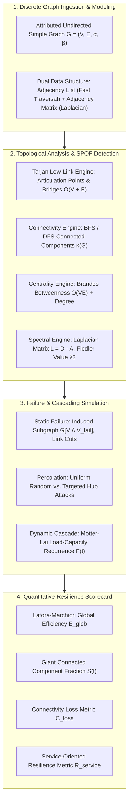

# MATHEMATICAL DESIGN SPECIFICATION
## Graph-Theoretic Critical Infrastructure Failure & Network Resilience Simulator

| Document Metadata | Specification Details |
| :--- | :--- |
| **Document Title** | Master Mathematical Architecture & Algorithmic Blueprint |
| **Phase** | Phase 1 (Mathematical Foundation & Algorithmic Design) |
| **Academic Curriculum** | Discrete Mathematics (Computer Engineering, Year 2) |
| **Version** | 1.0.0 (Phase 1 Baseline) |
| **Status** | Complete & Ready for Faculty Verification |
| **Date** | November 2026 |

---

### 1. Executive Summary & Mathematical Architecture

The **Graph-Theoretic Critical Infrastructure Failure & Network Resilience Simulator** is an interactive, mathematically rigorous simulation platform designed to model computer and communication network topologies as formal discrete graphs $G = (V, E)$. 

This document serves as the **Master Mathematical Architecture**, synthesizing the theoretical foundations, algorithmic contracts, failure dynamics, and resilience metrics into a unified, faculty-defensible engineering specification.

The mathematical architecture is organized into four interconnected mathematical engines:

---

### 2. Master Mathematical Notation Directory

$$\begin{array}{|l|l|l|}
\hline
\textbf{Symbol} & \textbf{Mathematical Domain} & \textbf{Formal Definition / Network Meaning} \\ \hline
G = (V, E) & \text{Graph Theory} & \text{Undirected simple graph of } n = |V| \text{ devices and } m = |E| \text{ communication links.} \\ \hline
\tau(v) & \text{Vertex Archetype} & \tau: V \to \{\text{ROUTER}, \text{SWITCH}, \text{SERVER}, \text{DATABASE}, \text{FIREWALL}, \text{GATEWAY}\}. \\ \hline
\sigma(v), \sigma(e) & \text{State Variable} & \sigma \in \{0, 1\}: \ 1 = \text{Operational (Up)}, \ 0 = \text{Failed (Down)}. \\ \hline
A \in \{0, 1\}^{n \times n} & \text{Linear Algebra} & \text{Binary Adjacency Matrix: } A[u, v] = 1 \iff \{u, v\} \in E. \\ \hline
D \in \mathbb{N}_0^{n \times n} & \text{Linear Algebra} & \text{Diagonal Degree Matrix: } D[u, u] = \deg(u) = \sum_v A[u, v]. \\ \hline
L = D - A & \text{Spectral Graph Theory} & \text{Combinatorial Graph Laplacian Matrix } (L \succeq 0). \\ \hline
\lambda_2(L) & \text{Spectral Graph Theory} & \text{Algebraic Connectivity (Fiedler value): Second smallest eigenvalue of } L. \\ \hline
d[u], \text{low}[u] & \text{DFS Tree Dynamics} & \text{Discovery timestamp and lowest reachable ancestor time in Tarjan's DFS.} \\ \hline
V_{\text{AP}} & \text{Cut-Set Theory} & \text{Set of Articulation Points (Cut-Vertices): } \{v \in V \mid \kappa(G - v) > \kappa(G)\}. \\ \hline
E_{\text{bridge}} & \text{Cut-Set Theory} & \text{Set of Bridges (Cut-Edges): } \{e \in E \mid \kappa(G - e) > \kappa(G)\}. \\ \hline
C_B(v) & \text{Complex Networks} & \text{Betweenness Centrality: } \sum_{s \neq v \neq t} \frac{\sigma_{st}(v)}{\sigma_{st}} \text{ (traffic transit volume).} \\ \hline
C_i = (1 + \alpha) L_i(0) & \text{Dynamical Systems} & \text{Operating throughput capacity with tolerance parameter } \alpha > 0. \\ \hline
F(t) \subseteq V & \text{Recurrence Relations} & \text{Cumulative set of failed nodes at discrete time step } t. \\ \hline
S(f) & \text{Percolation Theory} & \text{Relative Giant Connected Component size: } |V_{\text{GCC}}(f)| / |V_0|. \\ \hline
E_{\text{glob}}(G) & \text{Harmonic Path Analysis} & \text{Latora-Marchiori Global Network Efficiency: } \frac{1}{n(n-1)} \sum_{u \neq v} \frac{1}{d(u,v)}. \\ \hline
R_{\text{service}} & \text{Academic Metric} & \text{Service-Oriented Resilience: Ratio of reachable client-service paths.} \\ \hline
\end{array}$$

---

### 3. Core Theorems & Mathematical Formulations

#### 3.1 Tarjan’s Low-Link Articulation Point & Bridge Theorem
In a DFS spanning forest with discovery times $d[u]$:
$$\text{low}[u] = \min \left( d[u], \min_{(u, v) \in E_{\text{tree}}} \text{low}[v], \min_{(u, w) \in E_{\text{back}}} d[w] \right)$$
* **Cut-Edge (Bridge) Criterion**: Edge $(u, v)$ is a bridge if and only if:
  $$\text{low}[v] > d[u]$$
* **Cut-Vertex (Articulation Point) Criterion**: Vertex $u$ is an articulation point if and only if:
  1. $u$ is DFS root and has $\ge 2$ children in the DFS tree.
  2. $u$ is non-root and has a child $v$ such that $\text{low}[v] \ge d[u]$.

#### 3.2 Spectral Graph Theory & Laplacian Connectivity
The Graph Laplacian quadratic form:
$$\mathbf{x}^T L \mathbf{x} = \sum_{\{u, v\} \in E} (x_u - x_v)^2 \ge 0 \implies L \succeq 0$$
- $\lambda_1 = 0$ with constant eigenvector $\mathbf{1} = (1, 1, \dots, 1)^T$.
- $\lambda_2 > 0$ if and only if $G$ is connected.
- Bound on network conductance (Cheeger's Inequality):
  $$\frac{\lambda_2}{2} \le h(G) \le \sqrt{2 \lambda_2 \Delta(G)}$$

#### 3.3 Dynamic Cascading Recurrence Model (Motter-Lai)
$$\begin{aligned}
F(0) &= V_{\text{initial\_fail}} \\
L_v(t) &= C_B(v; G[V \setminus F(t)]) \\
\Delta F(t) &= \{v \in V \setminus F(t) \mid L_v(t) > (1 + \alpha) L_v(0)\} \\
F(t+1) &= F(t) \cup \Delta F(t)
\end{aligned}$$
*Convergence Theorem*: The sequence $F(0) \subseteq F(1) \subseteq \dots \subseteq V$ is monotonically non-decreasing on a finite set $|V| = n$, guaranteeing termination in at most $n$ iterations to an equilibrium fixed point or total collapse.

#### 3.4 Harmonic Global Network Efficiency
$$E_{\text{glob}}(G) = \frac{1}{n(n-1)} \sum_{u \neq v \in V} \frac{1}{d(u, v)}$$
Where $d(u, v) = \infty \implies \frac{1}{d(u,v)} = 0$, guaranteeing strict numerical stability in $[0, 1]$ across arbitrary network fragmentation.

---

### 4. Algorithmic Inventory & Performance Summary

Every algorithm is formally specified with step-by-step working, pseudocode, and edge-case handling in [algorithm_specifications.md](file:///c:/DM/CP/documentation/phase-1/algorithm_specifications.md):

| ID | Algorithm Name | Time Complexity | Space Complexity | Primary Theoretical Mechanism |
| :--- | :--- | :--- | :--- | :--- |
| **Alg 01** | **Graph Construction** | $\Theta(V + E)$ | $\Theta(V + E)$ | Adjacency List validation, irreflexivity and simplicity enforcement |
| **Alg 02** | **Breadth-First Search (BFS)** | $\Theta(V + E)$ | $\Theta(V)$ | FIFO queue traversal, unweighted minimum hop distances |
| **Alg 03** | **Depth-First Search (DFS)** | $\Theta(V + E)$ | $\Theta(V)$ | Recursive tree/back-edge classification, discovery/finish times |
| **Alg 04** | **Connected Components** | $\Theta(V + E)$ | $\Theta(V)$ | Reachability equivalence class labeling, Giant Component extraction |
| **Alg 05** | **Degree & Handshaking** | $\Theta(V + E)$ | $\Theta(V)$ | Degree sequence calculation, Euler Handshaking $\sum \deg(v) = 2m$ |
| **Alg 06** | **Tarjan Bridge Detection** | $\Theta(V + E)$ | $\Theta(V)$ | Linear DFS low-link condition $\text{low}[v] > d[u]$ |
| **Alg 07** | **Tarjan Articulation Points** | $\Theta(V + E)$ | $\Theta(V)$ | Linear DFS low-link condition $\text{low}[v] \ge d[u]$ & root child check |
| **Alg 08** | **Dijkstra Shortest Path** | $O((E + V) \log V)$ | $\Theta(V)$ | Min-heap greedy relaxation on non-negatively weighted graphs |
| **Alg 09** | **Single Node Failure** | $\Theta(V + E)$ | $\Theta(V)$ | Induced subgraph state update + component decomposition |
| **Alg 10** | **Single Edge Failure** | $\Theta(V + E)$ | $\Theta(V)$ | Link toggle + BFS alternative path search |
| **Alg 11** | **Multiple Failure ($N-k$)** | $\Theta(V + E)$ | $\Theta(V)$ | Multi-state toggle + component decomposition |
| **Alg 12** | **Random Percolation Engine** | $O(\frac{K}{\Delta f}(V+E))$ | $\Theta(V + E)$ | Monte Carlo uniform random sampling across $f \in [0, 1]$ |
| **Alg 13** | **Targeted Attack Engine** | $O(V \log V + V(V+E))$ | $\Theta(V)$ | Greedy sequential removal by Degree or Betweenness Centrality |
| **Alg 14** | **Cascading Failure Engine** | $O(\tau \cdot VE)$ | $\Theta(V)$ | Iterative Brandes shortest-path betweenness load reallocation |
| **Alg 15** | **Multi-Metric Resilience** | $O(V(V+E) + V^3)$ | $\Theta(V^2)$ | All-pairs BFS efficiency + NumPy QR Laplacian spectrum ($\lambda_2$) |

---

### 5. Discrete Mathematics Syllabus Mapping Summary

The project provides direct pedagogical demonstration of the official 2nd-year DM curriculum:

1. **Unit 1 (Logic, Sets, Relations)**: 
   - Network components as universal set $V$, active operational sets $V_{\text{active}} \subseteq V$.
   - Reachability relation $\mathcal{R}$ proven to be an **Equivalence Relation**; connected components are its equivalence classes $V / \mathcal{R}$.
   - Proof by contradiction establishing that an edge is a bridge if and only if it belongs to no cycle.
2. **Unit 2 (Basic Counting & Combinatorics)**:
   - Evaluated combinatorial explosion of multi-failure scenarios $C(n, k) = \binom{n}{k}$.
   - Proven that testing $k = 5$ failures on $n = 100$ produces $75.3\text{ million}$ combinations ($> 20\text{ hours}$ runtime), formally justifying why the simulator uses heuristic targeted attacks and Monte Carlo percolation sampling.
3. **Unit 3 (Advanced Combinatorics)**:
   - Pigeonhole Principle applied to switch link aggregation and packet flow congestion ($\lceil k / m \rceil$).
   - Principle of Inclusion-Exclusion (PIE) applied to calculating non-redundant disconnected node sets under simultaneous failures: $|A \cup B \cup C| = \sum |A| - \sum |A \cap B| + |A \cap B \cap C|$.
4. **Unit 4 (Recurrence Relations)**:
   - Dynamic cascading failure formulated as a discrete recurrence $F(t+1) = F(t) \cup \Delta F(t)$.
   - Proven finite-time convergence in at most $|V|$ steps.
5. **Unit 5 (Modular Arithmetic)**:
   - Evaluated and **formally excluded** from core graph resilience. Documented as an academic boundary to prevent artificial topic-forcing.
6. **Unit 6 (Graph Theory - Core Foundation)**:
   - Handshaking Lemma, Paths, Cycles, Trees, Spanning Trees, Bipartite Graphs (Spine-Leaf Clos architecture), Adjacency Matrices, BFS/DFS, Tarjan Articulation Points, Bridges, and Dijkstra.

---

### 6. Phase 1 Technical Documentation Inventory

All in-depth mathematical formulations and proofs are maintained in `documentation/phase-1/`:

* [graph_theoretic_model.md](file:///c:/DM/CP/documentation/phase-1/graph_theoretic_model.md) - Formal $G = (V, E)$, vertex/edge tuples, math inputs vs metadata, sample network, matrix vs list comparison.
* [syllabus_mapping.md](file:///c:/DM/CP/documentation/phase-1/syllabus_mapping.md) - Comprehensive mapping to all 6 Discrete Mathematics units, proofs, combinations $C(n,k)$, and exclusions.
* [mathematical_foundation.md](file:///c:/DM/CP/documentation/phase-1/mathematical_foundation.md) - Graph Laplacian $L = D - A$, algebraic connectivity $\lambda_2$, Cheeger's inequality, percolation theory, and Menger's theorems.
* [algorithm_specifications.md](file:///c:/DM/CP/documentation/phase-1/algorithm_specifications.md) - Exhaustive specifications for Algorithms 01 to 15 (Purpose, Math, I/O, Steps, Pseudocode, Complexity, Edge Cases, Worked Examples).
* [failure_models.md](file:///c:/DM/CP/documentation/phase-1/failure_models.md) - Node/edge failure, multiple failure, random percolation, targeted attacks, and Motter-Lai cascade dynamics.
* [resilience_metrics.md](file:///c:/DM/CP/documentation/phase-1/resilience_metrics.md) - $\kappa(G)$, $N_{\text{reach}}$, $\mathcal{C}_{\text{loss}}$, $E_{\text{glob}}$, $S(f)$, and proposed $R_{\text{service}}$ metric with academic disclaimers.
* [complexity_analysis.md](file:///c:/DM/CP/documentation/phase-1/complexity_analysis.md) - Master complexity table, Tarjan $O(V+E)$ proof vs naive $O(E(V+E))$, and combinatorial bounds on $N=500$.
* [mathematical_validation.md](file:///c:/DM/CP/documentation/phase-1/mathematical_validation.md) - 15 Canonical verification test cases with analytical ground truths (Empty, Single, Path, Star, Cycle, Complete, Disconnected, Bridges, Articulation Points, etc.).
* [mathematical_assumptions.md](file:///c:/DM/CP/documentation/phase-1/mathematical_assumptions.md) - Undirected links, binary states, simple graphs, steady-state routing, betweenness load approximation, and scaling bounds.

---

### 7. Verification Readiness & Next Phase Gateway

The mathematical architecture and algorithmic specifications detailed herein provide a complete, verified foundation. No mathematical ambiguities or unverified algorithmic contracts remain.

Following faculty approval of Phase 1:
- **Phase 2 (Core Backend Implementation)** will proceed with 100% adherence to these specifications, implementing the Python FastAPI backend, NetworkX/NumPy analytical engines, and automated Pytest test fixtures matching the 15 canonical validation cases.

