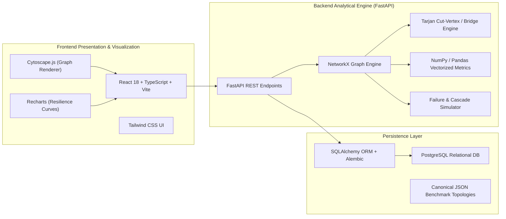

# PROJECT CHARTER
## Graph-Theoretic Critical Infrastructure Failure & Network Resilience Simulator

| Document Metadata | Details |
| :--- | :--- |
| **Project Title** | Graph-Theoretic Critical Infrastructure Failure & Network Resilience Simulator |
| **Academic Context** | Discrete Mathematics (Course Project) / Computer Engineering (Year 2) |
| **Document Version** | 1.0.0 (Phase 0 Baseline) |
| **Status** | Approved for Faculty Review |
| **Date** | November 2026 |
| **Author** | Computer Engineering Student Project Team |
| **Faculty Supervisor** | Department of Computer Engineering |

---

### 1. Executive Summary

Modern critical communication networks—comprising core routers, distribution switches, edge firewalls, gateway nodes, enterprise servers, and redundant transmission lines—constitute the backbone of digital civilization. When network elements fail due to hardware malfunctions, environmental disruptions, cyber-attacks, or operational misconfigurations, the consequences range from isolated service degradation to catastrophic systemic disconnection.

The **Graph-Theoretic Critical Infrastructure Failure & Network Resilience Simulator** is an interactive, academically rigorous, and industry-relevant software platform designed to model computer and communication network topologies as formal discrete graphs $G = (V, E)$. The platform implements classical and modern graph-theoretic algorithms to:
1. Identify single points of failure (articulation points / cut-vertices) and critical transmission links (bridges / cut-edges).
2. Quantify structural vulnerabilities using multi-metric centrality analysis and algebraic connectivity.
3. Simulate deterministic, random, and targeted network failure scenarios.
4. Model dynamic cascading failures triggered by traffic capacity and load reallocation.
5. Empirically evaluate and compare network resilience across topological archetypes (tree, star, ring, mesh, fat-tree/clos, and enterprise hierarchical structures).
6. Recommend cost-effective redundant edge augmentations to eliminate structural bottlenecks.

This project bridges the gap between pure discrete mathematical theory (graph connectivity, spectral graph theory, traversal algorithms) and practical network reliability engineering, delivering a high-fidelity visual and analytical tool tailored for undergraduate research, pedagogical exploration, and network architecture evaluation.

---

### 2. Project Vision & Purpose

#### 2.1 Vision Statement
To establish an open-source, mathematically transparent network resilience simulation workbench that transforms abstract graph theorems into observable, interactive, and actionable engineering insights.

#### 2.2 Academic Alignment
The project directly demonstrates mastery of the core outcomes of a second-year Discrete Mathematics curriculum in Computer Engineering:
- **Graph Representation**: Adjacency matrices, adjacency lists, incidence structures, and node/edge attribute mappings.
- **Connectivity & Traversal**: Breadth-First Search (BFS), Depth-First Search (DFS), Connected Components decomposition.
- **Structural Bottlenecks**: Cut-vertices (articulation points) and cut-edges (bridges) via Tarjan’s linear-time DFS algorithm.
- **Trees & Spanning Forests**: Minimum spanning trees, cycle detection, path redundancy.
- **Centrality & Connectivity Bounds**: Degree, betweenness, closeness centrality, and Laplacian algebraic connectivity ($\lambda_2$).
- **Percolation & Network Robustness**: Random node failure (percolation) versus targeted hub disruption (scale-free network vulnerability).

---

### 3. Stakeholder Roles & Governance

| Role | Name / Group | Responsibilities |
| :--- | :--- | :--- |
| **Student Engineer / Lead** | 2nd Year Computer Engineering Student | System architecture design, graph algorithm implementation, API development, UI integration, testing, documentation. |
| **Faculty Advisor / Evaluator** | Discrete Mathematics Course Faculty | Academic oversight, algorithmic rigor validation, mathematical correctness evaluation, milestone assessment. |
| **Industry Peer Reviewer** | Senior Network / Systems Engineer | Industry relevance check, architectural feedback, operational realism of network failure models. |
| **Target User Group** | Undergraduate Students, Network Learners | Interactive exploration of graph algorithms and network resilience concepts. |

---

### 4. High-Level Technology Architecture

The system utilizes an enterprise-grade, modern open-source stack partitioned into decoupled layers:

---

### 5. Project Milestones & Lifecycle

| Phase | Milestone Description | Deliverables | Target Status |
| :--- | :--- | :--- | :--- |
| **Phase 0** | **Requirements, Architecture & Academic Blueprint** | Complete technical specifications, comparative literature review, mathematical problem formulation, risk mitigation, and project charter. | **Current Phase** |
| **Phase 1** | **Core Graph Modeling & Algorithmic Foundation** | Python backend graph data structures, Tarjan's algorithm, BFS/DFS component labeling, REST API endpoints, unit test suite with 100% mathematical verification. | Planned |
| **Phase 2** | **Simulation Engine & Resilience Metrics** | Node/edge removal handlers, random failure generator, targeted attack generator, cascading load redistribution, resilience degradation curves ($S(f), E(f)$). | Planned |
| **Phase 3** | **Interactive Visualization & Dashboard UI** | React/TypeScript UI, Cytoscape.js interactive topology canvas, manual failure triggers, real-time node state styling, Recharts analytical plots. | Planned |
| **Phase 4** | **Persistence, Benchmarking & Redundancy Recommendations** | PostgreSQL scenario persistence, benchmark network library (Enterprise 3-Tier, Fat-Tree, Ring-Mesh, ARPANET), redundancy recommendation heuristic. | Planned |
| **Phase 5** | **Testing, Verification & Faculty Defense Preparation** | Pytest test suite ($>85\%$ coverage), end-to-end integration tests, comprehensive final project report, and demonstration presentation. | Planned |

---

### 6. Success Criteria

The project will be evaluated as successful if and only if it fulfills the following verifiable engineering criteria:
1. **Algorithmic Accuracy**: 100% correct detection of articulation points and bridges across canonical validation graphs (e.g., Bridge graphs, Star graphs, Complete graphs $K_n$, Petersen graph).
2. **Computational Performance**: Tarjan’s algorithm, BFS/DFS decomposition, and baseline connectivity evaluation execute in $< 50\text{ ms}$ for networks up to $N = 500$ nodes.
3. **Interactive Simulation**: The user can interactively disable any node or link on the Cytoscape canvas and immediately observe network partitioning, giant component shrinking, and alternate path availability in $< 100\text{ ms}$.
4. **Resilience Curve Generation**: Accurate simulation and plotting of network degradation under random versus targeted failure regimes, demonstrating the classical Barabási–Albert scale-free vulnerability effect.
5. **Code & Engineering Quality**: Strict PEP 8 compliance, comprehensive type annotations in Python and TypeScript, zero application crashes on disconnected graphs, and fully documented REST API schema (Swagger/OpenAPI).

---

### 7. Document Organization

All detailed Phase 0 engineering specifications are maintained in the `documentation/phase-0/` directory:
- [project_overview.md](file:///c:/DM/CP/documentation/phase-0/project_overview.md) - Executive context, tech stack rationale, academic relevance.
- [problem_statement.md](file:///c:/DM/CP/documentation/phase-0/problem_statement.md) - Formal engineering problem, infrastructure failure significance, conceptual distinctions.
- [existing_system_analysis.md](file:///c:/DM/CP/documentation/phase-0/existing_system_analysis.md) - Deep comparative study of SolarWinds NTM, Cisco CML, AWS FIS, and Chaos Mesh.
- [research_gap.md](file:///c:/DM/CP/documentation/phase-0/research_gap.md) - Discrete mathematical simulation opportunities and academic contribution.
- [proposed_system.md](file:///c:/DM/CP/documentation/phase-0/proposed_system.md) - Detailed system mechanics, analytical engines, and architecture.
- [objectives_and_scope.md](file:///c:/DM/CP/documentation/phase-0/objectives_and_scope.md) - 1 Main and 10 specific objectives; Core, Advanced, and Out-of-Scope boundaries.
- [functional_requirements.md](file:///c:/DM/CP/documentation/phase-0/functional_requirements.md) - 22 granular functional requirements and user interaction stories.
- [non_functional_requirements.md](file:///c:/DM/CP/documentation/phase-0/non_functional_requirements.md) - Performance, accuracy, reliability, scalability, usability, maintainability, and security specs.
- [risks_and_limitations.md](file:///c:/DM/CP/documentation/phase-0/risks_and_limitations.md) - Technical, algorithmic, mathematical, and scope risk analysis with mitigation paths.
- [references.md](file:///c:/DM/CP/documentation/phase-0/references.md) - Authentic academic literature, textbook citations, and verified official documentation links.

