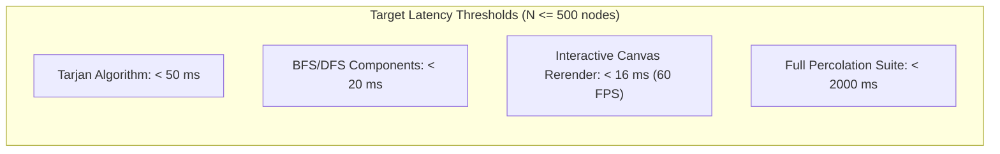

# Phase 0: Non-Functional Requirements Specification
## Graph-Theoretic Critical Infrastructure Failure & Network Resilience Simulator

---

### 1. Introduction and Quality Strategy

The non-functional requirements (NFRs) define the operational quality attributes, performance constraints, mathematical accuracy standards, maintainability benchmarks, and security guardrails of the **Graph-Theoretic Critical Infrastructure Failure & Network Resilience Simulator**. 

Because this application serves both as an academic engineering project and a reliable analytical tool, every non-functional requirement is specified with **quantifiable, testable acceptance criteria**.

---

### 2. Performance & Latency Requirements

- **NFR-PERF-01: Algorithmic Execution Time for Cut-Elements**
  - *Requirement*: The detection of all articulation points and bridges via Tarjan’s algorithm shall execute in **under 50 milliseconds** for graphs containing up to $N = 500$ nodes and $M = 2,500$ edges.
  - *Verification Method*: Automated Pytest benchmark fixture measuring wall-clock execution time across 50 iterations on synthetic random graphs.

- **NFR-PERF-02: Interactive Graph Rerendering Latency**
  - *Requirement*: Upon user-triggered node or link failure, the Cytoscape.js canvas shall update node states (colors, opacity, stroke indicators) within **16 milliseconds** (maintaining a smooth 60 frames-per-second display).
  - *Verification Method*: Chrome DevTools Performance Profiler recording frame-rate and paint time during interactive manipulation.

- **NFR-PERF-03: API Response Latency**
  - *Requirement*: The `/api/v1/analyze` endpoint (computing connected components, Tarjan SPOFs, degree centrality, and global efficiency) shall have a 95th percentile ($P_{95}$) response time of **under 150 milliseconds** for topologies under 200 nodes.
  - *Verification Method*: Locust or Apache Benchmark load test simulating concurrent single-user requests under local development conditions.

- **NFR-PERF-04: Batch Percolation Simulation Latency**
  - *Requirement*: The automated Random vs. Targeted failure simulation suite (running $f \in [0, 1]$ in $0.05$ increments over $K = 20$ Monte Carlo trials) shall complete within **2.0 seconds** for graphs with $N \le 100$ nodes.
  - *Verification Method*: Backend benchmark logging elapsed time for the full simulation cycle.

---

### 3. Mathematical Accuracy & Algorithmic Correctness

- **NFR-ACC-01: Zero Tolerance for SPOF Misclassification**
  - *Requirement*: The Tarjan cut-vertex and bridge engine must achieve **100% precision and 100% recall** against verified mathematical ground-truth graphs:
    1. Complete Graph $K_n$ ($n \ge 3$): 0 articulation points, 0 bridges.
    2. Star Graph $S_k$ ($k \ge 3$): 1 articulation point (hub), $k$ bridges.
    3. Cycle Graph $C_n$ ($n \ge 3$): 0 articulation points, 0 bridges.
    4. Two complete graphs connected by a single edge ($K_p - e - K_q$): 2 articulation points, 1 bridge.
    5. Petersen Graph: 0 articulation points, 0 bridges.
  - *Verification Method*: Dedicated Pytest unit test suite validating outputs against exact combinatorial expectations.

- **NFR-ACC-02: Spectral Connectivity Bounds**
  - *Requirement*: The algebraic connectivity $\lambda_2$ computed via the graph Laplacian $L = D - A$ must satisfy mathematical properties:
    - $\lambda_2 = 0$ if and only if the graph has $\ge 2$ connected components.
    - $\lambda_2 > 0$ for all connected graphs.
    - Numerical precision error must be within $\pm 10^{-6}$.
  - *Verification Method*: Unit tests comparing NumPy-computed eigenvalues against analytical eigenvalues of complete and cycle graphs.

- **NFR-ACC-03: Singularity-Free Network Efficiency**
  - *Requirement*: The Global Network Efficiency calculation must yield a value strictly bounded in $[0, 1]$ for all graphs:
    - $E_{\text{glob}} = 1.0$ for complete graphs $K_n$.
    - $E_{\text{glob}} = 0.0$ for empty graphs (all isolated nodes).
    - Under disconnection, no `ZeroDivisionError` or `NaN` values shall occur.
  - *Verification Method*: Boundary condition unit tests on graphs with isolated nodes and disconnected components.

---

### 4. Reliability, Determinism & Fault Tolerance

- **NFR-REL-01: Seeded Randomness Determinism**
  - *Requirement*: The random failure simulation engine must accept an optional integer `seed` parameter. When provided, two identical simulation requests on the same topology must produce **byte-for-byte identical degradation curves**.
  - *Verification Method*: Pytest assertion verifying output identity across seeded runs.

- **NFR-REL-02: Graceful Degradation on Extreme Partitions**
  - *Requirement*: If a failure event causes a network to fragment into $N$ completely isolated individual nodes, the system must not crash or throw unhandled exceptions. All metrics must transition smoothly to baseline values ($S = 1/N$, $E = 0$).
  - *Verification Method*: Stress test injecting simultaneous failure of all edges and high-degree vertices.

- **NFR-REL-03: Input Validation and Schema Guardrails**
  - *Requirement*: All JSON payloads sent to the backend must be strictly validated by Pydantic v2 schemas. Malformed JSON, cyclical parent loops, negative capacities, or unknown device types must be rejected with HTTP 422 and human-readable error descriptions.
  - *Verification Method*: Integration test suite feeding 20 distinct invalid JSON payloads (e.g., negative link weights, orphaned edges, missing IDs).

---

### 5. Scalability & Sizing Constraints

- **NFR-SCAL-01: Graph Sizing Thresholds**
  - *Target Operating Range*: Designed primarily for topologies between **5 and 200 nodes** (standard enterprise campus LAN, data center fabric, or regional WAN).
  - *Upper Bound*: The system shall support graphs up to **500 nodes and 2,500 edges** without browser freezing or memory exhaustion.
  - *Verification Method*: Synthetic scale-free graph generator ($N = 500, m = 3$) ingested and visualized in Cytoscape.js.

- **NFR-SCAL-02: Memory Footprint Constraints**
  - *Requirement*: The backend Python process shall consume **less than 250 MB RAM** during baseline operation and **less than 600 MB RAM** during batch Monte Carlo percolation simulations.
  - *Verification Method*: Memory profiling using Python `tracemalloc` and Docker resource inspection.

---

### 6. Usability & Human-Computer Interaction (HCI)

- **NFR-USE-01: Visual Recognition of Structural Roles**
  - *Requirement*: The interactive canvas must use distinct, standardized visual cues for network elements:
    - Distinct shapes and colors for 6 device archetypes.
    - High-visibility pulsing red halo (`#DC2626`) for articulation points.
    - High-visibility bold dashed amber stroke (`#F59E0B`) for bridges.
    - Translucent grey opacity (0.3) with an overlaid red cross for failed components.
  - *Verification Method*: User interface inspection and color-blind contrast testing (WCAG 2.1 AA compliant).

- **NFR-USE-02: Responsive Desktop Resolution Support**
  - *Requirement*: The dashboard UI must render cleanly without layout breakage or overlapping controls on modern desktop screen resolutions from $1366 \times 768$ up to $2560 \times 1440$.
  - *Verification Method*: Chrome DevTools device mode testing across standard 1080p and 1440p viewport dimensions.

- **NFR-USE-03: Zero-Learning-Curve Benchmark Loading**
  - *Requirement*: A new user must be able to load any pre-configured benchmark network (e.g., Enterprise 3-Tier) and inspect its single points of failure in **fewer than 2 mouse clicks** from the home screen.
  - *Verification Method*: User interaction walkthrough validation.

---

### 7. Maintainability & Code Quality

- **NFR-MAINT-01: Code Formatting & Linting Compliance**
  - *Requirement*: The Python backend must adhere strictly to PEP 8 standards, verified by `flake8` and formatted with `black`. The frontend TypeScript code must pass `eslint` and `prettier` checks with zero errors.
  - *Verification Method*: Pre-commit hooks and automated CI lint checks.

- **NFR-MAINT-02: Static Type Annotations**
  - *Requirement*: 100% of Python backend function signatures must include strict type annotations (`mypy` compliant). 100% of React components and API client models must use strict TypeScript interfaces with `noImplicitAny: true`.
  - *Verification Method*: Static analysis verification via `mypy --strict` and `tsc --noEmit`.

- **NFR-MAINT-03: Test Coverage Benchmark**
  - *Requirement*: The algorithmic and backend engine code must maintain a minimum automated unit test coverage of **85%**, measured via `pytest-cov`.
  - *Verification Method*: Automated test coverage report generated in Pytest.

- **NFR-MAINT-04: Documentation Integrity**
  - *Requirement*: Every public class, algorithm, and REST endpoint must be documented with comprehensive docstrings (Google or Sphinx format) detailing parameters, return types, mathematical invariants, and time complexity.

---

### 8. Security & Environment Sandboxing

- **NFR-SEC-01: Safe Local Execution & Absence of Remote Code Execution**
  - *Requirement*: The system shall not execute arbitrary user-submitted scripts or shell commands. Graph specifications are restricted strictly to declarative JSON data structures.
  - *Verification Method*: Static code review ensuring no use of `eval()`, `exec()`, or unsanitized system subprocesses.

- **NFR-SEC-02: Cross-Origin Resource Sharing (CORS) Policy**
  - *Requirement*: The FastAPI backend shall restrict CORS access to configured local frontend development origins (`http://localhost:5173`, `http://127.0.0.1:5173`) by default.
  - *Verification Method*: API header verification inspecting `Access-Control-Allow-Origin`.

- **NFR-SEC-03: Payload Size Limits (Denial of Service Prevention)**
  - *Requirement*: The backend shall enforce an HTTP payload size limit of **5 MB** on topology upload endpoints to prevent memory exhaustion from maliciously oversized JSON payloads.
  - *Verification Method*: Test sending a 10 MB mock JSON payload, verifying immediate HTTP 413 (Payload Too Large) response.

