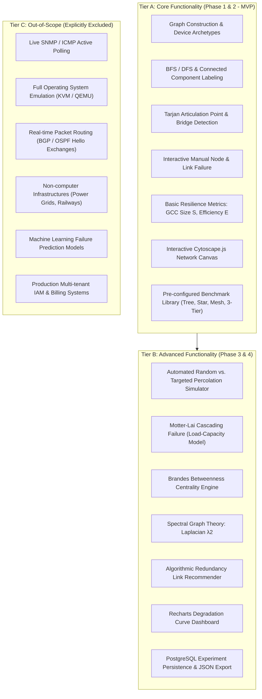

# Phase 0: Project Objectives & Scope Specification
## Graph-Theoretic Critical Infrastructure Failure & Network Resilience Simulator

---

### 1. Main Project Objective

> **To design, implement, and validate an interactive, graph-theoretic simulation platform that models computer and communication network topologies as discrete mathematical graphs, automatically detects structural single points of failure (articulation points and bridges), simulates multiple deterministic, random, targeted, and cascading failure regimes, and quantifies network resilience using standardized topological metrics.**

---

### 2. Specific, Measurable Objectives

The project is structured around ten specific, technically rigorous, and measurable objectives tailored to demonstrate mastery of Discrete Mathematics within the capacity of a second-year Computer Engineering student:

| ID | Specific Objective | Mathematical Foundation | Target Measurable Metric / Criteria |
| :--- | :--- | :--- | :--- |
| **OBJ-01** | **Graph Topology Modeling Engine**: Develop an attributed graph data structure supporting 6 core device archetypes (Routers, Switches, Servers, DB Servers, Firewalls, Gateways) and communication links. | Undirected/Directed Graph $G = (V, E)$, vertex/edge attribute mapping. | Ingests, validates, and serializes arbitrary topologies up to $N = 1000$ nodes via JSON schema and interactive builder in $< 20\text{ ms}$. |
| **OBJ-02** | **Connected Components & Reachability Engine**: Implement Breadth-First Search (BFS) and Depth-First Search (DFS) traversals to compute connected components, diameter, and pairwise reachability. | Connected components $\kappa(G)$, equivalence relation of reachability. | Computes all connected components and determines pairwise reachability between any $(s, t)$ in $O(|V| + |E|)$ time with 100% test accuracy. |
| **OBJ-03** | **Linear-Time Cut-Vertex & Bridge Detection**: Implement Tarjan’s DFS low-link algorithm to identify all articulation points (SPOF nodes) and bridges (critical links) in the network. | DFS tree back-edges, low-link values $\text{low}[u]$, cut-vertex and cut-edge theorems. | 100% precision and recall against canonical benchmark graphs (e.g., Petersen, Star, Complete, Bridge graphs) executing in $< 50\text{ ms}$ for $N = 500$. |
| **OBJ-04** | **Centrality & Bottleneck Quantification**: Implement degree centrality, Brandes' betweenness centrality, and closeness centrality to rank critical network transit points. | Brandes' $O(|V||E|)$ algorithm, shortest-path count $\sigma_{st}(v)$, harmonic distance. | Computes betweenness rankings for all nodes with verified correlation against NetworkX reference implementations. |
| **OBJ-05** | **Spectral Robustness Analysis**: Compute the graph Laplacian matrix $L = D - A$ and its eigenvalues to extract algebraic connectivity ($\lambda_2$). | Spectral graph theory, Fiedler value $\lambda_2$, graph Laplacian spectrum. | Correctly identifies disconnected topologies ($\lambda_2 = 0$) and calculates $\lambda_2 > 0$ for connected topologies using NumPy linear algebra in $< 100\text{ ms}$. |
| **OBJ-06** | **Interactive Manual Failure & Rerouting**: Enable dynamic single- and multi-element knockout (nodes and edges) with immediate real-time feedback on graph partitioning and alternative path availability. | Induced subgraphs $G[V \setminus V_{\text{failed}}]$, Dijkstra shortest path. | Recalculates connected components and re-routes active paths in $< 30\text{ ms}$ upon any interactive node or link toggle on the canvas. |
| **OBJ-07** | **Automated Percolation & Stress-Test Simulation**: Implement automated sequential node removal comparing uniform random failure (hardware wear-out) against targeted attack (hub removal by degree/betweenness). | Percolation theory, percolation threshold $f_c$, Barabási-Albert scale-free vulnerability. | Generates comparative degradation curves across $f \in [0, 1]$ in increments of $0.05$ over 20 Monte Carlo trials in $< 2\text{ seconds}$ total. |
| **OBJ-08** | **Dynamic Cascading Failure Engine**: Implement the Motter-Lai load-capacity model where node failure redistributes shortest-path traffic loads, triggering sequential overload failures. | Dynamic flow reallocation, capacity tolerance threshold $C_i = (1 + \alpha) L_i(0)$. | Simulates multi-step cascade propagation, recording the exact sequence of overloaded nodes per timestep until equilibrium or total collapse is reached. |
| **OBJ-09** | **Mathematical Resilience Metric Suite**: Compute and plot Giant Connected Component fraction $S(f)$, Global Network Efficiency $E_{\text{glob}}(f)$, and Average Path Length $\bar{l}(f)$. | Latora-Marchiori efficiency $E_{\text{glob}}$, characteristic path length. | Generates dual-axis degradation plots via Recharts with zero division-by-zero errors when networks fragment. |
| **OBJ-10** | **Algorithmic Redundancy Optimization**: Formulate a heuristic recommendation engine that identifies the minimum set of redundant edges required to eliminate all articulation points and bridges. | 2-vertex-connected (biconnected) and 2-edge-connected augmentation. | Identifies candidate links that transform a 1-connected network into a 2-connected network, demonstrating a measurable gain in $\lambda_2$ and $E_{\text{glob}}$. |

---

### 3. Detailed Project Scope

The project scope is strictly bounded into three tiers to guarantee academic depth, algorithmic correctness, and feasibility within the second-year academic calendar:

#### 3.1 Tier A: Core Functionality (Mandatory Foundation / MVP)
1. **Graph Construction & Ingestion**:
   - Interactive creation of nodes and links via Cytoscape.js canvas.
   - Support for 6 distinct network device archetypes: Router, Switch, Server, Database Server, Firewall, Gateway.
   - JSON file import and export of network topologies.
2. **Fundamental Discrete Traversal & Connectivity**:
   - Full BFS and DFS graph traversal implementations.
   - Connected component labeling and count $\kappa(G)$.
   - Pairwise reachability queries between any selected source and destination.
3. **Single Point of Failure (SPOF) Identification**:
   - Tarjan’s linear-time cut-vertex (articulation point) algorithm.
   - Tarjan’s linear-time cut-edge (bridge) algorithm.
   - Immediate visual highlighting on canvas (pulsing red for SPOFs, dashed amber for bridges).
4. **Interactive Manual Failure Simulation**:
   - Click-to-disable nodes or links.
   - Visual greying out of failed components.
   - Immediate recalculation of surviving connected components and reachability.
5. **Basic Resilience Quantification**:
   - Tracking Giant Connected Component (GCC) size $S$.
   - Tracking severed node count and percentage.
6. **Pre-configured Benchmark Network Library**:
   - Inclusion of classic topologies: Simple Tree, Central Star, Token Ring, Partial Mesh, Full Mesh, and Enterprise 3-Tier (Core-Distribution-Access).

#### 3.2 Tier B: Advanced Functionality (High-Impact Academic Extensions)
1. **Automated Comparative Stress-Testing**:
   - Batch simulation of uniform random node failure (Monte Carlo averaged over 20 iterations).
   - Batch simulation of targeted attack by degree and betweenness centrality.
   - Export of comparative degradation curves ($S(f)$ vs. $f$).
2. **Cascading Failure Simulation Engine**:
   - Implementation of the Motter-Lai capacity-load model.
   - Adjustable capacity tolerance parameter $\alpha \in [0.1, 1.0]$.
   - Step-by-step visual animation of cascading failure waves.
3. **Comprehensive Centrality & Spectral Suite**:
   - Degree, betweenness, and closeness centrality distributions.
   - Laplacian matrix construction and algebraic connectivity ($\lambda_2$) computation.
   - Global network efficiency calculation $E_{\text{glob}}(G)$.
4. **Redundancy & Topology Optimization Recommender**:
   - Heuristic discovery of candidate edges that bridge biconnected components.
   - Ranking candidate links by marginal resilience gain.
5. **Persistence & Reporting**:
   - PostgreSQL persistence of custom topologies and simulation runs.
   - PDF / JSON comprehensive resilience audit report generation.

#### 3.3 Tier C: Out-of-Scope Functionality (Strictly Excluded)
To preserve engineering focus and maintain a high-quality, fully verifiable submission, the following features are explicitly out of scope for the course project:
1. **Live Infrastructure Telemetry / SNMP Polling**:
   - The system is an abstract mathematical simulator, not an active network monitoring tool. No live ICMP pinging, SNMP polling, or network packet sniffing will be implemented.
2. **Kernel-Level Packet Forwarding & Virtual Machine Emulation**:
   - The application does not run real router OS images (no KVM/QEMU, Cisco IOS, or Linux network namespaces). Packets and routing protocol convergence (BGP, OSPF state machines) are not emulated.
3. **Non-Computer Infrastructure Domains**:
   - Physical infrastructure domains such as power grids (AC power flow equations), water distribution pipes, railway lines, and hospital logistics are excluded.
4. **Machine Learning / AI Failure Prediction**:
   - Unverified black-box neural networks or predictive maintenance models are excluded. All resilience evaluations are grounded in deterministic discrete mathematics.
5. **Production Enterprise Multi-tenancy & Billing**:
   - No commercial IAM, OAuth2 multi-tenancy, or billing modules will be built. The platform is designed for single-user local or classroom deployment.

---

### 4. Prioritization Matrix (MoSCoW Framework)

| Category | Features Included | Target Phase |
| :--- | :--- | :--- |
| **Must Have (M)** | Attributed Graph Ingestion, BFS/DFS, Connected Components, Tarjan Cut-Vertices & Bridges, Manual Node/Link Failure, Basic GCC Metric, Cytoscape Visualization. | Phase 1 & Phase 2 |
| **Should Have (S)** | Random vs. Targeted Failure Batch Engine, Global Efficiency Metric $E_{\text{glob}}$, Recharts Degradation Curves, Pre-configured Benchmark Topologies. | Phase 2 & Phase 3 |
| **Could Have (C)** | Motter-Lai Cascading Failure Engine, Spectral Algebraic Connectivity $\lambda_2$, Redundancy Link Recommendation Heuristic, PostgreSQL Persistence. | Phase 3 & Phase 4 |
| **Won't Have (W)** | SNMP/ICMP Polling, Live Packet Capture, Cisco IOS Virtualization, Power Grid Physics, Machine Learning Predictive Models. | Out of Scope |

---

### 5. Measurable Expected Outcomes

Upon project completion, the successfully delivered software artifact must conclusively demonstrate the following measurable technical outcomes:

1. **Fully Functional Interactive Web Platform**:
   - A modern React/TypeScript single-page dashboard featuring a responsive Cytoscape.js canvas and Recharts analytical graphs, served via a FastAPI REST backend.
2. **Empirical Verification of Graph Theorems**:
   - Exact mathematical detection of 100% of articulation points and bridges across arbitrary user-defined and benchmark topologies, verified against rigorous mathematical test fixtures.
3. **Demonstrable Scale-Free Vulnerability Phenomenon**:
   - Quantitative reproduction of the Albert-Jeong-Barabási percolation phenomenon: showing that a benchmark hierarchical/scale-free network retains $S(f) > 0.8$ under $f = 0.20$ random failures, but collapses to $S(f) < 0.15$ under $f = 0.05$ targeted hub attacks.
4. **Observable Cascading Failure Propagation**:
   - Visual step-by-step demonstration of the Motter-Lai cascade model, showing how the removal of a single high-betweenness router diverts shortest-path flows, triggering progressive overload failures across adjacent nodes until a steady-state or network collapse is reached.
5. **Algorithmic Topology Hardening**:
   - Automated identification and visual preview of the minimum redundant communication links required to convert a vulnerable 1-connected network into a robust 2-connected network, showing measurable improvements in algebraic connectivity ($\lambda_2$) and global efficiency ($E_{\text{glob}}$).
6. **Academic Code Quality & Test Suite**:
   - Complete, reproducible Python test suite achieving $\ge 85\%$ test coverage via Pytest, strict PEP 8 compliance, full TypeScript type safety, and automated Docker Compose deployment.

