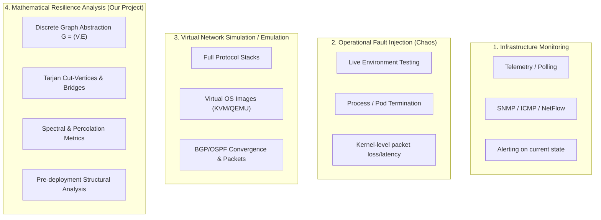

# Phase 0: Problem Statement & Engineering Context
## Graph-Theoretic Critical Infrastructure Failure & Network Resilience Simulator

---

### 1. The Actual Engineering Problem

Computer and communication networks represent high-consequence critical infrastructure. Modern networks connect geographically dispersed offices, edge data centers, multi-cloud hosting environments, enterprise subnets, and critical application endpoints. These systems are inherently heterogeneous, incorporating physical Layer-1 transmission lines, Layer-2 switches, Layer-3 core and border routers, Layer-4/7 firewalls, and application/database server clusters.

The fundamental engineering problem is that **network topology directly dictates systemic resilience, yet topological vulnerability is rarely evaluated mathematically before deployment**. In practice:
1. **Unidentified Single Points of Failure (SPOFs)**: Enterprise and campus networks often evolve organically over time. New switches, VLANs, and servers are added incrementally, creating hidden structural bottlenecks. A single unflagged switch or firewall may serve as an **articulation point** (cut-vertex), whose failure partitions the entire network into isolated islands.
2. **Hidden Critical Transmission Links**: Redundant physical links are frequently installed without formal verification of 2-edge-connectivity. If two subnets rely on a single bridge (cut-edge), a physical fiber cut, transceiver failure, or switch port breakdown instantly severs communication between dependent clusters.
3. **Differential Vulnerability to Failure Regimes**: Network architectures exhibit drastically different failure tolerances depending on the nature of the disruption:
   - Under *random failures* (e.g., stochastic hardware defects, power supply burnouts), highly connected scale-free networks demonstrate remarkable robustness because random removals disproportionately hit low-degree leaves.
   - Under *targeted attacks* or directed outages (e.g., targeted distributed denial-of-service (DDoS), physical sabotage, or zero-day exploits disabling core distribution routers), the exact same network collapses rapidly into disconnected components.
4. **Cascading Failure Vulnerability**: Communication links and routers possess finite packet buffers and routing throughput limits. When a critical router fails, dynamic routing protocols (such as OSPF or BGP) recalculate shortest paths and immediately divert all transit traffic onto alternative adjacent links. If these backup nodes and links lack sufficient spare capacity, they experience buffer saturation, packet drops, and subsequent hardware/software crashes, triggering a catastrophic cascading failure across the entire infrastructure.

Without dedicated mathematical modeling tools, network architects and engineering students struggle to quantify these vulnerabilities objectively, relying instead on subjective rules of thumb or expensive trial-and-error configurations.

---

### 2. Why Infrastructure Failures Matter

Infrastructure failures in communication networks inflict severe technological, financial, and operational damages:
- **Financial Losses**: Industry studies (e.g., Uptime Institute, Gartner) indicate that enterprise network downtime costs average between \$5,600 and \$9,000 per minute, with large data center outages exceeding millions of dollars per hour.
- **Service Level Agreement (SLA) Violations**: Telecommunications providers and cloud hosts face severe contractual penalties when network availability drops below agreed thresholds (e.g., "four nines" or "five nines" availability).
- **Critical Service Disruption**: In institutional settings (hospitals, university campuses, emergency dispatch, financial exchanges), network partitioning severs access to electronic health records, authentication gateways, and real-time transaction processing.
- **Operational Chaos & MTTR Inflation**: When an unmapped articulation point fails, the Mean Time to Repair (MTTR) increases exponentially because network administrators must spend hours diagnosing which downstream alarms are symptoms and which upstream node is the root cause.

---

### 3. Target User Personas

| Persona | Role / Profile | Primary Objectives & Use Cases |
| :--- | :--- | :--- |
| **Computer Engineering Student / Learner** | 2nd-year undergraduate studying Discrete Mathematics, Data Structures, and Computer Networks. | Needs an interactive, visual platform to observe how abstract graph algorithms (Tarjan's DFS, BFS, Dijkstra) operate on realistic network topologies. Wants to understand why star and tree topologies fail catastrophically compared to redundant mesh and fat-tree designs. |
| **Course Instructor / Academic Evaluator** | Professor or Teaching Assistant teaching Graph Theory or Network Architecture. | Requires an educational demonstration tool to design problem sets, visualize cut-vertices, demonstrate percolation curves, and grade student submissions on topology optimization. |
| **Network Architect / Systems Administrator** | Early-career network engineer designing campus LANs, data center backbones, or enterprise subnets. | Wants to evaluate candidate network topologies before purchasing hardware; needs to test "what-if" failure scenarios, identify articulation points, and determine minimum-cost redundant links. |

---

### 4. What Existing Infrastructure Management Systems Address

The networking and cloud software industries have developed powerful operational platforms, but they focus primarily on operational monitoring, protocol emulation, or live chaos testing:
1. **Infrastructure Monitoring Platforms (e.g., SolarWinds, Nagios, Datadog)**: Focus on real-time health telemetry. They poll devices via SNMP, ICMP pings, and telemetry agents to track CPU utilization, interface bandwidth, packet drops, and device uptime.
2. **Virtual Network Emulation Platforms (e.g., Cisco Modeling Labs, GNS3, EVE-NG)**: Focus on full-fidelity protocol emulation. They run authentic vendor operating system images (Cisco IOS, Juniper JunOS) inside virtual machines (KVM/QEMU) to test routing protocol convergence (BGP, OSPF, ISIS) and CLI configurations.
3. **Cloud Chaos Engineering & Fault Injection Platforms (e.g., AWS FIS, Chaos Mesh)**: Focus on operational resilience testing in production or staging environments. They inject live faults (killing Kubernetes pods, injecting kernel-level network latency, dropping packets via Linux `tc` and `iptables`) to verify microservice circuit breakers and alert triggers.

While these systems are essential for operational maintenance and protocol validation, they do not address the foundational mathematical question: **What is the intrinsic topological resilience of the underlying graph structure, and how can discrete mathematical algorithms quantify structural vulnerability prior to hardware deployment?**

---

### 5. Specific Analytical Problem Our Application Solves

The proposed **Graph-Theoretic Critical Infrastructure Failure & Network Resilience Simulator** addresses the exact analytical void between abstract mathematical theory and operational network deployment. Specifically, it solves:

1. **Deterministic Topological Vulnerability Discovery**: Automatically computing and visually highlighting all articulation points (cut-vertices) and bridges (cut-edges) using Tarjan's linear-time $O(V + E)$ algorithm.
2. **Quantitative Degradation Analysis**: Simulating iterative node and edge removals and measuring the structural collapse of the graph using formal discrete mathematics metrics:
   - **Giant Connected Component (GCC) Relative Size**: $S = \frac{|V_{\text{GCC}}|}{|V_0|}$, measuring the fraction of reachable nodes remaining in the primary network partition.
   - **Global Network Efficiency**: $E_{\text{glob}}(G) = \frac{1}{n(n-1)} \sum_{u \neq v} \frac{1}{d(u,v)}$, measuring harmonic information transmission ease even when the network fragments into disconnected subgraphs.
   - **Average Shortest Path Length**: $\bar{l} = \frac{1}{n(n-1)} \sum_{u \neq v} d(u,v)$, tracking latency and hop inflation among connected pairs.
   - **Algebraic Connectivity ($\lambda_2$)**: The second smallest eigenvalue of the normalized graph Laplacian, providing a spectral measure of network cohesion and bottleneck severity.
3. **Comparative Attack Modeling**: Simultaneously executing and plotting random failure sequences (modeling hardware wear-out) against targeted attack sequences (greedy removal by degree or betweenness centrality), generating empirical percolation curves that reveal the critical failure threshold $f_c$.
4. **Capacity-Constrained Cascading Failure Modeling**: Simulating flow reallocation under the Motter-Lai load-capacity model to demonstrate how the failure of an overloaded core node triggers sequential overload breakdowns in neighboring nodes.
5. **Algorithmic Redundancy Recommendation**: Analyzing 2-vertex-connected and 2-edge-connected components (biconnected components) and recommending optimal edge additions to eliminate all articulation points and bridges with minimal link cost.

---

### 6. Clear Conceptual Distinctions: The Four Paradigms

To avoid architectural confusion, the following taxonomy establishes the clear boundaries between existing operational paradigms and our mathematical resilience approach:

| Dimension | 1. Infrastructure Monitoring | 2. Operational Fault Injection | 3. Virtual Network Simulation | 4. Mathematical Resilience Analysis (Our Simulator) |
| :--- | :--- | :--- | :--- | :--- |
| **Primary Philosophy** | "What is broken or degraded right now?" | "How does our live system handle a simulated crash?" | "How do routing protocols converge and forward packets?" | "What are the structural topological bottlenecks and theoretical breaking points?" |
| **Underlying Object** | Live hardware, OS telemetry, network interfaces. | Running software processes, containers, VMs in staging/prod. | Emulated router operating systems (Cisco IOS, Linux). | Formal discrete mathematical graph $G = (V, E)$. |
| **Execution Cost** | Ongoing operational telemetry overhead. | High risk; requires staging/canary infrastructure. | Extremely high CPU/RAM; limited to small topologies. | **Extremely lightweight, microsecond-to-millisecond graph algorithms.** |
| **Prerequisites** | Deployed physical or virtual network. | Deployed microservices or cloud infrastructure. | Vendor OS disk images, hypervisors, complex licenses. | **None (Pure topology definition via JSON or interactive GUI builder).** |
| **Key Output** | Dashboard time-series, uptime %, alerts (PagerDuty). | Steady-state hypothesis confirmation / rollback triggers. | Packet capture (PCAP), CLI routing tables, console logs. | **Cut-vertices, bridges, GCC degradation curves, algebraic connectivity $\lambda_2$, critical percolation threshold $f_c$.** |
| **Pre-deployment Utility** | Zero (only monitors after deployment). | Low (requires running services to inject faults). | Moderate (tests configurations, but computationally heavy). | **High (allows rapid mathematical exploration and optimization of candidate topologies before any hardware purchase).** |

By explicitly positioning the project within **Domain 4: Mathematical Resilience Analysis**, the project establishes a rigorous, academically sound, and computationally feasible foundation suitable for a second-year engineering student while delivering profound industry value.

