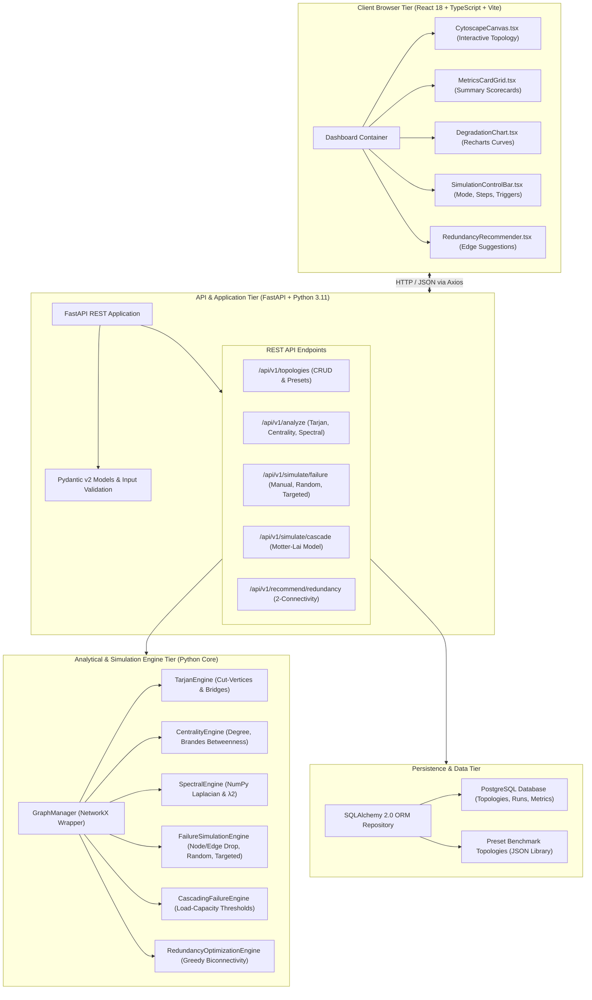

# Phase 0: Proposed System Specification & Architecture
## Graph-Theoretic Critical Infrastructure Failure & Network Resilience Simulator

---

### 1. System Overview & Core Philosophy

The **Graph-Theoretic Critical Infrastructure Failure & Network Resilience Simulator** is a multi-tier web application designed to evaluate the topological robustness of communication networks. The platform abstracts physical and logical networking devices into a formal discrete graph $G = (V, E)$, applies rigorous graph algorithms to discover single points of failure, executes automated and manual failure sequences, simulates load-dependent cascading failures, and plots mathematical resilience curves in real time.

The system is founded on three core architectural principles:
1. **Mathematical Determinism**: Every graph metric, connectivity partition, and cut-element detection is computed via deterministic, mathematically proven discrete algorithms.
2. **Sub-Second Analytical Latency**: All graph traversals, Tarjan cut evaluations, and baseline resilience computations execute in milliseconds, providing instant visual feedback.
3. **Decoupled Layered Architecture**: The computational graph engine operates as an independent backend microservice exposing typed REST endpoints, strictly separated from the React/Cytoscape.js presentation layer.

---

### 2. End-to-End System Workflow

```mermaid
flowchart TD
    Start([User Initiates Session]) --> InputChoice{Input Method?}
    
    InputChoice -->|Select Pre-built| LoadBench[Load Benchmark Topology<br/>e.g., Enterprise 3-Tier, Spine-Leaf, ARPANET]
    InputChoice -->|Interactive Canvas| DrawGUI[Build Topology via Cytoscape GUI<br/>Add Routers, Switches, Firewalls, Links]
    InputChoice -->|Upload File| UploadJSON[Import Topology JSON File]

    LoadBench --> Ingest[Backend Ingestion & Validation<br/>Pydantic Schema Validation]
    DrawGUI --> Ingest
    UploadJSON --> Ingest

    Ingest --> CoreAnalysis[Core Analytical Engine Run]
    
    subgraph AnalysisBlock ["1. Baseline Graph Analytics"]
        CoreAnalysis --> DFS_BFS[BFS / DFS Traversal & Connected Components]
        CoreAnalysis --> Tarjan[Tarjan Algorithm: Articulation Points & Bridges]
        CoreAnalysis --> Centrality[Degree & Betweenness Centrality Engine]
        CoreAnalysis --> Spectral[Laplacian Matrix & Algebraic Connectivity λ2]
        CoreAnalysis --> Efficiency[Global Network Efficiency E_glob]
    end

    AnalysisBlock --> RenderBaseline[Frontend Renders Baseline Topology & Analytics<br/>Highlights SPOFs, Displays Baseline Scorecard]

    RenderBaseline --> SimChoice{Select Simulation Mode}

    SimChoice -->|Manual Click| ManualFail[Manual Node/Link Failure<br/>Click device to toggle Up/Down]
    SimChoice -->|Comparative Stress Test| BatchFail[Random vs. Targeted Failure Test<br/>Percolation Simulation across f = 0 to 1]
    SimChoice -->|Cascading Failure| CascadeFail[Motter-Lai Cascading Load Simulation<br/>Iterative Betweenness Reallocation]

    ManualFail --> ExecSim[Execution in Simulation Engine]
    BatchFail --> ExecSim
    CascadeFail --> ExecSim

    ExecSim --> ResilienceCompute[Resilience Analysis Engine<br/>Compute S(f), E(f), Component Partitioning]

    ResilienceCompute --> RenderSim[Frontend Dynamic Visual Update]
    
    subgraph VisBlock ["2. Real-Time Dynamic Visualization"]
        RenderSim --> UpdateCanvas[Cytoscape Canvas: Grey out failed nodes,<br/>isolate disconnected components, color alternate paths]
        RenderSim --> UpdateCharts[Recharts Dashboard: Plot Giant Component S(f)<br/>and Network Efficiency E(f) Degradation Curves]
        RenderSim --> RedundancyRec[Redundancy Engine: Recommend Optimal Edges<br/>to eliminate cut-vertices and bridges]
    end

    VisBlock --> ExportReport[Export Topology, Simulation Metrics & PDF/JSON Report]
    ExportReport --> End([Session Complete / Next Iteration])
```

---

### 3. Formal System Inputs and Outputs

#### 3.1 Input Specifications
The system accepts network topologies via interactive GUI creation or structured JSON ingestion:

```json
{
  "topology_name": "Campus_Core_Distribution_Network",
  "version": "1.0",
  "directed": false,
  "nodes": [
    {
      "id": "R1_CORE",
      "label": "Core Router 1",
      "type": "ROUTER",
      "capacity": 1000.0,
      "metadata": { "zone": "DataCenter", "model": "Nexus-9000" }
    },
    {
      "id": "FW1_PERIMETER",
      "label": "Perimeter Firewall",
      "type": "FIREWALL",
      "capacity": 500.0,
      "metadata": { "zone": "DMZ" }
    },
    {
      "id": "SW1_ACCESS",
      "label": "Distribution Switch 1",
      "type": "SWITCH",
      "capacity": 300.0,
      "metadata": { "vlan": 10 }
    },
    {
      "id": "SRV_DB1",
      "label": "Primary Database Server",
      "type": "DATABASE_SERVER",
      "capacity": 100.0,
      "metadata": { "subnet": "192.168.10.0/24" }
    }
  ],
  "links": [
    {
      "source": "R1_CORE",
      "target": "FW1_PERIMETER",
      "weight": 1.0,
      "bandwidth_gbps": 10.0,
      "latency_ms": 1.2
    },
    {
      "source": "FW1_PERIMETER",
      "target": "SW1_ACCESS",
      "weight": 1.0,
      "bandwidth_gbps": 1.0,
      "latency_ms": 2.5
    },
    {
      "source": "SW1_ACCESS",
      "target": "SRV_DB1",
      "weight": 1.0,
      "bandwidth_gbps": 1.0,
      "latency_ms": 0.5
    }
  ]
}
```

#### 3.2 Output Specifications
The analytical engine returns comprehensive graph metrics, structural vulnerabilities, and failure outcomes:

```json
{
  "analysis_summary": {
    "node_count": 4,
    "edge_count": 3,
    "connected_components_count": 1,
    "is_connected": true,
    "algebraic_connectivity_lambda2": 0.438,
    "global_efficiency": 0.638,
    "average_shortest_path_length": 1.667,
    "diameter": 3
  },
  "structural_vulnerabilities": {
    "articulation_points": [
      { "id": "FW1_PERIMETER", "type": "FIREWALL", "isolated_nodes_on_failure": 2 },
      { "id": "SW1_ACCESS", "type": "SWITCH", "isolated_nodes_on_failure": 1 }
    ],
    "bridges": [
      { "source": "R1_CORE", "target": "FW1_PERIMETER" },
      { "source": "FW1_PERIMETER", "target": "SW1_ACCESS" },
      { "source": "SW1_ACCESS", "target": "SRV_DB1" }
    ]
  },
  "centrality_metrics": {
    "R1_CORE": { "degree": 1, "betweenness": 0.0, "closeness": 0.5 },
    "FW1_PERIMETER": { "degree": 2, "betweenness": 0.667, "closeness": 0.75 },
    "SW1_ACCESS": { "degree": 2, "betweenness": 0.667, "closeness": 0.75 },
    "SRV_DB1": { "degree": 1, "betweenness": 0.0, "closeness": 0.5 }
  },
  "redundancy_recommendations": [
    {
      "recommended_edge": ["R1_CORE", "SW1_ACCESS"],
      "eliminated_articulation_points": ["FW1_PERIMETER"],
      "eliminated_bridges": ["R1_CORE-FW1_PERIMETER", "FW1_PERIMETER-SW1_ACCESS"],
      "resilience_gain_efficiency": 0.162
    }
  ]
}
```

---

### 4. Core Analytical Engine

The Core Analytical Engine encapsulates the foundational discrete mathematics algorithms:

#### 4.1 Graph Data Model
The network is formalized as a vertex-attributed, edge-attributed undirected graph $G = (V, E, \alpha, \beta)$ where:
- $V = \{v_1, v_2, \dots, v_n\}$ is the finite set of networking devices.
- $E \subseteq \{\{u, v\} \mid u, v \in V, u \neq v\}$ is the set of bidirectional communication channels.
- $\alpha: V \to \mathcal{T} \times \mathbb{R}^+$ maps vertices to their archetype (`ROUTER`, `SWITCH`, `FIREWALL`, `GATEWAY`, `SERVER`, `DATABASE_SERVER`) and capacity thresholds.
- $\beta: E \to \mathbb{R}^+ \times \mathbb{R}^+$ maps edges to weight (hop latency) and bandwidth capacity.

#### 4.2 Tarjan’s Linear-Time Cut-Vertex & Bridge Detection
To identify Single Points of Failure (SPOFs) in $O(|V| + |E|)$ time, the engine implements Tarjan’s Depth-First Search algorithm:
- For each vertex $u$, maintain discovery time $d[u]$ and lowest reachable ancestor time $\text{low}[u]$.
- Initialize depth counter $\text{timer} \leftarrow 0$.
- In the DFS traversal from vertex $u$:
  $$\text{low}[u] = \min \left( d[u], \min_{(u, v) \in E_{\text{tree}}} \text{low}[v], \min_{(u, w) \in E_{\text{back}}} d[w] \right)$$
- **Cut-Vertex Rule**:
  1. If $u$ is the root of the DFS tree, $u$ is an articulation point if and only if it has two or more DFS tree children.
  2. If $u$ is not the root, $u$ is an articulation point if and only if it has a child $v$ such that $\text{low}[v] \ge d[u]$.
- **Cut-Edge (Bridge) Rule**:
  An edge $(u, v)$ is a bridge if and only if $\text{low}[v] > d[u]$.

#### 4.3 Centrality Metric Suite
- **Degree Centrality**: $C_D(v) = \frac{\deg(v)}{n - 1}$
- **Betweenness Centrality (Brandes' Algorithm)**: 
  $$C_B(v) = \sum_{s \neq v \neq t \in V} \frac{\sigma_{st}(v)}{\sigma_{st}}$$
  Implemented using Brandes' $O(|V||E|)$ algorithm via NetworkX, calculating how frequently node $v$ sits on the shortest communication path between all pairs $(s, t)$.
- **Closeness Centrality**: 
  $$C_C(v) = \frac{n - 1}{\sum_{u \neq v} d(v, u)}$$

#### 4.4 Spectral & Algebraic Connectivity Engine
- Constructs the Graph Laplacian Matrix $L = D - A$, where $D$ is the degree diagonal matrix and $A$ is the adjacency matrix.
- Computes eigenvalues $0 = \lambda_1 \le \lambda_2 \le \dots \le \lambda_n$ via NumPy.
- **Fiedler Value ($\lambda_2$)**: The second smallest eigenvalue defines algebraic connectivity. $\lambda_2 > 0$ if and only if $G$ is connected; the magnitude of $\lambda_2$ quantifies how easily the graph can be partitioned.

#### 4.5 Global Network Efficiency Engine
To evaluate network communication ease without encountering division-by-zero singularities when the network fractures, the engine computes Latora-Marchiori Global Efficiency:
$$E_{\text{glob}}(G) = \frac{1}{n(n-1)} \sum_{u \neq v \in V} \frac{1}{d(u, v)}$$
Where $d(u, v)$ is the shortest path distance. When $u$ and $v$ are disconnected, $d(u, v) = \infty \implies \frac{1}{d(u,v)} = 0$.

---

### 5. Failure Simulation Engine

The Failure Simulation Engine executes three distinct modes of infrastructure failure:

#### 5.1 Mode 1: Interactive Manual Failure (Single & Multi-Element Knockout)
- The user clicks any node or link in the Cytoscape canvas to toggle its operational state (`UP` $\leftrightarrow$ `DOWN`).
- The engine computes the induced subgraph $G' = G[V \setminus V_{\text{failed}}]$ or $G' = (V, E \setminus E_{\text{failed}})$.
- Returns immediate graph partitioning status: newly formed connected components, severed node sets, and alternative path availability between selected source and destination endpoints.

#### 5.2 Mode 2: Automated Random vs. Targeted Failure Comparison (Percolation Engine)
Simulates sequential network breakdown by removing a fraction $f \in [0, 1]$ of nodes:
1. **Random Breakdown (Uniform Percolation)**:
   - Nodes are removed uniformly at random: $v_{\text{fail}} \sim \text{Uniform}(V_{\text{active}})$.
   - Simulates uncoordinated hardware wear-out, power supply failures, or localized physical incidents.
   - Run across $K = 20$ Monte Carlo trials to compute mean and standard deviation curves.
2. **Targeted Attack (Hub / Chokepoint Disruption)**:
   - Nodes are sequentially removed in descending order of structural importance:
     - Strategy A: Greedy initial degree centrality $C_D(v)$.
     - Strategy B: Greedy re-calculated betweenness centrality $C_B(v)$.
   - Simulates targeted DDoS attacks, exploitation of core routing infrastructure, or physical sabotage.
3. At each step $i \in \{1, 2, \dots, n\}$, the engine records:
   - Giant Connected Component fraction $S(f) = \frac{|V_{\text{GCC}}|}{n}$.
   - Global Network Efficiency $E_{\text{glob}}(f)$.
   - Isolated node count and component count $\kappa(G')$.

#### 5.3 Mode 3: Dynamic Cascading Failure Simulation (Motter-Lai Model)
Models load redistribution and capacity thresholds:
1. **Initial Load Assignment**: The initial load $L_i(0)$ on node $i$ is proportional to its initial betweenness centrality:
   $$L_i(0) = C_B(i)$$
2. **Capacity Definition**: Each node possesses a maximum operating throughput capacity $C_i$, defined with tolerance parameter $\alpha > 0$:
   $$C_i = (1 + \alpha) L_i(0)$$
3. **Trigger Event**: An initial node $v_{\text{initial}}$ fails or is manually disabled.
4. **Iterative Cascade Step**:
   - Shortest communication paths between all surviving node pairs are re-routed via BFS/Dijkstra.
   - New loads $L_i(t)$ are calculated for all surviving nodes.
   - Any surviving node $j$ with $L_j(t) > C_j$ becomes overloaded and fails at step $t+1$.
5. **Termination**: The cascade terminates when either:
   - For all surviving nodes, $L_k(t) \le C_k$ (steady-state equilibrium achieved).
   - All nodes in the network fail.
- The step-by-step cascading chain is recorded and returned as an animation sequence.

---

### 6. Resilience Analysis Engine

The Resilience Analysis Engine analyzes simulation outputs to produce actionable architectural recommendations:
1. **Resilience Scorecard**: Summarizes baseline robustness versus degraded states under 5%, 10%, 20%, and 50% node loss.
2. **Percolation Threshold ($f_c$) Estimation**: Identifies the critical fraction of removed nodes $f_c$ at which the Giant Connected Component disintegrates ($S(f) < 0.1$).
3. **Algorithmic Redundancy Recommendations**:
   - Analyzes biconnected components ($2$-vertex-connected) and $2$-edge-connected blocks.
   - Evaluates all potential candidate edges $e_{\text{cand}} \notin E$ that could be added between disconnected biconnected blocks.
   - Calculates the **Marginal Resilience Gain**:
     $$\Delta \mathcal{R}(e) = \Delta E_{\text{glob}} + w_1 \cdot (\Delta \text{eliminated SPOFs})$$
   - Ranks and recommends the top $k$ cost-effective redundant links to convert the topology into a 2-connected network where no single point of failure exists.

---

### 7. Visualization Layer (Cytoscape.js & Recharts)

The presentation layer provides a rich, responsive dashboard built with React 18, Tailwind CSS, Cytoscape.js, and Recharts:

#### 7.1 Cytoscape.js Canvas Features
- **Visual Encoding**:
  - *Routers*: Hexagonal glyphs, Blue (`#2563EB`).
  - *Switches*: Rounded rectangles, Indigo (`#4F46E5`).
  - *Firewalls*: Shield glyphs, Amber (`#D97706`).
  - *Gateways*: Octagonal glyphs, Purple (`#7C3AED`).
  - *Servers*: Cylindrical/Square glyphs, Slate (`#475569`).
  - *Database Servers*: Storage cylinders, Emerald (`#059669`).
  - *Articulation Points (SPOFs)*: Pulsing red border halo (`#DC2626`).
  - *Bridges (Cut-Edges)*: Bold dashed amber lines (`#F59E0B`).
  - *Failed Nodes/Links*: Muted translucent grey (`#9CA3AF`, opacity 0.3) with a red 'X' icon.
  - *Isolated Partitions*: Automatic color-coded component clustering.
- **Interactivity**: Drag-and-drop node placement, zoom/pan bounds, context menu to trigger node failure, inspect path between two selected nodes.

#### 7.2 Recharts Real-Time Analytics Dashboard
- **Degradation Curves**: Dual-axis line plot comparing Random Failure $S(f)$ vs. Targeted Attack $S(f)$ vs. Efficiency $E(f)$.
- **Cascade Timeline**: Step-by-step bar chart illustrating the count of newly overloaded nodes per cascade iteration.
- **Centrality Spectrum**: Bar charts displaying top betweenness and degree ranking across all devices.

---

### 8. Detailed System Architecture

The following diagram illustrates the complete modular multi-tier software architecture:



This architecture guarantees strict separation between pure discrete graph calculations, persistence models, and presentation logic, making the codebase clean, scalable, maintainable, and thoroughly verifiable.

