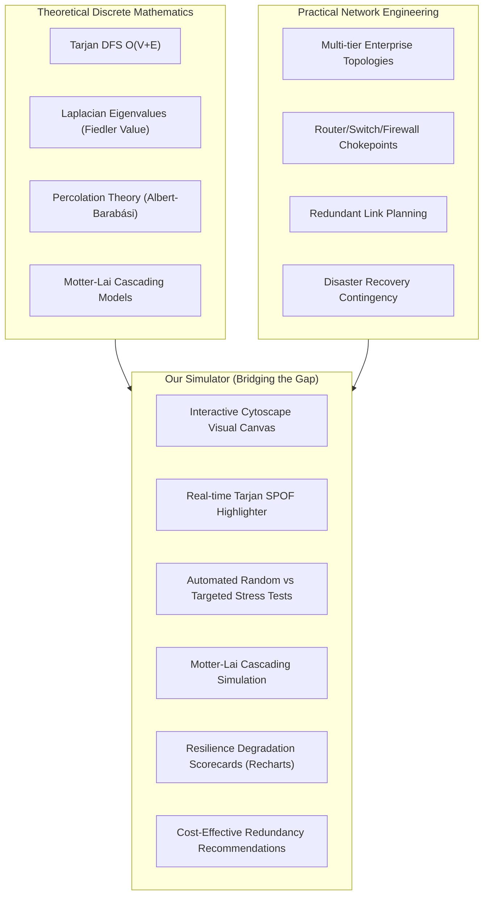

# Phase 0: Research Gap Analysis & Academic Contribution
## Graph-Theoretic Critical Infrastructure Failure & Network Resilience Simulator

---

### 1. Contextual Framing: Academic Research vs. Engineering Practice

The mathematical study of complex networks, graph connectivity, percolation theory, and cascading dynamics has been extensively investigated in academic literature over the past three decades (e.g., Albert, Jeong, & Barabási, 2000; Motter & Lai, 2002; Latora & Marchiori, 2001; Tarjan, 1972). Concurrently, commercial enterprise software has developed mature tools for operational network monitoring, protocol configuration, and live cloud fault injection (as established in [existing_system_analysis.md](file:///c:/DM/CP/documentation/phase-0/existing_system_analysis.md)).

**The research gap is neither the absence of theoretical graph algorithms nor the absence of commercial networking software.** 

Rather, the critical gap lies in the **complete disconnection between theoretical graph-theoretic resilience models and accessible, interactive software environments for network engineers and undergraduate students**. Theoretical research is predominantly published as abstract mathematical formulations or isolated, one-off academic scripts (often written in MATLAB or raw command-line Python) that lack interactive visualization, realistic network entity modeling, or unified scenario exploration. Conversely, practical networking tools treat network reliability as an empirical or protocol-configuration exercise, ignoring formal graph invariants.

Our project addresses this divide by developing an **academic prototype that synthesizes core discrete graph algorithms, complex network percolation models, and interactive network visualization into a unified, accessible mathematical workbench**.

---

### 2. Analysis of Specific Research & Analytical Gaps

#### 2.1 Graph-Theoretic Infrastructure Modeling
- **Current State**: Academic graph theory typically evaluates homogeneous graphs where all vertices $v \in V$ and edges $e \in E$ are identical mathematical abstractions. In contrast, practical network documentation relies on static architectural diagrams (Visio, Lucidchart) that assign device roles (routers, switches, firewalls, servers) but lack mathematical execution capabilities.
- **Identified Gap**: A modeling system that combines formal mathematical graph definitions with typed, heterogeneous networking entity attributes (router routing capacity, switch port aggregation, firewall inspection bottlenecks, link bandwidth, and latency) so that graph algorithms operate on structurally meaningful network abstractions.

#### 2.2 Articulation-Point and Bridge Detection in Network Planning
- **Current State**: Tarjan’s and Hopcroft’s linear-time ($O(V + E)$) Depth-First Search algorithms for detecting cut-vertices (articulation points) and cut-edges (bridges) are staple topics in discrete mathematics curricula. However, they are taught almost exclusively on small, abstract textbook graphs (5–8 vertices).
- **Identified Gap**: Network planning tools rarely offer automated, one-click cut-vertex and bridge highlighting on complex, multi-tiered enterprise topologies. Network designers lack an immediate visual feedback mechanism showing which specific router, switch, or firewall is a single point of failure (SPOF) that will partition the system into disconnected components if severed.

#### 2.3 Structural Vulnerability Identification via Multi-Metric Centrality
- **Current State**: Vulnerability in production networks is usually measured by CPU load or bandwidth saturation. In network science, various centrality metrics exist:
  - **Degree Centrality ($k_v$)**: Measures direct connection count.
  - **Betweenness Centrality ($C_B(v) = \sum_{s \neq v \neq t} \frac{\sigma_{st}(v)}{\sigma_{st}}$)**: Measures the fraction of all shortest communication paths traversing node $v$.
  - **Closeness Centrality ($C_C(v) = \frac{n-1}{\sum_{u \neq v} d(v, u)}$)**: Measures average proximity to all other nodes.
  - **Algebraic Connectivity ($\lambda_2$)**: The second smallest eigenvalue of the graph Laplacian matrix $L = D - A$, representing the graph's overall structural cohesiveness.
- **Identified Gap**: These metrics are rarely integrated into a single comparative dashboard that correlates structural graph centrality with physical network failure risk, making it difficult for designers to see whether a high-betweenness router is also a single point of failure.

#### 2.4 Multiple Failure Scenario Analysis (Simultaneous & Sequential)
- **Current State**: Most network reliability analyses evaluate $N-1$ contingency scenarios (the failure of a single element). However, major real-world outages (e.g., severe weather, coordinated cyber-attacks, power grid brownouts) induce $N-k$ simultaneous or rapid sequential failures.
- **Identified Gap**: Existing lightweight tools lack the capability to orchestrate multi-node failure sequences, evaluate partial network partitioning, and track how the residual network behaves as multiple independent devices fail concurrently.

#### 2.5 Random vs. Targeted Failure Comparison (Percolation Modeling)
- **Current State**: In the seminal paper by Albert, Jeong, and Barabási (2000), complex networks were shown to exhibit fundamental structural differences under failure regimes:
  - **Error Tolerance (Random Failure)**: Scale-free and power-law networks are exceptionally robust against random node removals because the vast majority of vertices are low-degree leaves.
  - **Attack Vulnerability (Targeted Failure)**: When nodes are removed in descending order of degree or betweenness centrality, the network rapidly fractures at a critical threshold $f_c$.
- **Identified Gap**: Despite being a cornerstone of modern discrete network theory, students and network engineers rarely have an interactive environment where they can upload an enterprise topology, press a button to simulate both regimes side-by-side, and observe the degradation curves of Giant Connected Component (GCC) size plotted in real time.

#### 2.6 Cascading Failure Simulation (Load & Capacity Reallocation)
- **Current State**: Models of cascading failure—such as the Motter-Lai model (Motter & Lai, 2002)—mathematically capture how the failure of an initial node redistributes communication load to alternate shortest paths, overwhelming adjacent nodes and causing successive failures.
- **Identified Gap**: Existing chaos engineering tools (Chaos Mesh, AWS FIS) observe operational failure in live containers but cannot simulate theoretical capacity-threshold cascades on planned topologies prior to deployment. Conversely, academic scripts implementing the Motter-Lai model are buried in research repositories without interactive step-by-step visual animation.

#### 2.7 Mathematical Resilience Measurement & Standardized Metrics
- **Current State**: Operational teams rely on "uptime percentage" or "Mean Time Between Failures" (MTBF), which are temporal, historical metrics. They do not capture topological resilience.
- **Identified Gap**: The absence of a standardized, unified mathematical scorecard that evaluates:
  - **Relative Giant Component Size ($S(f)$)**: Measures residual primary reachability.
  - **Global Network Efficiency ($E_{\text{glob}}(G)$)**: Measures harmonic path efficiency across both connected and disconnected graphs (avoiding the mathematical infinity singularity when paths are severed).
  - **Algebraic Connectivity ($\lambda_2$)**: Spectral robustness.

#### 2.8 Comparative Network Topology Analysis
- **Current State**: Academic courses describe classic topologies (Tree, Star, Ring, Full Mesh, Partial Mesh, Fat-Tree/Clos, 3-Tier Enterprise) theoretically, but students lack a benchmarking sandbox to subject these archetypes to identical stress-test failure sequences and contrast their resilience scorecards side by side.
- **Identified Gap**: A benchmark library of canonical topologies enabling direct, empirical comparison of structural trade-offs (e.g., the high vulnerability and low cost of Star/Tree vs. the high resilience and high cabling cost of Full Mesh vs. the balanced resilience of Spine-Leaf / Fat-Tree).

---

### 3. Summary of Research Opportunities

---

### 4. Defined Academic Contribution of This Project

Our contribution is defined as:
> **An open-source, interactive mathematical simulation workbench that unifies formal discrete graph theory algorithms, complex network percolation models, and network infrastructure abstractions into an accessible educational and architectural environment.**

This academic prototype enables:
1. **Pedagogical Enrichment**: Transforming abstract theorems of graph connectivity, cut-vertices, and spectral graph theory into an interactive, visual medium for computer engineering education.
2. **Pre-deployment Resilience Quantification**: Allowing network planners to mathematically quantify single points of failure, structural vulnerabilities, and cascading risks in arbitrary topologies before purchasing physical hardware or deploying live services.
3. **Reproducible Failure Benchmarking**: Providing a deterministic testing ground with standardized metrics ($S(f)$, $E_{\text{glob}}$, $\lambda_2$) across canonical and custom enterprise network topologies.

