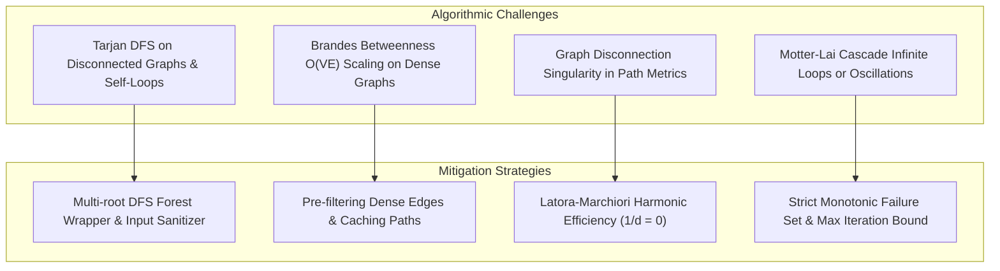

# Phase 0: Technical Risks, Algorithmic Limitations & Mitigation Strategies
## Graph-Theoretic Critical Infrastructure Failure & Network Resilience Simulator

---

### 1. Introduction and Risk Management Framework

Every engineering project balancing academic rigor with practical software development encounters algorithmic bottlenecks, mathematical model simplifications, and architectural trade-offs. 

This document systematically categorizes the risks, modeling assumptions, and performance boundaries of the **Graph-Theoretic Critical Infrastructure Failure & Network Resilience Simulator**, pairing each challenge with an actionable engineering mitigation strategy.

---

### 2. Algorithmic Challenges & Mathematical Edge Cases

#### 2.1 Tarjan’s Algorithm on Disconnected Graphs and Edge Cases
- **Algorithmic Challenge**: Classical implementations of Tarjan’s articulation point and bridge algorithm assume a single connected component and simple graphs without self-loops or multi-edges. If an input network is initially disconnected or contains parallel links, unhandled edge cases can produce false positive bridges or unvisited components.
- **Mathematical Impact**: A back-edge that is an exact duplicate of a tree edge could be misidentified as a bridge, or an unvisited disconnected subnet could be omitted from SPOF analysis.
- **Mitigation Strategy**:
  1. Wrap the Tarjan DFS inside an outer loop that iterates over all unvisited vertices, transforming the search into a complete **DFS Forest** traversal.
  2. Implement an input sanitization stage that strips self-loops (which cannot be bridges) and collapses parallel multi-edges into single weighted edges prior to Tarjan execution.
  3. Validate against an extensive suite of adversarial test graphs (e.g., disconnected clusters, triangle with an attached leaf, star graph with multiple leaves).

#### 2.2 Computational Complexity of Brandes’ Betweenness Centrality
- **Algorithmic Challenge**: Calculating betweenness centrality via Brandes’ algorithm requires $O(|V||E|)$ time for unweighted graphs and $O(|V||E| + |V|^2 \log |V|)$ for weighted graphs. In batch percolation simulations where betweenness must be recalculated after *every* node removal across 20 Monte Carlo iterations, execution time can scale to $O(K \cdot |V|^2 |E|)$, causing noticeable latency on larger graphs ($N > 200$).
- **Mitigation Strategy**:
  1. In automated percolation simulations, offer two selectable attack modes:
     - *Static Attack*: Ranks nodes by initial betweenness once ($O(|V||E|)$ total) and removes them sequentially.
     - *Dynamic Attack*: Recalculates betweenness at each step, restricted to graphs with $N \le 100$.
  2. Utilize NetworkX's optimized C-accelerated backend or NumPy matrix operations where feasible.
  3. Cache shortest path trees between unchanged subcomponents.

#### 2.3 Mathematical Singularity in Path-Length Metrics
- **Algorithmic Challenge**: The traditional Average Shortest Path Length metric $\bar{l} = \frac{1}{n(n-1)} \sum_{u \neq v} d(u, v)$ approaches infinity ($\infty$) the moment a single node or bridge failure disconnects the graph into two components.
- **Mathematical Impact**: Division-by-zero errors or infinite values in charting libraries, rendering degradation curves unplottable.
- **Mitigation Strategy**:
  1. Adopt the **Latora-Marchiori Global Network Efficiency** metric $E_{\text{glob}}(G) = \frac{1}{n(n-1)} \sum_{u \neq v} \frac{1}{d(u,v)}$, where disconnected pairs have distance $d(u, v) = \infty$, cleanly yielding $\frac{1}{\infty} = 0$.
  2. Restrict the computation of characteristic path length $\bar{l}$ exclusively to the Giant Connected Component (GCC), explicitly documenting this scope in metric tooltips.

#### 2.4 Cascading Failure Termination & Infinite Loops
- **Algorithmic Challenge**: In the Motter-Lai cascading failure model, dynamic load reallocation could theoretically oscillate or fail to converge if capacity restoration or floating-point rounding errors occur.
- **Mitigation Strategy**:
  1. Enforce a **strictly monotonic failure condition**: once a node fails due to capacity overload, it transitions permanently to the `DOWN` state and cannot be reactivated during that simulation run.
  2. Implement an explicit safety termination guardrail: `max_iterations = |V|`. If the simulation reaches $|V|$ iterations without stabilizing, the simulation forcibly terminates with a "Total Network Collapse" status.

---

### 3. Mathematical Modeling Assumptions & Simplifications

To ensure feasibility as a second-year engineering project, the simulation makes several well-defined mathematical abstractions:

| Mathematical Dimension | Real-World Network Complexity | Simulator Modeling Abstraction | Justification & Validity Boundary |
| :--- | :--- | :--- | :--- |
| **Link Directionality** | Asymmetric duplex transmission, asymmetric routing tables (e.g., BGP hot-potato routing). | Undirected communication graph $G = (V, E)$ by default (with optional directed edge support). | In physical Layer-1/Layer-2 campus infrastructure, physical links are bidirectional cables; if a fiber cable is severed, communication fails in both directions. |
| **Component Operational State** | Degrading state (packet loss, jitter, high CPU, intermittent flaps). | Binary discrete operational states: `UP` (1) or `DOWN` (0). | Focuses the analysis on pure topological connectivity and structural collapse rather than microsecond queueing dynamics. |
| **Traffic Load Distribution** | Dynamic packet flows dictated by TCP congestion windows and queue depth. | Abstract load modeled proportionally to Betweenness Centrality ($L_i = C_B(i)$). | Betweenness centrality is mathematically proven to accurately approximate uniform all-to-all packet communication demand across network backbones. |
| **Rerouting Dynamics** | Protocol convergence timers (OSPF LSAs ~5s, BGP hold timers ~90s). | Instantaneous shortest-path recalculation upon component knockout. | Models steady-state post-convergence topology rather than transient routing loops during convergence. |

---

### 4. Technical & Frontend Performance Limitations

#### 4.1 Browser DOM and Canvas Rendering Limits (Cytoscape.js)
- **Technical Risk**: Cytoscape.js uses HTML5 Canvas. While highly efficient for graphs up to 500 nodes, rendering complex animated layouts (e.g., force-directed CoSE layouts) on graphs with $N > 1,000$ nodes can drop browser frame rates below 30 FPS on low-tier student laptops.
- **Mitigation Strategy**:
  1. Set the maximum supported graph size in the UI to 500 nodes.
  2. Use pre-calculated static coordinates for benchmark topologies rather than running continuous physics simulations.
  3. Disable heavy CSS canvas shadows and continuous animation halos when node count exceeds 200.

#### 4.2 Python Global Interpreter Lock (GIL) & Asynchronous Execution
- **Technical Risk**: Batch Monte Carlo percolation simulations running 20 trials on 200 nodes could block the Python event loop if executed synchronously on the main thread, causing API timeouts.
- **Mitigation Strategy**:
  1. Run computationally heavy batch simulations in background worker threads using `fastapi.concurrency.run_in_threadpool` or Python `concurrent.futures.ProcessPoolExecutor`.
  2. Return incremental progress updates or execute the 20 Monte Carlo iterations using vectorized NumPy routines.

---

### 5. Data & Benchmarking Limitations

- **Challenge**: Proprietary enterprise network topologies and real-world ISP fiber maps (e.g., AT&T, Level 3) are typically protected by non-disclosure agreements (NDAs) or national security classifications, limiting access to real production datasets.
- **Mitigation Strategy**:
  1. Utilize canonical open-source historical topologies: ARPANET (1972), Abilene Network (Internet2), and standard IEEE reliability test networks.
  2. Implement synthetic graph generators in NetworkX to produce realistic network archetypes:
     - Barabási–Albert preferential attachment graphs (modeling scale-free autonomous systems).
     - Erdős–Rényi random graphs (modeling unstructured mesh topologies).
     - Hierarchical 3-Tier Enterprise trees (Core, Distribution, Access).
     - Clos / Spine-Leaf data center topologies.

---

### 6. Scope Management & Second-Year Student Guardrails

- **Scope Creep Risk**: Temptation to incorporate Machine Learning (e.g., Graph Neural Networks for link prediction) or real-time packet sniffers (e.g., Scapy, Wireshark packet capture), which would derail the core discrete mathematics focus.
- **Mitigation Strategy**:
  1. The project boundary is strictly enforced by the Project Charter and MoSCoW matrix: **Machine Learning and live telemetry are formally classified as Out-of-Scope**.
  2. Evaluation is strictly tied to Discrete Mathematics course deliverables: graph traversal, cut-vertices, bridges, centrality, and resilience metrics.
  3. Milestone gates require faculty review before any Phase 1 or Phase 2 implementation code is written.

