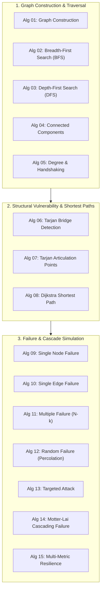

# Phase 1: Algorithmic Specifications & Implementation Blueprints
## Graph-Theoretic Critical Infrastructure Failure & Network Resilience Simulator

---

### 1. Architectural Overview & Algorithmic Inventory

This document provides formal, mathematically verified algorithmic specifications for the fifteen core algorithms powering the simulator. Each specification includes:
* Formal mathematical foundation and theorems.
* Input and output contract definitions.
* Step-by-step analytical working.
* Structured algorithmic pseudocode.
* Exact time and space complexity derivations.
* Critical edge-case handling.
* Concrete worked examples on the canonical 5-node enterprise topology.



---

### Algorithm 01: Graph Construction & Validation

#### 1. Purpose
Parses, validates, and initializes the in-memory vertex-attributed and edge-attributed graph $G = (V, E, \alpha, \beta)$ from declarative JSON schemas, populating the primary Adjacency List data structure and validating topological integrity.

#### 2. Mathematical Foundation
Constructs a simple, undirected finite graph $G = (V, E)$ where $V = \{v_1, \dots, v_n\}$ and $E \subseteq \{\{u, v\} \mid u, v \in V, u \neq v\}$. Enforces irreflexivity ($\{u, u\} \notin E$, no self-loops) and simplicity (at most one undirected edge per vertex pair).

#### 3. Inputs & Outputs
* **Input**: JSON payload containing `nodes` list and `links` list with attributes.
* **Output**: Instantiated graph object $G$ with Adjacency List $\text{Adj}$, attribute mappings $\alpha, \beta$, or validation error with diagnostic message.

#### 4. Step-by-Step Working
1. Initialize an empty dictionary $\text{Adj} \leftarrow \{\}$ and attribute maps $\alpha \leftarrow \{\}, \beta \leftarrow \{\}$.
2. Iterate through `nodes`: check for duplicate `id`. If duplicate, throw `DuplicateNodeError`. Add node `id` as key in $\text{Adj}$ with empty list `[]`. Store attributes in $\alpha[\text{id}]$.
3. Iterate through `links`: for link $\{u, v\}$, verify that $u \in \text{Adj}$ and $v \in \text{Adj}$. If either is missing, throw `OrphanEdgeError`.
4. Check if $u = v$: if so, throw `SelfLoopDisallowedError`.
5. Check if $v \in \text{Adj}[u]$: if so, throw `DuplicateEdgeError` (or aggregate bandwidth).
6. Append $v$ to $\text{Adj}[u]$ and $u$ to $\text{Adj}[v]$. Store edge attributes in $\beta[\{u, v\}]$.
7. Return $G = (\text{Adj}, \alpha, \beta)$.

#### 5. Pseudocode
```text
Algorithm ConstructGraph(node_list, link_list):
    Adj = Map()
    alpha = Map()
    beta = Map()
    
    for node in node_list:
        if node.id in Adj:
            raise DuplicateNodeException(node.id)
        Adj[node.id] = List()
        alpha[node.id] = {type: node.type, capacity: node.capacity, status: 1}
        
    for link in link_list:
        u = link.source
        v = link.target
        if u not in Adj or v not in Adj:
            raise OrphanEdgeException(u, v)
        if u == v:
            raise SelfLoopException(u)
        if v in Adj[u]:
            raise DuplicateEdgeException(u, v)
            
        Adj[u].append(v)
        Adj[v].append(u)
        beta[{u, v}] = {weight: link.weight, bandwidth: link.bandwidth, status: 1}
        
    return Graph(Adj, alpha, beta)
```

#### 6. Complexity
* **Time Complexity**: $\Theta(|V| + |E|)$ linear time.
* **Space Complexity**: $\Theta(|V| + |E|)$ words to store the adjacency list.

#### 7. Edge Cases
* Empty graph ($|V| = 0$): Handled gracefully, returns empty graph structure.
* Dangling edges referencing non-existent nodes: Caught by membership test $u \notin \text{Adj}$.
* Duplicate edge specifications in JSON: Detected and rejected or deduplicated.

#### 8. Example
Input 5 nodes `[GW1, R1, FW1, SW1, DB1]` and 4 links: successfully creates `Adj` map with 5 entries and 8 total directed neighbor references.

---

### Algorithm 02: Breadth-First Search (BFS) Traversal

#### 1. Purpose
Traverses graph $G$ level-by-level starting from source vertex $s$, discovering all reachable vertices and computing unweighted minimum hop distances $d(s, v)$ and shortest path trees.

#### 2. Mathematical Foundation
Calculates shortest distance in an unweighted graph where every edge has unit cost $w(e) = 1$. Exploits the First-In, First-Out (FIFO) queue invariant: vertices are discovered in monotonically non-decreasing order of distance $d(s, v)$.

#### 3. Inputs & Outputs
* **Input**: Graph $G = (V, E)$, source vertex $s \in V$.
* **Output**: Distance map $d: V \to \mathbb{N}_0 \cup \{\infty\}$, predecessor map $\pi: V \to V \cup \{\text{NIL}\}$.

#### 4. Step-by-Step Working
1. For each $v \in V$: set $d[v] \leftarrow \infty$, $\pi[v] \leftarrow \text{NIL}$, $\text{visited}[v] \leftarrow \text{False}$.
2. Initialize FIFO queue $Q \leftarrow \text{Queue}()$.
3. Set $d[s] \leftarrow 0$, $\text{visited}[s] \leftarrow \text{True}$. Enqueue($Q, s$).
4. While $Q$ is not empty:
   a. $u \leftarrow \text{Dequeue}(Q)$.
   b. For each neighbor $v \in \text{Adj}[u]$:
      i. If $\text{visited}[v] == \text{False}$ and edge $\{u, v\}$ is active ($\sigma = 1$):
         - $\text{visited}[v] \leftarrow \text{True}$
         - $d[v] \leftarrow d[u] + 1$
         - $\pi[v] \leftarrow u$
         - Enqueue($Q, v$)
5. Return distance map $d$ and predecessor tree $\pi$.

#### 5. Pseudocode
```text
Algorithm BreadthFirstSearch(G, s):
    d = Map()
    pi = Map()
    visited = Map()
    for v in G.V:
        d[v] = infinity
        pi[v] = NIL
        visited[v] = False
        
    Q = Queue()
    d[s] = 0
    visited[s] = True
    Q.enqueue(s)
    
    while not Q.is_empty():
        u = Q.dequeue()
        for v in G.Adj[u]:
            if G.is_active(u, v) and not visited[v]:
                visited[v] = True
                d[v] = d[u] + 1
                pi[v] = u
                Q.enqueue(v)
                
    return (d, pi)
```

#### 6. Complexity
* **Time Complexity**: $\Theta(|V| + |E|)$. Every vertex is enqueued at most once ($\Theta(|V|)$), and every incident edge is inspected once ($\Theta(|E|)$).
* **Space Complexity**: $\Theta(|V|)$ for queue $Q$, distance map $d$, and predecessor map $\pi$.

#### 7. Edge Cases
* Disconnected graph: Any node $u$ unreachable from $s$ retains $d[u] = \infty$ and $\pi[u] = \text{NIL}$.
* Single vertex ($V = \{s\}$): Queue pops immediately, returns $d[s] = 0$.

#### 8. Example
On $G_{\text{sample}}$ with $s = \text{GW1}$: returns $d[\text{GW1}]=0, d[\text{R1}]=1, d[\text{FW1}]=2, d[\text{SW1}]=3, d[\text{DB1}]=4$.

---

### Algorithm 03: Depth-First Search (DFS) Traversal

#### 1. Purpose
Systematically visits all vertices in $G$ by following path branches as deep as possible before backtracking, computing vertex discovery timestamps $d[u]$ and finishing timestamps $f[u]$, and classifying edges into tree-edges and back-edges.

#### 2. Mathematical Foundation
Constructs a **DFS Spanning Forest**. Based on the **Parenthesis Theorem**: for any two vertices $u$ and $v$, the intervals $[d[u], f[u]]$ and $[d[v], f[v]]$ are either completely disjoint or one is strictly nested inside the other. In an undirected graph, every edge is either a **Tree Edge** or a **Back Edge** (no cross edges or forward edges exist).

#### 3. Inputs & Outputs
* **Input**: Graph $G = (V, E)$.
* **Output**: Discovery times $d[u]$, finish times $f[u]$, predecessor tree $\pi[u]$, list of tree edges $E_{\text{tree}}$, list of back edges $E_{\text{back}}$.

#### 4. Step-by-Step Working
1. Initialize $\text{time} \leftarrow 0$. For all $u \in V$: $\text{color}[u] \leftarrow \text{WHITE}, \pi[u] \leftarrow \text{NIL}$.
2. For each $u \in V$: if $\text{color}[u] == \text{WHITE}$, execute `DFS-Visit(G, u)`.
3. `DFS-Visit(G, u)`:
   a. $\text{time} \leftarrow \text{time} + 1; \ d[u] \leftarrow \text{time}; \ \text{color}[u] \leftarrow \text{GRAY}$.
   b. For each neighbor $v \in \text{Adj}[u]$:
      i. If $\text{color}[v] == \text{WHITE}$:
         - Record $(u, v)$ as Tree Edge.
         - $\pi[v] \leftarrow u$.
         - `DFS-Visit(G, v)`.
      ii. Else if $\text{color}[v] == \text{GRAY}$ and $v \neq \pi[u]$:
         - Record $(u, v)$ as Back Edge (cycle detected).
   c. $\text{color}[u] \leftarrow \text{BLACK}; \ \text{time} \leftarrow \text{time} + 1; \ f[u] \leftarrow \text{time}$.

#### 5. Pseudocode
```text
Algorithm DepthFirstSearch(G):
    color = Map()
    pi = Map()
    d = Map()
    f = Map()
    for u in G.V:
        color[u] = WHITE
        pi[u] = NIL
    time = 0
    
    function DFS_Visit(u):
        time = time + 1
        d[u] = time
        color[u] = GRAY
        for v in G.Adj[u]:
            if G.is_active(u, v):
                if color[v] == WHITE:
                    pi[v] = u
                    DFS_Visit(v)
                else if color[v] == GRAY and v != pi[u]:
                    RecordBackEdge(u, v)
        color[u] = BLACK
        time = time + 1
        f[u] = time

    for u in G.V:
        if G.is_active(u) and color[u] == WHITE:
            DFS_Visit(u)
            
    return (d, f, pi)
```

#### 6. Complexity
* **Time Complexity**: $\Theta(|V| + |E|)$. Every vertex is visited twice (discovery and finish), every edge is traversed twice.
* **Space Complexity**: $\Theta(|V|)$ call-stack frames in worst case (linear line graph) plus attribute maps.

#### 7. Edge Cases
* Disconnected graphs: Outer loop guarantees every component is fully traversed as an independent tree in the DFS forest.
* Isolated vertices: Discovered and finished with two consecutive clock ticks ($f[u] = d[u] + 1$).

#### 8. Example
On $G_{\text{sample}}$: generates discovery times $1, 2, 3, 4, 5$ and finishing times $10, 9, 8, 7, 6$. No back edges found (acyclic tree).

---

### Algorithm 04: Connected Component Detection

#### 1. Purpose
Partitions graph $V$ into its maximal connected equivalence classes, labeling each node with its component index, counting total components $\kappa(G)$, and identifying the Giant Connected Component (GCC).

#### 2. Mathematical Foundation
Decomposes the vertex set under the Reachability Equivalence Relation:
$$V = V_1 \uplus V_2 \uplus \dots \uplus V_{\kappa(G)}$$
where each $V_i$ induces a connected subgraph $G[V_i]$, and $\forall u \in V_i, v \in V_j \ (i \neq j)$, there is no edge $\{u, v\} \in E$.

#### 3. Inputs & Outputs
* **Input**: Graph $G = (V, E)$.
* **Output**: Number of components $\kappa(G)$, component assignment map $\text{comp}: V \to \mathbb{N}$, Giant Component vertex set $V_{\text{GCC}}$.

#### 4. Step-by-Step Working
1. Set $\text{visited}[v] \leftarrow \text{False}$ for all $v \in V$.
2. $\text{component\_count} \leftarrow 0, \ \text{max\_size} \leftarrow 0, \ V_{\text{GCC}} \leftarrow \emptyset$.
3. For each $v \in V$:
   a. If $\text{visited}[v] == \text{False}$ and $v$ is active ($\sigma_v = 1$):
      - $\text{component\_count} \leftarrow \text{component\_count} + 1$.
      - Initialize component list $C \leftarrow [v]$.
      - Run BFS or iterative DFS starting at $v$, adding all newly visited nodes to $C$ and setting $\text{visited}[u] \leftarrow \text{True}, \text{comp}[u] \leftarrow \text{component\_count}$.
      - If $|C| > \text{max\_size}$: $\text{max\_size} \leftarrow |C|, \ V_{\text{GCC}} \leftarrow C$.
4. Return $(\text{component\_count}, \text{comp}, V_{\text{GCC}})$.

#### 5. Pseudocode
```text
Algorithm FindConnectedComponents(G):
    visited = Map()
    comp = Map()
    for v in G.V:
        visited[v] = False
        
    component_count = 0
    giant_component = []
    
    for v in G.V:
        if G.is_active(v) and not visited[v]:
            component_count = component_count + 1
            current_component = []
            Q = Queue()
            visited[v] = True
            comp[v] = component_count
            Q.enqueue(v)
            
            while not Q.is_empty():
                u = Q.dequeue()
                current_component.append(u)
                for w in G.Adj[u]:
                    if G.is_active(u, w) and not visited[w]:
                        visited[w] = True
                        comp[w] = component_count
                        Q.enqueue(w)
                        
            if length(current_component) > length(giant_component):
                giant_component = current_component
                
    return (component_count, comp, giant_component)
```

#### 6. Complexity
* **Time Complexity**: $\Theta(|V| + |E|)$. Each vertex and edge is processed exactly once.
* **Space Complexity**: $\Theta(|V|)$ for visited table, queue, and component rosters.

#### 7. Edge Cases
* Empty graph: Returns $\kappa(G) = 0$, giant component $\emptyset$.
* Completely disconnected graph ($E = \emptyset$): Returns $\kappa(G) = |V|$, giant component of size 1.

#### 8. Example
If Firewall (FW1) fails in $G_{\text{sample}}$: algorithm returns $\kappa = 2$ components: $C_1 = \{\text{GW1}, \text{R1}\}$ and $C_2 = \{\text{SW1}, \text{DB1}\}$.

---

### Algorithm 05: Degree Analysis & Handshaking Validation

#### 1. Purpose
Computes vertex degree $\deg(v)$, maximum degree $\Delta(G)$, minimum degree $\delta(G)$, average degree $\langle k \rangle$, and formally validates Euler's Handshaking Lemma.

#### 2. Mathematical Foundation
Euler's Handshaking Lemma (1736):
$$\sum_{v \in V} \deg(v) = 2|E| = 2m$$
Proves that every edge contributes exactly 1 to the degree of each of its two endpoints. A direct corollary is that the number of vertices with odd degree must be even.

#### 3. Inputs & Outputs
* **Input**: Graph $G = (V, E)$.
* **Output**: Degree map $\deg: V \to \mathbb{N}_0$, degree sequence, $\Delta(G), \delta(G), \langle k \rangle$, handshaking boolean verification flag.

#### 4. Step-by-Step Working
1. Initialize $\text{sum\_deg} \leftarrow 0, \ \Delta \leftarrow 0, \ \delta \leftarrow \infty, \ \text{odd\_count} \leftarrow 0$.
2. For each active vertex $v \in V$:
   a. Count active incident edges: $k_v = |\{u \in \text{Adj}[v] \mid \sigma(\{u, v\}) = 1 \text{ and } \sigma(u) = 1\}|$.
   b. $\deg[v] \leftarrow k_v$.
   c. $\text{sum\_deg} \leftarrow \text{sum\_deg} + k_v$.
   d. If $k_v > \Delta$: $\Delta \leftarrow k_v$.
   e. If $k_v < \delta$: $\delta \leftarrow k_v$.
   f. If $k_v \pmod 2 \neq 0$: $\text{odd\_count} \leftarrow \text{odd\_count} + 1$.
3. Compute average degree: $\langle k \rangle \leftarrow \frac{\text{sum\_deg}}{|V_{\text{active}}|}$.
4. Validate Handshaking: verify if $\text{sum\_deg} == 2 \cdot |E_{\text{active}}|$ and $\text{odd\_count} \pmod 2 == 0$.
5. Return statistics.

#### 5. Pseudocode
```text
Algorithm AnalyzeDegrees(G):
    deg = Map()
    sum_deg = 0
    delta_min = infinity
    delta_max = 0
    odd_count = 0
    
    active_V = [v for v in G.V if G.is_active(v)]
    if length(active_V) == 0:
        return (deg, 0, 0, 0, True)
        
    for v in active_V:
        k = 0
        for u in G.Adj[v]:
            if G.is_active(u) and G.is_active(u, v):
                k = k + 1
        deg[v] = k
        sum_deg = sum_deg + k
        if k > delta_max: delta_max = k
        if k < delta_min: delta_min = k
        if k % 2 != 0: odd_count = odd_count + 1
        
    avg_k = sum_deg / length(active_V)
    active_E_count = G.count_active_edges()
    handshaking_valid = (sum_deg == 2 * active_E_count) and (odd_count % 2 == 0)
    
    return (deg, delta_min, delta_max, avg_k, handshaking_valid)
```

#### 6. Complexity
* **Time Complexity**: $\Theta(|V| + |E|)$.
* **Space Complexity**: $\Theta(|V|)$ for the degree map.

#### 7. Edge Cases
* Isolated vertices: Correctly records $\deg(v) = 0$.
* Complete graph $K_n$: Correctly reports $\delta = \Delta = n - 1$.

#### 8. Example
On $G_{\text{sample}}$: $\deg = [\text{GW1}:1, \text{R1}:2, \text{FW1}:2, \text{SW1}:2, \text{DB1}:1]$. $\text{Sum} = 8 = 2(4)$. $\text{Odd count} = 2$ (GW1, DB1). Handshaking holds.

---

### Algorithm 06: Tarjan’s Linear-Time Bridge (Cut-Edge) Detection

#### 1. Purpose
Identifies all critical transmission links (bridges) in $G$ whose failure strictly increases the number of connected components $\kappa(G)$, executing in linear time $O(|V| + |E|)$ without running costly $O(E(V+E))$ brute-force edge removals.

#### 2. Mathematical Foundation
Based on Tarjan’s DFS Low-Link Theorem (1972). Let a DFS traversal impose a tree structure on $G$:
* Discovery timestamp $d[u]$: The time vertex $u$ is first entered.
* Low-link value $\text{low}[u]$: The lowest discovery time reachable from $u$ by traversing zero or more tree edges followed by at most one back-edge:
  $$\text{low}[u] = \min \begin{cases} d[u] \\ \text{low}[v] & \text{for all tree edges } (u, v) \\ d[w] & \text{for all back edges } (u, w) \text{ where } w \neq \pi[u] \end{cases}$$

**Bridge Theorem**:
*An edge $(u, v)$ in the DFS tree (where $u$ is parent of $v$) is a bridge if and only if:*
$$\text{low}[v] > d[u]$$
*Proof*:
If $\text{low}[v] > d[u]$, there is no back-edge from $v$ or any of its descendants in the subtree $T_v$ to $u$ or any ancestor of $u$. Consequently, the only path from $v$ to the rest of the graph is through edge $(u, v)$. Removing $(u, v)$ leaves $T_v$ completely disconnected from $V \setminus T_v$. Conversely, if $\text{low}[v] \le d[u]$, a back-edge exists that forms a cycle enclosing $(u, v)$; hence $(u, v)$ is not a bridge. $\blacksquare$

#### 3. Inputs & Outputs
* **Input**: Graph $G = (V, E)$.
* **Output**: List of bridge edges $E_{\text{bridge}} = [\{u_1, v_1\}, \{u_2, v_2\}, \dots]$.

#### 4. Step-by-Step Working
1. Initialize $d \leftarrow \text{Map}(), \ \text{low} \leftarrow \text{Map}(), \ \text{visited} \leftarrow \text{Map}()$. Set $\text{timer} \leftarrow 0, \ \text{bridges} \leftarrow []$.
2. For every $u \in V$: set $\text{visited}[u] \leftarrow \text{False}$.
3. For every $u \in V$: if $\text{visited}[u] == \text{False}$ and $u$ is active, call `BridgeDFS(u, NIL)`.
4. `BridgeDFS(u, p)`:
   a. $\text{visited}[u] \leftarrow \text{True}$.
   b. $\text{timer} \leftarrow \text{timer} + 1; \ d[u] \leftarrow \text{timer}; \ \text{low}[u] \leftarrow \text{timer}$.
   c. For each active neighbor $v \in \text{Adj}[u]$:
      i. If $v == p$: continue (ignore parent edge).
      ii. If $\text{visited}[v] == \text{True}$:
         - Back-edge detected: $\text{low}[u] \leftarrow \min(\text{low}[u], d[v])$.
      iii. Else:
         - Tree edge detected: call `BridgeDFS(v, u)`.
         - Upon backtrack from $v$: $\text{low}[u] \leftarrow \min(\text{low}[u], \text{low}[v])$.
         - **Evaluate Bridge Condition**: If $\text{low}[v] > d[u]$, append $\{u, v\}$ to `bridges`.
5. Return `bridges`.

#### 5. Pseudocode
```text
Algorithm FindBridges(G):
    d = Map()
    low = Map()
    visited = Map()
    bridges = []
    timer = 0
    
    for u in G.V:
        visited[u] = False
        
    function BridgeDFS(u, p):
        timer = timer + 1
        d[u] = timer
        low[u] = timer
        visited[u] = True
        
        for v in G.Adj[u]:
            if G.is_active(u, v) and G.is_active(v):
                if v == p:
                    continue
                if visited[v]:
                    low[u] = min(low[u], d[v])
                else:
                    BridgeDFS(v, u)
                    low[u] = min(low[u], low[v])
                    if low[v] > d[u]:
                        bridges.append({u, v})

    for u in G.V:
        if G.is_active(u) and not visited[u]:
            BridgeDFS(u, NIL)
            
    return bridges
```

#### 6. Complexity
* **Time Complexity**: $\Theta(|V| + |E|)$. Traverses every vertex and edge exactly once.
* **Space Complexity**: $\Theta(|V|)$ for recursion stack, discovery maps, and low maps.

#### 7. Edge Cases
* Multiple connected components: The outer loop ensures every disconnected subnet is explored.
* Complete graph $K_n$: Correctly returns zero bridges.
* Single-edge graph ($u - v$): Correctly identifies the edge as a bridge.

#### 8. Example
On $G_{\text{sample}}$:
* Traversal order: GW1 (d=1, low=1) $\to$ R1 (d=2, low=2) $\to$ FW1 (d=3, low=3) $\to$ SW1 (d=4, low=4) $\to$ DB1 (d=5, low=5).
* On backtrack: low[DB1]=5 > d[SW1]=4 $\implies$ {SW1, DB1} is bridge.
* low[SW1]=4 > d[FW1]=3 $\implies$ {FW1, SW1} is bridge.
* low[FW1]=3 > d[R1]=2 $\implies$ {R1, FW1} is bridge.
* low[R1]=2 > d[GW1]=1 $\implies$ {GW1, R1} is bridge.
* All 4 edges are correctly identified as bridges (tree graph).

---

### Algorithm 07: Tarjan’s Linear-Time Articulation Point Detection

#### 1. Purpose
Identifies all Single Points of Failure (SPOFs) in $G$—vertices whose failure increases the number of connected components—in $O(|V| + |E|)$ time.

#### 2. Mathematical Foundation
Based on Tarjan and Hopcroft (1973). Using the same discovery $d[u]$ and low-link $\text{low}[u]$ timestamps as Algorithm 06.

**Articulation Point Theorem**:
*A vertex $u \in V$ is an articulation point if and only if:*
1. **Root Condition**: $u$ is the root of the DFS tree and has **two or more children** in the DFS tree ($|\text{children}(u)| \ge 2$).
2. **Non-Root Condition**: $u$ is not the root of the DFS tree, and there exists at least one DFS tree child $v$ of $u$ such that:
   $$\text{low}[v] \ge d[u]$$

*Proof*:
1. If root $r$ has $\ge 2$ children $v_1, v_2$, in an undirected DFS tree there are no cross-edges between separate subtrees $T_{v_1}$ and $T_{v_2}$. Any path between $v_1$ and $v_2$ must traverse root $r$. Removing $r$ disconnects $v_1$ and $v_2$.
2. If non-root $u$ has a child $v$ with $\text{low}[v] \ge d[u]$, no vertex in the subtree $T_v$ can reach any proper ancestor of $u$ via a back-edge. Therefore, removing $u$ traps $T_v$ in a severed partition, proving $u$ is an articulation point. $\blacksquare$

#### 3. Inputs & Outputs
* **Input**: Graph $G = (V, E)$.
* **Output**: Set of articulation point vertex IDs $V_{\text{AP}} \subseteq V$.

#### 4. Step-by-Step Working
1. Initialize $d \leftarrow \text{Map}(), \ \text{low} \leftarrow \text{Map}(), \ \text{visited} \leftarrow \text{Map}(), \ \text{is\_ap} \leftarrow \text{Map}()$.
2. $\text{timer} \leftarrow 0$. Set $\text{visited}[u] \leftarrow \text{False}, \ \text{is\_ap}[u] \leftarrow \text{False}$ for all $u \in V$.
3. For each $u \in V$: if not visited, call `APDFS(u, NIL)`.
4. `APDFS(u, p)`:
   a. $\text{visited}[u] \leftarrow \text{True}$.
   b. $\text{timer} \leftarrow \text{timer} + 1; \ d[u] \leftarrow \text{timer}; \ \text{low}[u] \leftarrow \text{timer}$.
   c. $\text{children} \leftarrow 0$.
   d. For each active neighbor $v \in \text{Adj}[u]$:
      i. If $v == p$: continue.
      ii. If $\text{visited}[v] == \text{True}$:
         - $\text{low}[u] \leftarrow \min(\text{low}[u], d[v])$.
      iii. Else:
         - $\text{children} \leftarrow \text{children} + 1$.
         - `APDFS(v, u)`.
         - $\text{low}[u] \leftarrow \min(\text{low}[u], \text{low}[v])$.
         - **Non-Root Check**: If $p \neq \text{NIL}$ and $\text{low}[v] \ge d[u]$: set $\text{is\_ap}[u] \leftarrow \text{True}$.
   e. **Root Check**: If $p == \text{NIL}$ and $\text{children} \ge 2$: set $\text{is\_ap}[u] \leftarrow \text{True}$.
5. Return all $u$ where $\text{is\_ap}[u] == \text{True}$.

#### 5. Pseudocode
```text
Algorithm FindArticulationPoints(G):
    d = Map()
    low = Map()
    visited = Map()
    is_ap = Map()
    timer = 0
    
    for u in G.V:
        visited[u] = False
        is_ap[u] = False
        
    function APDFS(u, p):
        timer = timer + 1
        d[u] = timer
        low[u] = timer
        visited[u] = True
        children = 0
        
        for v in G.Adj[u]:
            if G.is_active(u, v) and G.is_active(v):
                if v == p:
                    continue
                if visited[v]:
                    low[u] = min(low[u], d[v])
                else:
                    children = children + 1
                    APDFS(v, u)
                    low[u] = min(low[u], low[v])
                    if p != NIL and low[v] >= d[u]:
                        is_ap[u] = True
                        
        if p == NIL and children >= 2:
            is_ap[u] = True

    for u in G.V:
        if G.is_active(u) and not visited[u]:
            APDFS(u, NIL)
            
    return [u for u in G.V if is_ap[u]]
```

#### 6. Complexity
* **Time Complexity**: $\Theta(|V| + |E|)$.
* **Space Complexity**: $\Theta(|V|)$.

#### 7. Edge Cases
* Root with 1 child: Not an articulation point (even if child is articulation point). Handled by $p == \text{NIL} \land \text{children} \ge 2$.
* Leaf node: Has zero children in DFS tree, cannot satisfy condition. Correctly classified as non-AP.

#### 8. Example
On $G_{\text{sample}}$:
* GW1: Root, 1 child (R1) $\implies$ Not AP.
* R1: Non-root, child FW1 has low[FW1]=3 $\ge$ d[R1]=2 $\implies$ **R1 is AP**.
* FW1: Non-root, child SW1 has low[SW1]=4 $\ge$ d[FW1]=3 $\implies$ **FW1 is AP**.
* SW1: Non-root, child DB1 has low[DB1]=5 $\ge$ d[SW1]=4 $\implies$ **SW1 is AP**.
* DB1: Leaf $\implies$ Not AP.
* Articulation points: `[R1, FW1, SW1]`.

---

### Algorithm 08: Dijkstra’s Shortest Path Algorithm

#### 1. Purpose
Computes the minimum latency/cost communication path between source $s$ and all destinations $v \in V$ on non-negatively weighted graphs, returning shortest path sequences and distances.

#### 2. Mathematical Foundation
Finds path $P^* = (s = x_0, x_1, \dots, x_k = v)$ minimizing $\sum_{i=1}^k w(x_{i-1}, x_i)$. Exploits greedy relaxation and triangular inequality: $d(s, v) \le d(s, u) + w(u, v)$. Maintains a priority queue (min-heap) of unvisited vertices ordered by current distance estimate.

#### 3. Inputs & Outputs
* **Input**: Weighted graph $G = (V, E, w)$, source vertex $s \in V$.
* **Output**: Minimum distance map $\text{dist}: V \to \mathbb{R}^+ \cup \{\infty\}$, path predecessor map $\pi: V \to V \cup \{\text{NIL}\}$.

#### 4. Step-by-Step Working
1. For all $v \in V$: set $\text{dist}[v] \leftarrow \infty, \ \pi[v] \leftarrow \text{NIL}$.
2. Set $\text{dist}[s] \leftarrow 0$.
3. Insert all $(0, s)$ into min-heap priority queue $PQ$.
4. While $PQ$ is not empty:
   a. Pop $(curr\_dist, u)$ with minimum $curr\_dist$.
   b. If $curr\_dist > \text{dist}[u]$: continue (stale heap entry).
   c. For each active neighbor $v \in \text{Adj}[u]$:
      - Weight $W = w(\{u, v\})$.
      - If $\text{dist}[u] + W < \text{dist}[v]$:
        - $\text{dist}[v] \leftarrow \text{dist}[u] + W$.
        - $\pi[v] \leftarrow u$.
        - Push $(\text{dist}[v], v)$ into $PQ$.
5. Return $(\text{dist}, \pi)$.

#### 5. Pseudocode
```text
Algorithm DijkstraShortestPath(G, s):
    dist = Map()
    pi = Map()
    for v in G.V:
        dist[v] = infinity
        pi[v] = NIL
        
    dist[s] = 0
    PQ = MinPriorityQueue()
    PQ.insert(0, s)
    
    while not PQ.is_empty():
        (d_u, u) = PQ.pop_min()
        if d_u > dist[u]:
            continue
            
        for v in G.Adj[u]:
            if G.is_active(u, v) and G.is_active(v):
                w = G.get_edge_weight(u, v)
                if dist[u] + w < dist[v]:
                    dist[v] = dist[u] + w
                    pi[v] = u
                    PQ.insert(dist[v], v)
                    
    return (dist, pi)
```

#### 6. Complexity
* **Time Complexity**: $O(|E| + |V| \log |V|)$ using a Fibonacci heap; $O((|E| + |V|) \log |V|)$ using a standard binary heap.
* **Space Complexity**: $\Theta(|V|)$ for min-heap and predecessor map.

#### 7. Edge Cases
* Target unreachable: Retains $\text{dist}[t] = \infty$.
* Negative edge weights: Forbidden by precondition $w(e) > 0$.

#### 8. Example
On $G_{\text{sample}}$ with uniform weights $w = 1$: from GW1, returns $\text{dist}[\text{DB1}] = 4$ via path $[\text{GW1}, \text{R1}, \text{FW1}, \text{SW1}, \text{DB1}]$.

---

### Algorithm 09: Single Node Failure Simulation

#### 1. Purpose
Simulates the operational failure of an individual network device $v_{\text{fail}} \in V$ on a simulation copy of $G$, computing immediate consequences on connectivity, component count, and isolated node rosters.

#### 2. Mathematical Foundation
Constructs the vertex-deleted induced subgraph $G' = G - v_{\text{fail}} = G[V \setminus \{v_{\text{fail}}\}]$. All incident edges $\delta(v_{\text{fail}}) = \{\{v_{\text{fail}}, u\} \in E\}$ are rendered non-operational.

#### 3. Inputs & Outputs
* **Input**: Graph $G = (V, E)$, target node ID $v_{\text{fail}} \in V$.
* **Output**: Degraded graph state, new component count $\kappa(G')$, isolated node list, delta efficiency $\Delta E$.

#### 4. Step-by-Step Working
1. Clone the active operational status map: $\sigma' \leftarrow \text{copy}(\sigma)$.
2. Set $\sigma'[v_{\text{fail}}] \leftarrow 0$.
3. Run Algorithm 04 (`FindConnectedComponents`) on $G$ constrained to active vertices.
4. Compare $\kappa_{\text{new}}$ with $\kappa_{\text{baseline}}$:
   - If $\kappa_{\text{new}} > \kappa_{\text{baseline}}$, confirm that $v_{\text{fail}}$ was an articulation point.
5. Compute new Global Efficiency $E_{\text{glob}}(G')$.
6. Return simulation summary.

#### 5. Pseudocode
```text
Algorithm SimulateNodeFailure(G, v_fail):
    if not G.is_active(v_fail):
        return Error("Node already failed")
        
    G_sim = G.clone_state()
    G_sim.set_node_status(v_fail, 0)
    
    (comp_count, comp_map, gcc) = FindConnectedComponents(G_sim)
    new_eff = ComputeGlobalEfficiency(G_sim)
    isolated_nodes = [v for v in G_sim.active_nodes() if G_sim.degree(v) == 0]
    
    return {
        "failed_node": v_fail,
        "connected_components": comp_count,
        "gcc_size": length(gcc),
        "isolated_nodes": isolated_nodes,
        "global_efficiency": new_eff
    }
```

#### 6. Complexity
* **Time Complexity**: $\Theta(|V| + |E|)$.
* **Space Complexity**: $\Theta(|V| + |E|)$ to maintain the simulated state.

---

### Algorithm 10: Single Edge Failure Simulation

#### 1. Purpose
Simulates the physical severance or transceiver failure of an individual communication link $e_{\text{fail}} = \{u, v\} \in E$, evaluating whether alternative communication paths exist or if network partitioning occurs.

#### 2. Mathematical Foundation
Constructs the edge-deleted subgraph $G' = (V, E \setminus \{e_{\text{fail}}\})$. If $e_{\text{fail}}$ is a bridge, $\kappa(G') = \kappa(G) + 1$. If $e_{\text{fail}}$ belongs to a cycle, $\kappa(G') = \kappa(G)$, but average shortest path distance may inflate.

#### 3. Inputs & Outputs
* **Input**: Graph $G = (V, E)$, target edge $\{u, v\} \in E$.
* **Output**: Partition status, alternate path sequence between $u$ and $v$ (if existent), metric changes.

#### 4. Step-by-Step Working
1. Set edge operational state $\sigma(\{u, v\}) \leftarrow 0$.
2. Run BFS starting at $u$ seeking $v$.
   - If $v$ is reached: record new alternative path $P_{\text{alt}}(u, v)$ and path latency.
   - If $v$ is unreachable: confirm edge was a bridge, calculate sizes of severed partitions.
3. Compute updated Global Network Efficiency.
4. Return simulation metrics.

#### 5. Pseudocode
```text
Algorithm SimulateEdgeFailure(G, u, v):
    if not G.is_edge_active(u, v):
        return Error("Link already inactive")
        
    G_sim = G.clone_state()
    G_sim.set_edge_status(u, v, 0)
    
    (dist, pi) = BreadthFirstSearch(G_sim, u)
    alt_path_exists = (dist[v] != infinity)
    alt_path = []
    if alt_path_exists:
        curr = v
        while curr != NIL:
            alt_path.prepend(curr)
            curr = pi[curr]
            
    (comp_count, _, gcc) = FindConnectedComponents(G_sim)
    
    return {
        "failed_edge": (u, v),
        "alternate_path_exists": alt_path_exists,
        "alternate_path": alt_path,
        "new_hop_distance": dist[v],
        "components": comp_count
    }
```

#### 6. Complexity
* **Time Complexity**: $\Theta(|V| + |E|)$ via BFS.
* **Space Complexity**: $\Theta(|V|)$.

---

### Algorithm 11: Multiple Component Failure Simulation ($N-k$)

#### 1. Purpose
Simulates simultaneous concurrent failure of an arbitrary subset of $k$ vertices and/or $j$ edges ($N-k$ contingency analysis).

#### 2. Mathematical Foundation
Constructs subgraph $G' = G[V \setminus V_{\text{fail}}] - E_{\text{fail}}$. Decomposes remaining vertices into equivalence classes under reachability.

#### 3. Inputs & Outputs
* **Input**: Graph $G = (V, E)$, failure set $V_{\text{fail}} \subset V$, failure set $E_{\text{fail}} \subset E$.
* **Output**: Surviving Giant Component fraction $S$, component count $\kappa$, list of completely disconnected server endpoints.

#### 4. Pseudocode
```text
Algorithm SimulateMultipleFailures(G, V_fail, E_fail):
    G_sim = G.clone_state()
    for v in V_fail:
        G_sim.set_node_status(v, 0)
    for (u, w) in E_fail:
        G_sim.set_edge_status(u, w, 0)
        
    (comp_count, comp_map, gcc) = FindConnectedComponents(G_sim)
    s_f = length(gcc) / G.initial_node_count()
    eff = ComputeGlobalEfficiency(G_sim)
    
    return {
        "surviving_nodes": G_sim.active_node_count(),
        "component_count": comp_count,
        "gcc_fraction": s_f,
        "global_efficiency": eff
    }
```

#### 5. Complexity
* **Time Complexity**: $\Theta(|V| + |E| + k + j)$.
* **Space Complexity**: $\Theta(|V|)$.

---

### Algorithm 12: Uniform Random Failure Simulation (Percolation)

#### 1. Purpose
Executes a Monte Carlo percolation experiment, simulating progressive stochastic hardware wear-out across removal fractions $f \in [0, 1]$, producing mean and standard deviation curves for Giant Component size $S(f)$ and efficiency $E(f)$.

#### 2. Mathematical Foundation
Evaluates random graph percolation. Nodes are sampled uniformly at random without replacement. To obtain statistical convergence, the simulation executes $K$ independent Monte Carlo trials (default $K = 20$) for each fraction $f$, computing expected values:
$$\mathbb{E}[S(f)] = \frac{1}{K} \sum_{i=1}^K S_i(f), \quad \text{Var}(S(f)) = \frac{1}{K - 1} \sum_{i=1}^K (S_i(f) - \mathbb{E}[S(f)])^2$$

#### 3. Inputs & Outputs
* **Input**: Graph $G = (V, E)$, trials $K$, step size $\Delta f$ (default $0.05$), random seed.
* **Output**: Time-series list of data points $\langle f, \mathbb{E}[S], \sigma_S, \mathbb{E}[E], \sigma_E \rangle$.

#### 4. Pseudocode
```text
Algorithm SimulateRandomPercolation(G, K=20, delta_f=0.05, seed=NIL):
    if seed != NIL: SetRandomSeed(seed)
    n = G.node_count()
    results = []
    
    fractions = [0.0, delta_f, 2*delta_f, ..., 1.0]
    for f in fractions:
        k_rem = floor(f * n)
        s_trials = []
        eff_trials = []
        
        for trial in 1..K:
            G_trial = G.clone_state()
            nodes_to_fail = UniformRandomSample(G_trial.nodes(), k_rem)
            for v in nodes_to_fail:
                G_trial.set_node_status(v, 0)
                
            (_, _, gcc) = FindConnectedComponents(G_trial)
            s_trials.append(length(gcc) / n)
            eff_trials.append(ComputeGlobalEfficiency(G_trial))
            
        results.append({
            "f": f,
            "mean_S": Mean(s_trials),
            "std_S": StdDev(s_trials),
            "mean_E": Mean(eff_trials),
            "std_E": StdDev(eff_trials)
        })
        
    return results
```

#### 5. Complexity
* **Time Complexity**: $O\left( \frac{1}{\Delta f} \cdot K \cdot (|V| + |E|) \right)$. For $n = 100, K = 20, \Delta f = 0.05$ (21 steps), total passes = $420 \times O(V+E)$, completing in $< 1.5$ seconds.
* **Space Complexity**: $\Theta(|V| + |E|)$.

---

### Algorithm 13: Targeted Attack Simulation (Hub / Chokepoint Removal)

#### 1. Purpose
Simulates coordinated attacks on critical network infrastructure by removing vertices in descending order of structural importance (Degree or Betweenness Centrality), computing degradation curves to evaluate attack vulnerability.

#### 2. Mathematical Foundation
Models complex network attack vulnerability (Albert et al., 2000). Nodes are sorted by centrality metric:
$$\Pi = (v_{(1)}, v_{(2)}, \dots, v_{(n)}) \quad \text{such that } C(v_{(1)}) \ge C(v_{(2)}) \ge \dots \ge C(v_{(n)})$$
Nodes are sequentially disabled according to permutation $\Pi$, exposing the critical percolation threshold $f_c^{\text{target}}$.

#### 3. Inputs & Outputs
* **Input**: Graph $G = (V, E)$, targeting metric (`DEGREE`, `BETWEENNESS_STATIC`, `BETWEENNESS_DYNAMIC`).
* **Output**: Degradation curve $S(f)$ and $E(f)$ under targeted attack.

#### 4. Pseudocode
```text
Algorithm SimulateTargetedAttack(G, metric="DEGREE"):
    n = G.node_count()
    G_sim = G.clone_state()
    results = []
    
    if metric == "DEGREE":
        order = SortNodesDescending(G_sim.V, key=lambda v: G_sim.degree(v))
    else if metric == "BETWEENNESS_STATIC":
        cb = BrandesBetweenness(G_sim)
        order = SortNodesDescending(G_sim.V, key=lambda v: cb[v])
        
    for step in 0..n:
        f = step / n
        (_, _, gcc) = FindConnectedComponents(G_sim)
        results.append({
            "f": f,
            "S": length(gcc) / n,
            "E": ComputeGlobalEfficiency(G_sim),
            "removed_node": order[step-1] if step > 0 else NIL
        })
        if step < n:
            target = order[step]
            G_sim.set_node_status(target, 0)
            
    return results
```

#### 5. Complexity
* Static Degree targeting: $O(|V| \log |V| + |V|(|V| + |E|))$.
* Static Betweenness targeting: $O(|V||E| + |V| \log |V| + |V|(|V| + |E|))$.
* Dynamic Betweenness targeting: $O(|V|^2 |E|)$ (recalculates Brandes at each step).

---

### Algorithm 14: Dynamic Cascading Failure Simulation (Motter-Lai Model)

#### 1. Purpose
Simulates dynamic load redistribution and capacity-constrained cascading failure waves initiated by the knockout of a trigger node $v_{\text{initial}}$, tracking propagation iteration-by-iteration until stabilization or network collapse.

#### 2. Mathematical Foundation
Implements the Motter-Lai capacity-load model (2002):
1. Initial load on node $i$: $L_i(0) = C_B(i; G(0))$ (Betweenness Centrality).
2. Operating capacity: $C_i = (1 + \alpha) L_i(0)$, with tolerance parameter $\alpha > 0$.
3. When nodes fail, traffic is rerouted along surviving shortest paths, inflating loads $L_j(t) = C_B(j; G(t))$.
4. A node fails if $L_j(t) > C_j$.

#### 3. Inputs & Outputs
* **Input**: Graph $G = (V, E)$, initial trigger node $v_{\text{init}}$, tolerance parameter $\alpha \ge 0$.
* **Output**: Step-by-step cascade history: newly overloaded nodes per timestep, final surviving graph, collapse flag.

#### 4. Pseudocode
```text
Algorithm SimulateCascadingFailure(G, v_init, alpha=0.2):
    // Phase 1: Baseline Load & Capacity
    cb_init = BrandesBetweenness(G)
    Capacity = Map()
    for v in G.V:
        Capacity[v] = (1.0 + alpha) * cb_init[v]
        
    G_sim = G.clone_state()
    G_sim.set_node_status(v_init, 0)
    
    cascade_log = []
    cascade_log.append({step: 0, newly_failed: [v_init], active_count: G_sim.active_node_count()})
    
    step = 0
    max_steps = G.node_count()
    
    while step < max_steps:
        step = step + 1
        active_nodes = G_sim.active_nodes()
        if length(active_nodes) == 0:
            break
            
        // Recalculate shortest-path load on surviving graph
        cb_current = BrandesBetweenness(G_sim)
        overloaded_nodes = []
        
        for v in active_nodes:
            if cb_current[v] > Capacity[v]:
                overloaded_nodes.append(v)
                
        if length(overloaded_nodes) == 0:
            // Equilibrium achieved
            break
            
        for v in overloaded_nodes:
            G_sim.set_node_status(v, 0)
            
        cascade_log.append({
            step: step,
            newly_failed: overloaded_nodes,
            active_count: G_sim.active_node_count()
        })
        
    return {
        "stabilized": (length(overloaded_nodes) == 0),
        "total_steps": step,
        "history": cascade_log,
        "surviving_nodes": G_sim.active_node_count(),
        "collapsed": (G_sim.active_node_count() == 0)
    }
```

#### 5. Complexity
* **Time Complexity**: $O(\tau \cdot |V||E|)$, where $\tau$ is the number of cascade iterations ($\tau \le |V|$). In practice, $\tau \in [2, 6]$.
* **Space Complexity**: $\Theta(|V|)$ to store capacity and load maps.

---

### Algorithm 15: Multi-Metric Network Resilience Calculation

#### 1. Purpose
Computes a comprehensive mathematical resilience scorecard for graph $G$ in its current operational state, evaluating Giant Component fraction $S$, Global Efficiency $E_{\text{glob}}$, Algebraic Connectivity $\lambda_2$, and the service-oriented resilience index $R_{\text{service}}$.

#### 2. Mathematical Foundation
Combines discrete traversal, harmonic path distance, and linear algebraic spectral decomposition:
1. $S = \frac{|V_{\text{GCC}}|}{n}$.
2. $E_{\text{glob}} = \frac{1}{n(n-1)} \sum_{u \neq v} \frac{1}{d(u,v)}$.
3. $\lambda_2 = \text{second eigenvalue of } L = D - A$.
4. $R_{\text{service}} = \frac{\sum_{s \in \mathcal{S}} \mathbb{I}(\text{Reachable}(s, \text{Clients}; G_{\text{post}}))}{\sum_{s \in \mathcal{S}} \mathbb{I}(\text{Reachable}(s, \text{Clients}; G_{\text{pre}}))}$.

#### 3. Inputs & Outputs
* **Input**: Active graph state $G$.
* **Output**: Structured scorecard containing numerical resilience metrics.

#### 4. Pseudocode
```text
Algorithm ComputeResilienceScorecard(G, baseline_services=NIL):
    n = G.initial_node_count()
    (comp_count, _, gcc) = FindConnectedComponents(G)
    s_f = length(gcc) / n
    
    // Global Efficiency
    sum_inv_dist = 0.0
    active_nodes = G.active_nodes()
    for u in active_nodes:
        (dist, _) = BreadthFirstSearch(G, u)
        for v in active_nodes:
            if u != v and dist[v] != infinity:
                sum_inv_dist = sum_inv_dist + (1.0 / dist[v])
                
    if n > 1:
        e_glob = sum_inv_dist / (n * (n - 1))
    else:
        e_glob = 0.0
        
    // Algebraic Connectivity via Laplacian Spectrum
    L = G.construct_laplacian_matrix()
    eigenvalues = ComputeEigenvalues(L)  // Sorted ascending via NumPy
    lambda_2 = eigenvalues[1] if length(eigenvalues) > 1 else 0.0
    if lambda_2 < 1e-9: lambda_2 = 0.0
    
    // Service-Oriented Metric
    r_service = 1.0
    if baseline_services != NIL:
        reachable_now = CountReachableServices(G)
        r_service = reachable_now / baseline_services
        
    return {
        "component_count": comp_count,
        "gcc_fraction": s_f,
        "global_efficiency": e_glob,
        "algebraic_connectivity": lambda_2,
        "service_resilience": r_service
    }
```

#### 5. Complexity
* BFS All-Pairs Efficiency: $O(|V|(|V| + |E|))$.
* NumPy Laplacian Eigenvalues: $O(|V|^3)$ via dense QR algorithm.
* Total Time Complexity: $O(|V|^3 + |V||E|)$. For $N \le 200$, executes in $< 120\text{ ms}$.
* Space Complexity: $\Theta(|V|^2)$ to hold the dense float Laplacian matrix during spectral decomposition.

