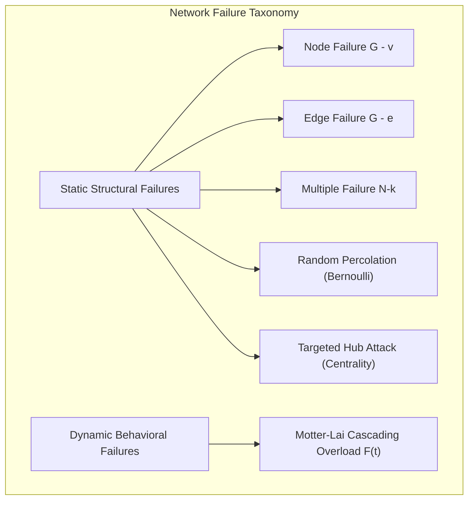
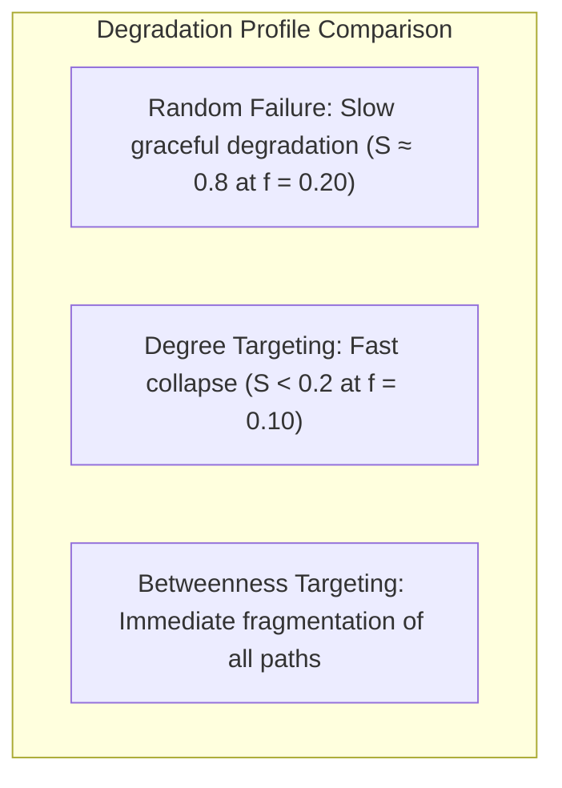

# Phase 1: Mathematical Failure Models & Degradation Dynamics
## Graph-Theoretic Critical Infrastructure Failure & Network Resilience Simulator

---

### 1. Conceptual Framework & Failure Taxonomy

In physical and logical communication networks, failure modes exhibit starkly different mathematical characteristics based on:
1. **Locality**: Whether an outage affects an endpoint vertex, an entire switching backplane, or an isolated transmission cable.
2. **Cardinality**: Whether a disruption is a single contingency ($N-1$), multiple simultaneous events ($N-k$), or progressive percolation.
3. **Intentionality**: Whether failures occur stochastically (random equipment wear-out, power outages) or deterministically (targeted cyber-attacks, physical sabotage on critical infrastructure hubs).
4. **Dynamics**: Whether failures are static (steady-state component removal) or dynamic (cascading overload redistribution).

---

### 2. Failure Model 1: Single Node Failure ($G - v$)

#### 2.1 Mathematical Formulation
Let $G = (V, E)$ be the operational graph. The failure of vertex $v_{\text{fail}} \in V$ induces the subgraph:

$$G' = G - v_{\text{fail}} = G[V \setminus \{v_{\text{fail}}\}]$$

Where:
* Vertex set: $V' = V \setminus \{v_{\text{fail}}\}$, so $|V'| = n - 1$.
* Edge set: $E' = E \setminus \delta(v_{\text{fail}})$, where $\delta(v_{\text{fail}}) = \{\{v_{\text{fail}}, u\} \in E \mid u \in V\}$ is the set of all incident edges.
* Number of severed links: $|\delta(v_{\text{fail}})| = \deg(v_{\text{fail}})$.

#### 2.2 Structural Consequences & Classification
1. **Case A: $v_{\text{fail}}$ is NOT an Articulation Point**:
   $$\kappa(G') = \kappa(G)$$
   The number of connected components is unchanged. All remaining $n - 1$ devices maintain reachability to each other.
2. **Case B: $v_{\text{fail}}$ IS an Articulation Point**:
   $$\kappa(G') = \kappa(G) + c - 1, \quad c \ge 2$$
   where $c$ is the number of DFS branches severed at $v_{\text{fail}}$. The network fragments into $c$ disjoint subnets. Communication between these subnets becomes impossible:
   $$\forall x \in V_i, y \in V_j \ (i \neq j) \implies x \not\mathcal{R}_{G'} y \implies d_{G'}(x, y) = \infty$$

---

### 3. Failure Model 2: Single Edge Failure ($G - e$)

#### 3.1 Mathematical Formulation
The failure of a communication link $e_{\text{fail}} = \{u, v\} \in E$ creates the edge-deleted subgraph:

$$G' = G - e_{\text{fail}} = (V, E \setminus \{e_{\text{fail}}\})$$

Where $|V'| = |V| = n$ and $|E'| = m - 1$.

#### 3.2 Structural Consequences & Classification
1. **Case A: $e_{\text{fail}}$ is NOT a Bridge (Belongs to a Cycle $C_k$)**:
   $$\kappa(G') = \kappa(G)$$
   Network connectivity is preserved. However, the shortest path distance between $u$ and $v$ inflates:
   $$d_{G'}(u, v) \ge 2 > d_G(u, v) = 1$$
   This increases latency and diverts traffic through alternate nodes in cycle $C_k$.
2. **Case B: $e_{\text{fail}}$ IS a Bridge**:
   $$\kappa(G') = \kappa(G) + 1$$
   The network strictly fractures into two separate connected components. No alternate physical path exists between $u$ and $v$.

---

### 4. Failure Model 3: Multiple Simultaneous Failures ($N-k$)

#### 4.1 Mathematical Formulation
Models the concurrent failure of a subset of $k$ vertices $V_{\text{fail}} \subset V$ and $j$ edges $E_{\text{fail}} \subset E$:

$$G' = (V \setminus V_{\text{fail}}, \ E \setminus (E_{\text{fail}} \cup \bigcup_{v \in V_{\text{fail}}} \delta(v)))$$

#### 4.2 Impact Metrics
- **Surviving Fraction of Nodes**:
  $$\rho_V = \frac{|V'|}{|V|} = \frac{n - k}{n}$$
- **Surviving Giant Component Ratio**:
  $$S = \frac{|V_{\text{GCC}}'|}{n}$$
- **Component Partition Vector**:
  $$\mathbf{p} = (|V_1'|, |V_2'|, \dots, |V_{\kappa}'|) \quad \text{such that } \sum_{i=1}^{\kappa} |V_i'| = n - k$$

---

### 5. Failure Model 4: Uniform Random Failure (Percolation)

#### 5.1 Mathematical Formulation & Monte Carlo Sampling
Models stochastic, uncoordinated component failures (e.g., manufacturing defects, power surges, cable wear-out).
- At removal fraction $f \in [0, 1]$, exactly $k = \lfloor f \cdot n \rfloor$ vertices are chosen uniformly at random without replacement from $V$.
- The probability that any specific subset of size $k$ is selected is uniformly:
  $$P(V_{\text{fail}}) = \frac{1}{\binom{n}{k}}$$
- Because individual random trials exhibit stochastic variance, the simulator executes $K = 20$ independent Monte Carlo iterations for each fraction $f$, computing:
  - **Empirical Expected Giant Component**:
    $$\mathbb{E}[S(f)] = \frac{1}{K} \sum_{i=1}^K S_i(f)$$
  - **Sample Variance**:
    $$\text{Var}(S(f)) = \frac{1}{K - 1} \sum_{i=1}^K (S_i(f) - \mathbb{E}[S(f)])^2$$
  - **Seeded Determinism**: When a user inputs an integer `seed`, Python's pseudo-random number generator initializes with `random.seed(seed)`, ensuring identical reproducibility across runs.

---

### 6. Failure Model 5: Targeted Attacks & Targeting Strategies

Targeted attacks model deliberate adversarial disruptions (e.g., directed denial-of-service, core router zero-day exploitation, physical infrastructure sabotage).

#### 6.1 Strict Failure Budget Equivalence
To ensure rigorous, academically defensible comparison, **both random failure and targeted attack simulations operate under an identical failure budget**:
$$\text{At step } i, \text{ exactly } i \text{ nodes are removed under both models } (f = i / n)$$
This guarantees that any observed degradation difference is strictly attributable to topological targeting strategy rather than sample size disparity.

#### 6.2 Comparison of Three Targeting Strategies

| Strategy | Ordering Rule | Mathematical Formulation | Operational Network Analogy |
| :--- | :--- | :--- | :--- |
| **Strategy 1: Degree-Based Targeting** | Descending order of vertex degree $\deg(v)$. | $v_{(1)} = \arg\max \deg(v)$. Remove highest interface density first. | Attacking high-density backbone aggregation switches. |
| **Strategy 2: Articulation-Point Targeting** | Priority to cut-vertices, ordered by isolated partition size. | Select $v \in V_{\text{AP}}$ maximizing $|V_{\text{isolated}}(v)|$. | Attacking boundary firewalls and single-homed gateway routers. |
| **Strategy 3: Betweenness-Centrality Targeting** | Descending order of betweenness centrality $C_B(v)$. | $v_{(1)} = \arg\max \sum_{s \neq v \neq t} \frac{\sigma_{st}(v)}{\sigma_{st}}$. | Attacking the primary transit transit hubs carrying the highest volume of shortest communication paths. |

---

### 7. Failure Model 6: Capacity-Constrained Cascading Failures

Cascading failures represent dynamic propagation where the initial failure of a single device diverts communication traffic onto surviving paths, overwhelming adjacent nodes and inducing secondary overload failures.

#### 7.1 Mathematical Specification (Motter-Lai Model)
1. **Initial Load Assignment**:
   In an infrastructure network where every pair of nodes exchanges information via shortest paths, the initial traffic load $L_i(0)$ on node $i$ is proportional to its Betweenness Centrality:
   $$L_i(0) = C_B(i; G(0))$$
2. **Operating Capacity**:
   Routers and switches are provisioned to handle their baseline load plus an engineering safety margin $\alpha > 0$ (tolerance parameter):
   $$C_i = (1 + \alpha) L_i(0)$$
   *Typical values*: $\alpha = 0.2$ (20% headroom) to $\alpha = 0.5$ (50% headroom).
3. **Trigger Event ($t = 0$)**:
   An initial node $v_{\text{initial}}$ fails:
   $$F(0) = \{v_{\text{initial}}\}, \quad G(0) = G[V \setminus F(0)]$$
4. **Dynamic Flow Redistribution ($t \ge 1$)**:
   With $F(t)$ failed, shortest paths between all surviving node pairs are recomputed on $G(t) = G[V \setminus F(t)]$. The updated traffic load on surviving node $j$ is:
   $$L_j(t) = C_B(j; G(t))$$
5. **Overload Condition & Secondary Failure**:
   Any node whose new load exceeds its rated capacity experiences queue exhaustion, bufferbloat, and crash:
   $$\Delta F(t) = \{j \in V \setminus F(t) \mid L_j(t) > C_j\}$$
   $$F(t+1) = F(t) \cup \Delta F(t)$$
6. **Termination**:
   The cascade process terminates when:
   $$\Delta F(t^*) = \emptyset \quad (\text{Steady-State Equilibrium})$$
   or
   $$F(t^*) = V \quad (\text{Total Systemic Collapse})$$

#### 7.2 Phase Transition Behavior
When the tolerance parameter $\alpha$ is plotted against the final surviving giant component size $S_{\text{final}}$, the system exhibits a sharp **first-order phase transition**:
- For $\alpha < \alpha_c$: The initial failure triggers a catastrophic cascade that destroys the entire network ($S_{\text{final}} \approx 0$).
- For $\alpha > \alpha_c$: The network possesses sufficient redundant capacity to absorb rerouted traffic without secondary failures ($S_{\text{final}} \approx 1 - 1/n$).

