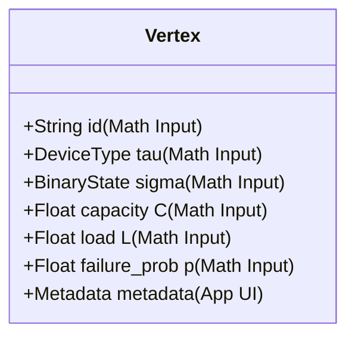
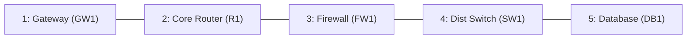

# Phase 1: Graph-Theoretic Infrastructure Model
## Graph-Theoretic Critical Infrastructure Failure & Network Resilience Simulator

---

### 1. Mathematical Graph Definition

A computer and communication network infrastructure is formally defined as a vertex-attributed, edge-attributed graph:

$$G = (V, E, \alpha, \beta)$$

Where:
* $V$ is a finite, non-empty set of vertices (nodes) representing networking equipment and compute endpoints:
  $$V = \{v_1, v_2, \dots, v_n\}, \quad n = |V| \ge 1$$
* $E$ is a finite set of edges representing communication links connecting pairs of vertices:
  $$E \subseteq \{\{u, v\} \mid u, v \in V, \ u \neq v\}, \quad m = |E| \ge 0$$
* $\alpha: V \to \mathcal{A}_V$ is a vertex attribution function mapping each vertex to its operational and architectural parameters.
* $\beta: E \to \mathcal{A}_E$ is an edge attribution function mapping each link to its physical transmission characteristics.

```mermaid
graph LR
    subgraph Legend ["Graph Terminology"]
        N1((Vertex u)) ---|Edge e = {u, v}| N2((Vertex v))
    end
```

#### 1.1 Structural Graph Classifications

To ensure unambiguous mathematical reasoning, the following standard graph-theoretic classifications apply:

1. **Undirected Graph**:
   An edge $e = \{u, v\} \in E$ is an unordered pair. If communication can flow from $u$ to $v$, it can symmetrically flow from $v$ to $u$:
   $$\{u, v\} = \{v, u\}$$
   *Justification for Initial Scope*: Physical Layer-1 copper cables, fiber transceivers, and Layer-2 Ethernet switches are full-duplex and bidirectional. If a physical cable is severed or a switch port fails, bidirectional packet exchange halts. Modeling links as undirected edges correctly mirrors physical infrastructure reality.

2. **Directed Graph (Digraph)**:
   An edge is an ordered pair $e = (u, v) \in E$, where $u$ is the tail and $v$ is the head ($u \to v$).
   *Future Extension Note*: While routing protocols (such as asymmetric BGP routing) and application service dependencies (client $\to$ server $\to$ database) exhibit directionality, mixing directed dependencies with undirected physical cable cuts in the initial engine introduces mathematical inconsistencies. Directed graphs are therefore designated as a Phase 4 service-layer extension.

3. **Weighted Graph**:
   A graph equipped with an edge weighting function $w: E \to \mathbb{R}^+$. For any edge $e = \{u, v\}$, $w(e)$ represents a cost metric such as link propagation latency (in milliseconds), administrative cost (OSPF metric), or inverse bandwidth ($1 / B$).
   *Impact*: Path length is defined as the sum of edge weights $\sum_{e \in P} w(e)$ rather than simple hop count.

4. **Simple Graph**:
   A graph having no **self-loops** ($\forall u \in V, \{u, u\} \notin E$) and no **multi-edges** (between any pair $u, v \in V$, there exists at most one edge $e = \{u, v\}$).
   *Enforcement*: Network infrastructure is modeled as a simple graph. Where link aggregation (LACP / EtherChannel) bundles physical cables between two switches, they are aggregated mathematically into a single edge with combined bandwidth $B_{\text{total}} = \sum B_i$.

5. **Connected Graph**:
   A graph $G$ is connected if, for every pair of distinct vertices $u, v \in V$, there exists at least one walk $W = (u = x_0, e_1, x_1, \dots, e_k, x_k = v)$ where all $e_i \in E$.
   If a network is not connected, it is partitioned into $\kappa(G) > 1$ maximal connected subgraphs, termed **connected components**.

---

### 2. Vertex Modeling (Network Entities)

The network model supports six distinct physical and logical device archetypes:

$$\mathcal{T} = \{\text{ROUTER}, \text{SWITCH}, \text{SERVER}, \text{DATABASE\_SERVER}, \text{FIREWALL}, \text{GATEWAY}\}$$

Each vertex $v \in V$ is formalized as a mathematical tuple:

$$v = \langle \text{id}, \tau_v, \sigma_v, C_v, L_v, p_v, \mathcal{M}_v \rangle$$



#### 2.1 Formal Vertex Attributes

| Attribute | Mathematical Symbol | Domain / Type | Nature | Theoretical Function & Significance |
| :--- | :--- | :--- | :--- | :--- |
| **Node ID** | $v$ or $\text{id}(v)$ | $\Sigma^*$ (Unique String) | Mathematical Input | Uniquely identifies vertex $v \in V$ in adjacency structures. |
| **Device Archetype** | $\tau(v)$ | $\mathcal{T}$ | Mathematical Input | Determines device role, default capacity, and service criticality. |
| **Operational Status** | $\sigma(v)$ | $\{0, 1\}$ | Mathematical Input | State variable: $\sigma(v) = 1$ (Active / Up), $\sigma(v) = 0$ (Failed / Down). |
| **Processing Capacity** | $C(v)$ | $\mathbb{R}^+ \cup \{\infty\}$ | Mathematical Input | Maximum packet/traffic volume node $v$ can route per second before overloading. |
| **Current Load** | $L(v)$ | $\mathbb{R}^+ \cup \{0\}$ | Mathematical Input | Dynamic traffic load routed through $v$, calculated via betweenness centrality. |
| **Failure Probability** | $p(v)$ | $[0, 1] \subset \mathbb{R}$ | Mathematical Input | Prior probability of stochastic failure used in Monte Carlo percolation trials. |
| **Importance Weight** | $I(v)$ | $\mathbb{R}^+$ | Mathematical Input | Relative service weight (e.g., $I(\text{DATABASE}) = 5.0$, $I(\text{SWITCH}) = 1.0$). |
| **Application Metadata** | $\mathcal{M}(v)$ | JSON Object | Application Metadata | Hostname, IP subnet, vendor model, canvas coordinates $(x, y)$. |

#### 2.2 Mathematical Inputs vs. Application Metadata

To ensure strict engineering separation of concerns:
- **Mathematical Inputs ($\text{id}, \tau, \sigma, C, L, p, I$)** directly participate in discrete mathematical algorithms:
  - If $\sigma(v) = 0$, vertex $v$ and all incident edges $\delta(v)$ are excluded from the active induced subgraph $G[V_{\text{active}}]$.
  - If $L(v) > C(v)$, the node triggers a cascading failure event in the Motter-Lai simulation.
- **Application Metadata ($\mathcal{M}$)** does *not* alter graph connectivity, cut-vertex status, or spectral eigenvalues. Metadata is used exclusively for UI rendering, search filtering, and audit reporting.

---

### 3. Edge Modeling (Communication Links)

Every communication link $e \in E$ connecting vertices $u$ and $v$ is formalized as an attributed undirected pair:

$$e = \{u, v\}, \quad \beta(e) = \langle \sigma_e, w_e, B_e, \mathcal{R}_e \rangle$$

| Attribute | Mathematical Symbol | Domain / Type | Operational Meaning |
| :--- | :--- | :--- | :--- |
| **Endpoints** | $\{u, v\}$ | $u, v \in V, u \neq v$ | Topological interconnection between devices $u$ and $v$. |
| **Operational Status** | $\sigma(e)$ | $\{0, 1\}$ | Link status: $\sigma(e) = 1$ (Up / Transmitting), $\sigma(e) = 0$ (Cut / Severed). |
| **Link Weight (Latency)** | $w(e)$ | $\mathbb{R}^+$ | Physical transmission delay (ms). Governs shortest path metrics via Dijkstra. |
| **Bandwidth Capacity** | $B(e)$ | $\mathbb{R}^+$ | Maximum throughput (Gbps). Limits flow volume in traffic modeling. |
| **Reliability Metric** | $\mathcal{R}(e)$ | $[0, 1] \subset \mathbb{R}$ | Probability that the physical transmission link operates without bit errors. |

#### 3.1 Impact of Weighted vs. Unweighted Edges on Algorithms

$$\begin{array}{|l|l|l|}
\hline
\textbf{Algorithmic Dimension} & \textbf{Unweighted Graph Formulation } (w_e = 1) & \textbf{Weighted Graph Formulation } (w_e \in \mathbb{R}^+) \\ \hline
\text{Distance Metric } d(u, v) & \text{Minimum hop count between } u \text{ and } v. & \text{Minimum sum of latencies } \sum w_i. \\ \hline
\text{Shortest Path Algorithm} & \text{Breadth-First Search (BFS): } O(V + E). & \text{Dijkstra with Min-Heap: } O(E + V \log V). \\ \hline
\text{Tarjan Cut-Vertex / Bridge} & \textbf{Identical: } Topology-dependent only. & \textbf{Identical: } Weights do not alter bridges. \\ \hline
\text{Connected Components} & \textbf{Identical: } Reachability is binary. & \textbf{Identical: } Weights do not alter reachability. \\ \hline
\text{Betweenness Centrality} & \text{Shortest paths measured by hop count.} & \text{Shortest paths measured by latency.} \\ \hline
\text{Network Efficiency } E_{\text{glob}} & \frac{1}{n(n-1)} \sum \frac{1}{\text{hop}(u,v)} & \frac{1}{n(n-1)} \sum \frac{1}{\text{latency}(u,v)} \\ \hline
\end{array}$$

*Key Insight*: Structural vulnerability indicators—specifically **connected components**, **articulation points**, and **bridges**—are purely topological invariants. They are completely independent of edge weights. Edge weights govern path latency and betweenness traffic distribution.

---

### 4. Graph Representation & Data Structures

To demonstrate both mathematical representations, consider the following canonical 5-node enterprise edge topology $G_{\text{sample}} = (V_{\text{sample}}, E_{\text{sample}})$:



Where:
* $V_{\text{sample}} = \{v_1: \text{GW1}, \ v_2: \text{R1}, \ v_3: \text{FW1}, \ v_4: \text{SW1}, \ v_5: \text{DB1}\}$, so $n = 5$.
* $E_{\text{sample}} = \{\{v_1, v_2\}, \{v_2, v_3\}, \{v_3, v_4\}, \{v_4, v_5\}\}$, so $m = 4$.

#### 4.1 Representation A: Adjacency Matrix

The Adjacency Matrix $A \in \{0, 1\}^{n \times n}$ of an undirected simple graph is a symmetric binary square matrix defined as:

$$A[i, j] = \begin{cases} 1 & \text{if } \{v_i, v_j\} \in E \\ 0 & \text{otherwise} \end{cases}$$

For $G_{\text{sample}}$:

$$A(G_{\text{sample}}) = \begin{pmatrix}
0 & 1 & 0 & 0 & 0 \\
1 & 0 & 1 & 0 & 0 \\
0 & 1 & 0 & 1 & 0 \\
0 & 0 & 1 & 0 & 1 \\
0 & 0 & 0 & 1 & 0
\end{pmatrix}$$

*Mathematical Properties of $A$*:
1. **Symmetry**: $A = A^T$ because edges are undirected.
2. **Main Diagonal**: $\text{diag}(A) = \mathbf{0}$ because the graph is simple (no self-loops).
3. **Degree Sum**: The degree of vertex $v_i$ is the row (or column) sum:
   $$\deg(v_i) = \sum_{j=1}^n A[i, j]$$
   For R1 (row 2): $\deg(v_2) = 1 + 0 + 1 + 0 + 0 = 2$.
4. **Walk Counting Theorem**: The $(i, j)$-th entry of the matrix power $A^k$ equals the exact number of distinct walks of length $k$ between $v_i$ and $v_j$:
   $$(A^k)[i, j] = \text{number of walks of length } k$$

#### 4.2 Representation B: Adjacency List

The Adjacency List representation maintains an array or hash map of size $n$, where each index $i$ references a linked list or dynamic array of all vertices adjacent to $v_i$:

$$\text{Adj}[u] = \{v \in V \mid \{u, v\} \in E\}$$

For $G_{\text{sample}}$:
* $\text{Adj}[\text{GW1}] = [\text{R1}]$
* $\text{Adj}[\text{R1}] = [\text{GW1}, \text{FW1}]$
* $\text{Adj}[\text{FW1}] = [\text{R1}, \text{SW1}]$
* $\text{Adj}[\text{SW1}] = [\text{FW1}, \text{DB1}]$
* $\text{Adj}[\text{DB1}] = [\text{SW1}]$

Total stored adjacency entries: $\sum_{v \in V} \deg(v) = 2m = 2(4) = 8$ pointers.

---

### 5. Rigorous Comparative Analysis of Representations

| Evaluation Criterion | Adjacency Matrix ($A$) | Adjacency List ($\text{Adj}$) | Mathematical & Architectural Impact |
| :--- | :--- | :--- | :--- |
| **Space Complexity** | $\Theta(V^2)$ bits | $\Theta(V + E)$ words | On a sparse network ($V=500, E=1000$), $A$ allocates $250,000$ cells; $\text{Adj}$ allocates only $2,500$ references. |
| **Edge Existence Lookup $\{u, v\} \in E$** | $\Theta(1)$ | $O(\deg(u))$ | Matrix achieves instant lookup $A[u, v] == 1$. Adjacency list requires linear search over neighbor list. |
| **Iterate All Neighbors of $u$** | $\Theta(V)$ | $\Theta(\deg(u))$ | **Critical for DFS/BFS:** To visit neighbors of a leaf node ($\deg=1$), Matrix checks all $V$ cells; List inspects exactly 1 element. |
| **Insert New Edge $\{u, v\}$** | $\Theta(1)$ | $\Theta(1)$ (prepend) | Both allow constant-time edge insertion. |
| **Delete Existing Edge $\{u, v\}$** | $\Theta(1)$ | $O(\deg(u))$ | Matrix sets $A[u, v] \leftarrow 0$ in $\Theta(1)$; List must locate and remove pointer. |
| **Add New Vertex $v$** | $\Theta(V^2)$ (resize matrix) | $\Theta(1)$ (append key) | Adjacency lists easily accommodate dynamic growth without reallocating an entire matrix. |
| **Suitability for Infrastructure Networks** | Poor for traversal; Excellent for spectral algebra ($L = D - A$). | **Optimal for core simulation & graph traversal algorithms.** | Real enterprise networks are **sparse graphs** where $m \ll n^2$ (typically $m \approx 1.5n$ to $3n$). |

---

### 6. Architectural Decision for the Simulator

The platform implements a **dual hybrid representation**:
1. **Primary Operational Engine (Adjacency List via NetworkX Graph)**:
   All graph traversals (BFS, DFS), shortest-path evaluations (Dijkstra), connected component extractions, and Tarjan cut-vertex/bridge calculations utilize the **Adjacency List** data structure. This guarantees optimal $O(V + E)$ linear time complexity.
2. **Auxiliary Spectral Engine (NumPy Adjacency Matrix)**:
   For computing the Graph Laplacian matrix $L = D - A$ and extracting algebraic connectivity (the Fiedler eigenvalue $\lambda_2$), the backend projects the graph into an in-memory NumPy dense float matrix only during spectral calculations.

