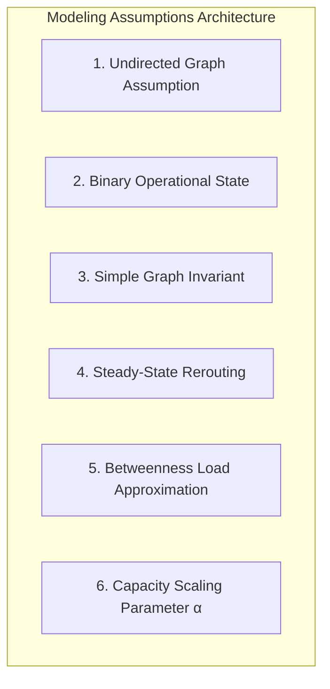

# Phase 1: Mathematical Assumptions, Boundary Conditions & Theoretical Justifications
## Graph-Theoretic Critical Infrastructure Failure & Network Resilience Simulator

---

### 1. Purpose & Methodological Framework

In discrete mathematical modeling, establishing clear assumptions and boundary conditions is essential to balance mathematical tractability with engineering fidelity. This document formally records every simplification, boundary condition, and modeling abstraction adopted in the **Graph-Theoretic Critical Infrastructure Failure & Network Resilience Simulator**, detailing its theoretical justification, limits of validity, and operational impact.

---

### 2. Inventory of Mathematical Assumptions

#### Assumption 1: Undirected Graph Formulation for Physical Infrastructure
* **Formal Assumption**: Every communication link is modeled as an unordered pair $e = \{u, v\} \in E$, implying symmetric bidirectional transmission capability:
  $$\{u, v\} = \{v, u\}$$
* **Physical Justification**: Physical Layer-1 transmission lines (twisted-pair copper, dual-strand fiber transceivers) and Layer-2 Ethernet switch ports operate in full-duplex mode. If a physical cable is severed or an optical transceiver burns out, bidirectional carrier detect drops instantly, terminating communication in both directions.
* **Limits of Validity**: Does not model asymmetric Layer-3 routing policies (e.g., BGP hot-potato routing) or unidirectional firewall state tables.
* **Resolution**: Symmetric physical connectivity is modeled in the core engine; directional service dependencies are preserved as a Phase 4 architectural extension.

---

#### Assumption 2: Binary Discrete Operational State ($\sigma \in \{0, 1\}$)
* **Formal Assumption**: Every vertex $v \in V$ and edge $e \in E$ exists in one of two discrete states:
  $$\sigma \in \{0, 1\}$$
  Where $\sigma = 1$ denotes fully operational (Up), and $\sigma = 0$ denotes completely failed / removed (Down).
* **Physical Justification**: Focuses analytical power on topological connectivity, graph partitioning, articulation points, and systemic percolation thresholds.
* **Limits of Validity**: Real networks experience continuous degradation (packet loss, queueing delay, jitter, link flaps).
* **Resolution**: Continuous physical transmission phenomena are abstracted to evaluate purely structural breaking points.

---

#### Assumption 3: Simple Graph Invariant (No Self-Loops, No Multi-Edges)
* **Formal Assumption**:
  1. Irreflexivity: $\forall u \in V, \ \{u, u\} \notin E$.
  2. Simplicity: Between any two vertices $u, v \in V$, there exists at most one edge $\{u, v\} \in E$.
* **Physical Justification**: Self-loops in networking represent loopback interfaces (`127.0.0.1`), which do not participate in inter-device connectivity. Where multiple physical cables run in parallel between two switches (e.g., LACP port bonding or EtherChannel), they operate logically as a single aggregated link with multiplied capacity $B_{\text{total}} = \sum B_i$.
* **Impact on Algorithms**: Prevents infinite recursion loops in Tarjan's DFS and simplifies adjacency matrices to binary symmetric matrices with zero diagonal entries.

---

#### Assumption 4: Instantaneous Steady-State Rerouting
* **Formal Assumption**: When a node or link fails, shortest paths and connected components recalculate instantaneously with zero transient delay.
* **Physical Justification**: Evaluates the post-convergence equilibrium topology of the network.
* **Limits of Validity**: Real routing protocols require finite convergence intervals (OSPF Link-State Advertisements take 2–5 seconds; BGP path convergence can require 30–90 seconds), during which micro-loops and blackholes occur.
* **Resolution**: The simulator explicitly focuses on steady-state structural resilience rather than transient protocol race conditions.

---

#### Assumption 5: Betweenness Centrality as an Approximation of Traffic Load
* **Formal Assumption**: In the Motter-Lai cascading failure model, the background traffic load $L_i$ traversing node $i$ is proportional to its Betweenness Centrality:
  $$L_i \propto C_B(i) = \sum_{s \neq i \neq t} \frac{\sigma_{st}(i)}{\sigma_{st}}$$
* **Physical Justification**: Under an all-to-all communication model (where every pair of network devices exchanges packets at approximately uniform rates), traffic naturally flows along shortest paths. Betweenness centrality measures the exact fraction of all network shortest paths that traverse node $i$, making it the optimal graph-theoretic estimator of transit demand.
* **Limits of Validity**: Real traffic matrices are non-uniform (e.g., high traffic toward database clusters, low traffic between isolated client PCs).
* **Resolution**: Node capacity is scaled relative to baseline betweenness via $C_i = (1 + \alpha) C_B(i; G_0)$, guaranteeing that initially well-dimensioned backbones carry higher rated capacity.

---

#### Assumption 6: Linear Capacity Scaling Parameter ($\alpha$)
* **Formal Assumption**: Operating capacity is provisioned linearly relative to initial load with a uniform safety headroom parameter $\alpha > 0$:
  $$C_i = (1 + \alpha) L_i(0)$$
* **Physical Justification**: Industry standards (e.g., Cisco, Juniper data center design guides) recommend provisioning core routers to operate at 40%–70% utilization during normal operations, leaving 30%–60% spare capacity ($\alpha \in [0.3, 0.6]$) to absorb failover rerouting without saturation.

---

#### Assumption 7: Graph Scaling Boundaries ($5 \le |V| \le 500$)
* **Formal Assumption**: The primary operational scale for real-time interactive simulation is networks containing between 5 and 500 nodes and up to 2,500 edges.
* **Physical Justification**:
  1. Represents realistic enterprise campus LANs, regional WANs, and data center Clos clusters.
  2. Guarantees sub-50 ms execution for Tarjan's algorithm, BFS/DFS, and Dijkstra.
  3. Ensures smooth 60 FPS HTML5 canvas rendering in Cytoscape.js without browser memory exhaustion.
* **Limits of Validity**: Global Internet Autonomous System graphs ($N \approx 70,000$) or massive IoT sensor meshes require distributed graph processing engines (e.g., Apache Spark GraphX), which exceed the scope of an interactive web application.

---

### 3. Summary of Assumptions & Academic Defensibility

| Modeling Dimension | Adopted Model | Rejected Complex Alternative | Academic Justification |
| :--- | :--- | :--- | :--- |
| **Edge Direction** | Undirected simple graph | Directed multi-graph | Full-duplex physical links; eliminates mathematical contradictions in cut-vertex theorems. |
| **Failure State** | Binary ($0$ or $1$) | Continuous Poisson degradation | Clean topological partitioning; direct alignment with Discrete Mathematics syllabus. |
| **Traffic Dynamics** | Betweenness Centrality | Packet-level M/M/1 queuing | Avoids simulator bloat; preserves linear-algebraic and combinatorial transparency. |
| **Rerouting** | Instantaneous shortest path | OSPF/BGP convergence timers | Evaluates post-failure steady-state graph equilibrium. |
| **Network Scale** | $5 \le N \le 500$ | $N > 10,000$ | Ensures millisecond responsiveness on standard student development hardware. |

