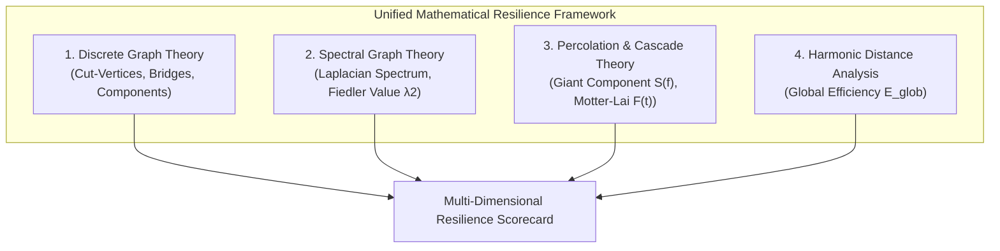
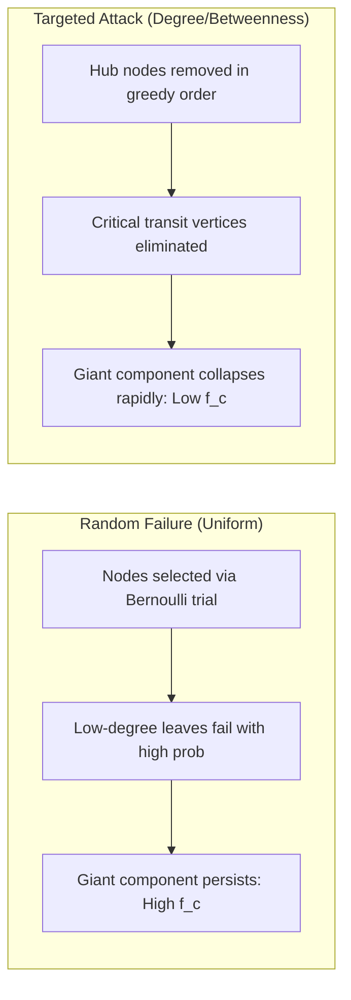

# Phase 1: Comprehensive Mathematical Foundations
## Graph-Theoretic Critical Infrastructure Failure & Network Resilience Simulator

---

### 1. Mathematical Architecture Overview

The mathematical architecture of the simulator unifies four rigorous mathematical domains into a coherent analytical platform:
1. **Discrete Graph Invariants & Cut-Set Theory**: Characterizing structural bottlenecks, articulation points, and bridges.
2. **Spectral Graph Theory & Linear Algebra**: Evaluating algebraic connectivity and partitioning bounds via the Graph Laplacian spectrum.
3. **Complex Network Percolation Theory**: Modeling structural disintegration under stochastic and targeted node removals.
4. **Harmonic Path Analysis**: Formulating singularity-free network efficiency metrics across disconnected topologies.

---

### 2. Spectral Graph Theory & Laplacian Matrices

Spectral graph theory relates the structural properties of a graph $G = (V, E)$ to the eigenvalues and eigenvectors of matrices associated with $G$.

#### 2.1 The Combinatorial Graph Laplacian
Let $G = (V, E)$ be an undirected simple graph with $n = |V|$ vertices and $m = |E|$ edges.
- Let $A \in \{0, 1\}^{n \times n}$ be the binary symmetric **Adjacency Matrix**:
  $$A[u, v] = \begin{cases} 1 & \text{if } \{u, v\} \in E \\ 0 & \text{otherwise} \end{cases}$$
- Let $D \in \mathbb{N}_0^{n \times n}$ be the diagonal **Degree Matrix**:
  $$D[u, u] = \deg(u) = \sum_{v \in V} A[u, v], \quad D[u, v] = 0 \text{ for } u \neq v$$

The **Combinatorial Graph Laplacian Matrix** $L \in \mathbb{R}^{n \times n}$ is defined as:

$$L = D - A$$

Explicitly, its entries are:

$$L[u, v] = \begin{cases} \deg(u) & \text{if } u = v \\ -1 & \text{if } u \neq v \text{ and } \{u, v\} \in E \\ 0 & \text{otherwise} \end{cases}$$

#### 2.2 Quadratic Form and Positive Semi-Definiteness
For any real vector $\mathbf{x} = (x_1, x_2, \dots, x_n)^T \in \mathbb{R}^n$, the quadratic form associated with $L$ is:

$$\mathbf{x}^T L \mathbf{x} = \sum_{u \in V} \deg(u) x_u^2 - 2 \sum_{\{u, v\} \in E} x_u x_v = \sum_{\{u, v\} \in E} (x_u - x_v)^2$$

**Theorem 1 (Positive Semi-Definiteness)**:
*The Graph Laplacian $L$ is a symmetric, positive semi-definite matrix ($L \succeq 0$).*
*Proof*:
Because $\mathbf{x}^T L \mathbf{x} = \sum_{\{u, v\} \in E} (x_u - x_v)^2 \ge 0$ for all $\mathbf{x} \in \mathbb{R}^n$, all eigenvalues of $L$ are non-negative real numbers. Furthermore, taking $\mathbf{1} = (1, 1, \dots, 1)^T$, every row sum of $L$ is $\deg(u) - \deg(u) = 0$, so:
$$L \mathbf{1} = \mathbf{0}$$
Thus, $\lambda_1 = 0$ is always an eigenvalue corresponding to the constant eigenvector $\mathbf{1}$. $\blacksquare$

#### 2.3 Spectrum and Algebraic Connectivity ($\lambda_2$)
Let the eigenvalues of $L$ be ordered in ascending order:

$$0 = \lambda_1 \le \lambda_2 \le \lambda_3 \le \dots \le \lambda_n$$

**Theorem 2 (Multiplicity of Zero Eigenvalue)**:
*The multiplicity of the eigenvalue $0$ of $L$ equals the number of connected components $\kappa(G)$ in $G$.*
*Consequence*: $G$ is connected if and only if $\lambda_2 > 0$.

**Definition (Algebraic Connectivity / Fiedler Value)**:
The second smallest eigenvalue $\lambda_2(L)$ is known as the **Algebraic Connectivity** of graph $G$ (Fiedler, 1973). It satisfies the Courant-Fischer variational characterization:

$$\lambda_2 = \min_{\mathbf{x} \perp \mathbf{1}, \mathbf{x} \neq \mathbf{0}} \frac{\mathbf{x}^T L \mathbf{x}}{\mathbf{x}^T \mathbf{x}} = \min_{\sum x_i = 0, \sum x_i^2 = 1} \sum_{\{u, v\} \in E} (x_u - x_v)^2$$

*Physical & Resilience Interpretation*:
- $\lambda_2$ quantifies the "effort" required to cut the graph into disconnected pieces.
- High $\lambda_2$ implies a densely meshed, highly synchronized topology with no structural bottlenecks.
- Low $\lambda_2$ (close to 0) signals the presence of severe bottlenecks (such as a long bridge or articulation point) that make the network easily partitionable.
- Under component failures, as the network degrades toward disconnection, $\lambda_2 \to 0$.

#### 2.4 Cheeger’s Inequality and Conductance Bounds
The Fiedler value $\lambda_2$ is fundamentally bounded by the graph's **conductance** (or Cheeger constant) $h(G)$, which measures the worst-case bottleneck in the network:

$$h(G) = \min_{\emptyset \subset S \subset V, \ 0 < |S| \le \frac{n}{2}} \frac{|\partial S|}{|S|}$$

where $\partial S = \{\{u, v\} \in E \mid u \in S, v \notin S\}$ is the cut-set separating $S$ from $V \setminus S$.  
**Cheeger's Inequality** establishes:

$$\frac{\lambda_2}{2} \le h(G) \le \sqrt{2 \lambda_2 \max_{v} \deg(v)}$$

This proves mathematically that a low $\lambda_2$ guarantees the existence of a sparse cut $\partial S$ (a physical bottleneck), directly validating $\lambda_2$ as a structural vulnerability metric.

---

### 3. Complex Network Percolation Theory

Percolation theory analyzes the behavior of connected clusters when vertices or edges are progressively removed.

#### 3.1 Relative Giant Connected Component Size $S(f)$
Let $G_0 = (V_0, E_0)$ be the initial connected network with $n = |V_0|$ nodes.  
Let $f \in [0, 1]$ denote the fraction of removed nodes ($k = \lfloor f \cdot n \rfloor$ nodes removed).  
Let $G(f)$ denote the residual graph, and let $V_{\text{GCC}}(f) \subseteq V(f)$ be the vertex set of the largest connected component (**Giant Connected Component**).

The relative size of the Giant Component is:

$$S(f) = \frac{|V_{\text{GCC}}(f)|}{|V_0|}$$

- At $f = 0$, $S(0) = 1.0$ (fully connected baseline).
- As $f \to 1.0$, $S(f) \to 0$.
- The **Percolation Threshold $f_c$** is the critical fraction at which the giant component disintegrates into small sub-clusters:
  $$f_c = \sup \{f \in [0, 1] \mid S(f) > 0 \text{ in thermodynamic limit } n \to \infty\}$$
  In our finite-size academic simulator, we define the empirical threshold as:
  $$f_c = \min \{f \in [0, 1] \mid S(f) < 0.10\}$$

#### 3.2 Random Failure vs. Targeted Attack (The Albert-Jeong-Barabási Phenomenon)

The mathematical divergence between random hardware failures and deliberate targeted attacks is governed by the degree distribution $P(k)$:

1. **Random Node Breakdown (Molloy-Reed Criterion)**:
   A giant component exists under random node removal if and only if:
   $$\kappa = \frac{\langle k^2 \rangle}{\langle k \rangle} > 2$$
   where $\langle k \rangle = \frac{1}{n} \sum \deg(v)$ and $\langle k^2 \rangle = \frac{1}{n} \sum \deg(v)^2$.
   The critical threshold under random failure is:
   $$f_c^{\text{rand}} = 1 - \frac{1}{\frac{\langle k^2 \rangle}{\langle k \rangle} - 1}$$
   In scale-free networks with degree distribution $P(k) \sim k^{-\gamma}$ ($2 < \gamma \le 3$), the second moment $\langle k^2 \rangle \to \infty$ as $n \to \infty$, which yields $f_c^{\text{rand}} \to 1.0$. **Scale-free topologies are virtually impervious to random failure.**

2. **Targeted Attack on Hubs**:
   When nodes are sequentially removed in descending order of degree $\deg(v)$ or betweenness $C_B(v)$, the high-degree hubs that bind the network together are immediately severed. As proven by Albert, Jeong, and Barabási (2000), $f_c^{\text{target}}$ drops drastically to very low values ($f_c^{\text{target}} \approx 0.05$ to $0.15$), precipitating catastrophic network collapse.

---

### 4. Global Network Efficiency & Harmonic Paths

In classical network analysis, the characteristic path length is defined as:

$$\bar{l} = \frac{1}{n(n-1)} \sum_{u \neq v \in V} d(u, v)$$

Where $d(u, v)$ is the shortest path distance. However, when an articulation point or bridge fails, the network fractures into multiple components. For any two nodes in separate components, $d(u, v) = \infty$, causing $\bar{l} \to \infty$. This creates an unusable mathematical singularity.

To resolve this, the platform adopts the **Latora-Marchiori Global Network Efficiency** metric:

$$E_{\text{glob}}(G) = \frac{1}{n(n-1)} \sum_{u \neq v \in V} \frac{1}{d(u, v)}$$

#### Mathematical Properties of $E_{\text{glob}}$:
1. **Harmonic Distance Regularization**:
   If node $u$ and node $v$ are disconnected ($u \not\mathcal{R} v$), then $d(u, v) = \infty \implies \frac{1}{d(u, v)} = 0$. Disconnected pairs smoothly contribute zero to the sum rather than inducing an arithmetic overflow.
2. **Strict Normalization**:
   For any graph $G$ with $n \ge 2$ nodes:
   $$0 \le E_{\text{glob}}(G) \le 1$$
   - $E_{\text{glob}} = 1.0$ if and only if $G$ is the Complete Graph $K_n$ (every pair has $d(u, v) = 1$).
   - $E_{\text{glob}} = 0.0$ if and only if $G$ is the Empty Graph $\overline{K_n}$ ($E = \emptyset$, all nodes isolated).
3. **Monotonic Degradation**:
   For any edge removal $e \in E$, distances cannot decrease ($d_{G - e}(u, v) \ge d_G(u, v)$), guaranteeing:
   $$E_{\text{glob}}(G - e) \le E_{\text{glob}}(G)$$

---

### 5. Cut-Set Invariants & Menger's Connectivity Theorems

#### 5.1 Cut-Vertices (Articulation Points)
A vertex $v \in V$ is an **articulation point** if the number of connected components increases upon its removal:

$$\kappa(G - v) > \kappa(G)$$

Where $G - v = G[V \setminus \{v\}]$ is the induced subgraph on $V \setminus \{v\}$.

#### 5.2 Bridges (Cut-Edges)
An edge $e = \{u, v\} \in E$ is a **bridge** if its removal increases the component count:

$$\kappa(G - e) > \kappa(G)$$

Where $G - e = (V, E \setminus \{e\})$.

#### 5.3 Menger’s Theorem (Path Redundancy Foundation)
The mathematical foundation for network redundancy is established by Karl Menger (1927):

**Theorem 3 (Menger's Theorem - Vertex Form)**:
*Let $u$ and $v$ be non-adjacent vertices in graph $G$. The minimum number of vertices whose removal disconnects $u$ and $v$ equals the maximum number of pairwise internally vertex-disjoint paths connecting $u$ and $v$.*

**Theorem 4 (Menger's Theorem - Edge Form)**:
*Let $u$ and $v$ be distinct vertices in $G$. The minimum number of edges whose removal disconnects $u$ and $v$ equals the maximum number of pairwise edge-disjoint paths connecting $u$ and $v$.*

*Network Engineering Application*:
- A network has **zero articulation points** if and only if it is **2-vertex-connected** ($\kappa(G) \ge 2$). By Menger's Theorem, between any two devices $u$ and $v$, there exist at least two completely independent paths that share no intermediate routers.
- A network has **zero bridges** if and only if it is **2-edge-connected** ($\lambda(G) \ge 2$). Between any two devices, there exist at least two cable routes that share no common physical links.
- Our **Redundancy Recommendation Engine** directly applies these theorems to compute the minimum set of edges required to promote a 1-connected network into a 2-connected topology.

