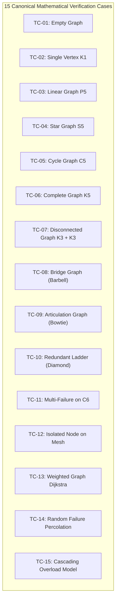

# Phase 1: Mathematical Validation Test Suite
## Graph-Theoretic Critical Infrastructure Failure & Network Resilience Simulator

---

### 1. Verification Strategy & Academic Ground Truth

To guarantee absolute mathematical correctness, the algorithmic engine must be validated against a comprehensive benchmark suite of fifteen canonical graph topologies with mathematically proven analytical ground truths. 

No empirical approximations or floating tolerances are accepted for topological invariants ($\kappa(G)$, Articulation Points, Bridges).

---

### 2. Comprehensive Test Cases (1 to 15)

#### Test Case 01: Empty Graph ($V = \emptyset, E = \emptyset$)
* **Topological Definition**: $n = 0, m = 0$.
* **Mathematical Rationale**: Boundary condition for graph data structure initialization.
* **Expected Output**:
  - Connected Components: $\kappa(G) = 0$.
  - Articulation Points: $\emptyset$.
  - Bridges: $\emptyset$.
  - Giant Component Size: $S = 0.0$.
  - Global Efficiency: $E_{\text{glob}} = 0.0$.
  - Algebraic Connectivity: $\lambda_2 = 0.0$.

---

#### Test Case 02: Single Vertex ($K_1$)
* **Topological Definition**: $V = \{v_1\}, E = \emptyset$ ($n = 1, m = 0$).
* **Mathematical Rationale**: Smallest valid non-empty graph. Cannot be disconnected by vertex removal.
* **Expected Output**:
  - Connected Components: $\kappa(G) = 1$.
  - Articulation Points: $\emptyset$ (removing $v_1$ leaves an empty graph with 0 components; $\kappa(G - v_1) = 0 \not> 1$).
  - Bridges: $\emptyset$.
  - Giant Component Size: $S = 1.0$.
  - Global Efficiency: $E_{\text{glob}} = 0.0$ (by definition for $n < 2$).
  - Algebraic Connectivity: $\lambda_2 = 0.0$.

---

#### Test Case 03: Linear Graph (Path $P_5$)
* **Topological Definition**: $V = \{1, 2, 3, 4, 5\}$, $E = \{\{1, 2\}, \{2, 3\}, \{3, 4\}, \{4, 5\}\}$ ($n = 5, m = 4$).
* **Mathematical Rationale**: Simple tree structure. Every interior node is an articulation point; every edge is a bridge.
* **Expected Output**:
  - Connected Components: $\kappa(G) = 1$.
  - Articulation Points: $\{2, 3, 4\}$ (Interior vertices).
  - Bridges: All 4 edges $\{\{1, 2\}, \{2, 3\}, \{3, 4\}, \{4, 5\}\}$.
  - Giant Component Size: $S = 1.0$.
  - Global Efficiency:
    $$\sum_{u < v} \frac{1}{d(u, v)} = 4(1) + 3(1/2) + 2(1/3) + 1(1/4) = 4 + 1.5 + 0.667 + 0.25 = 6.417$$
    $$E_{\text{glob}} = \frac{2 \times 6.417}{5 \times 4} = \frac{12.833}{20} = 0.6417$$
  - Node 3 Failure Impact: Fragments into two components of size 2 ($\{1, 2\}$ and $\{4, 5\}$).

---

#### Test Case 04: Star Graph ($S_5 = K_{1, 4}$)
* **Topological Definition**: Center hub $c = 1$, leaves $\{2, 3, 4, 5\}$. $E = \{\{1, 2\}, \{1, 3\}, \{1, 4\}, \{1, 5\}\}$ ($n = 5, m = 4$).
* **Mathematical Rationale**: Extreme centralized network; maximum vulnerability at hub.
* **Expected Output**:
  - Connected Components: $\kappa(G) = 1$.
  - Articulation Points: Exactly $\{1\}$ (Hub).
  - Bridges: All 4 edges $\{\{1, 2\}, \{1, 3\}, \{1, 4\}, \{1, 5\}\}$.
  - Hub Failure Impact: If hub 1 fails, $\kappa(G - 1) = 4$ isolated components (total collapse, $S = 1/5 = 0.2$).
  - Leaf Failure Impact: If leaf 2 fails, $\kappa(G - 2) = 1$, $S = 4/5 = 0.8$.

---

#### Test Case 05: Cycle Graph ($C_5$)
* **Topological Definition**: $V = \{1, 2, 3, 4, 5\}$, $E = \{\{1, 2\}, \{2, 3\}, \{3, 4\}, \{4, 5\}, \{5, 1\}\}$ ($n = 5, m = 5$).
* **Mathematical Rationale**: 2-regular, 2-connected graph. Possesses cyclic path redundancy.
* **Expected Output**:
  - Connected Components: $\kappa(G) = 1$.
  - Articulation Points: $\emptyset$ (0 articulation points).
  - Bridges: $\emptyset$ (0 bridges).
  - Single Node Failure Impact: Removing any node $v$ produces path $P_4$; network remains fully connected ($\kappa = 1, S = 4/5 = 0.8$).
  - Single Edge Failure Impact: Removing any edge produces path $P_5$; network remains connected ($\kappa = 1$).

---

#### Test Case 06: Fully Connected Graph ($K_5$)
* **Topological Definition**: Every pair of distinct vertices is adjacent. $n = 5, m = \binom{5}{2} = 10$.
* **Mathematical Rationale**: Complete graph. Maximum possible topological resilience and connectivity.
* **Expected Output**:
  - Connected Components: $\kappa(G) = 1$.
  - Articulation Points: $\emptyset$.
  - Bridges: $\emptyset$.
  - Vertex Connectivity: $\kappa = 4$.
  - Edge Connectivity: $\lambda = 4$.
  - Global Efficiency: $E_{\text{glob}} = 1.000$ (all $d(u, v) = 1$).
  - Algebraic Connectivity: $\lambda_2 = n = 5.0$.

---

#### Test Case 07: Disconnected Graph ($K_3 \cup K_3$)
* **Topological Definition**: Two disjoint triangles $T_1 = \{1, 2, 3\}, T_2 = \{4, 5, 6\}$ with no cross-edges ($n = 6, m = 6$).
* **Mathematical Rationale**: Validates disconnected graph handling, multiple connected components, and spectral zero-eigenvalues.
* **Expected Output**:
  - Connected Components: $\kappa(G) = 2$ ($C_1 = \{1, 2, 3\}, C_2 = \{4, 5, 6\}$).
  - Articulation Points: $\emptyset$.
  - Bridges: $\emptyset$.
  - Giant Component Size: $S = 3/6 = 0.5$.
  - Algebraic Connectivity: $\lambda_2 = 0.0$ (Multiplicity of 0 eigenvalue equals 2).
  - Reachability: $\text{Reachable}(1, 4) = \text{False}$.

---

#### Test Case 08: Graph Containing Bridges (Barbell Graph $K_3 - e - K_3$)
* **Topological Definition**: Triangle $\{1, 2, 3\}$ and triangle $\{4, 5, 6\}$ connected by bridge $e = \{3, 4\}$ ($n = 6, m = 7$).
* **Mathematical Rationale**: Classical bridge topology connecting two biconnected clusters.
* **Expected Output**:
  - Connected Components: $\kappa(G) = 1$.
  - Articulation Points: $\{3, 4\}$.
  - Bridges: Exactly one bridge: $\{\{3, 4\}\}$.
  - Edge Failure $\{3, 4\}$ Impact: Immediately fragments graph into two components $K_3$ and $K_3$ ($\kappa = 2$).
  - Node 3 Failure Impact: Fragments into $\{1, 2\}$ and $\{4, 5, 6\}$ ($\kappa = 2$).

---

#### Test Case 09: Graph Containing Articulation Points (Bowtie / Hourglass Graph)
* **Topological Definition**: Two cycles $C_3 = \{1, 2, 3\}$ and $C_3 = \{3, 4, 5\}$ sharing a single common vertex 3 ($n = 5, m = 6$).
* **Mathematical Rationale**: Vertex 3 is an articulation point, but the graph contains **zero bridges** because every edge belongs to a cycle.
* **Expected Output**:
  - Connected Components: $\kappa(G) = 1$.
  - Articulation Points: Exactly $\{3\}$.
  - Bridges: $\emptyset$ (0 bridges).
  - Validation Check: Confirms that an articulation point can exist without any incident bridge.

---

#### Test Case 10: Redundant Paths (Diamond Graph)
* **Topological Definition**: Nodes $\{1, 2, 3, 4\}$, edges $\{\{1, 2\}, \{1, 3\}, \{2, 4\}, \{3, 4\}\}$ ($n = 4, m = 4$).
* **Mathematical Rationale**: 2-vertex-connected, 2-edge-connected network.
* **Expected Output**:
  - Connected Components: $\kappa(G) = 1$.
  - Articulation Points: $\emptyset$.
  - Bridges: $\emptyset$.
  - Disjoint Paths between 1 and 4: Exactly 2 paths ($1 \to 2 \to 4$ and $1 \to 3 \to 4$).
  - Menger Redundancy Ratio: $\text{MRR}(1, 4) = 2$.

---

#### Test Case 11: Multiple Simultaneous Failures ($N-2$ on Cycle $C_6$)
* **Topological Definition**: Cycle $C_6 = (1-2-3-4-5-6-1)$. Fail vertices $V_{\text{fail}} = \{2, 5\}$.
* **Mathematical Rationale**: Evaluates multiple simultaneous component knockout.
* **Expected Output**:
  - Pre-failure: $\kappa = 1, S = 1.0$.
  - Post-failure graph: $G' = G[V \setminus \{2, 5\}]$.
  - Edges remaining: $\{\{3, 4\}, \{6, 1\}\}$.
  - Connected Components: $\kappa(G') = 2$ ($C_1 = \{3, 4\}, C_2 = \{6, 1\}$).
  - Giant Component Size: $S = 2/6 = 0.333$.

---

#### Test Case 12: Isolated Node Attached to Mesh
* **Topological Definition**: Complete mesh $K_4 = \{1, 2, 3, 4\}$ plus an isolated leaf node 5 connected only to node 1 ($n = 5, m = 7$).
* **Mathematical Rationale**: Tests asymmetric topology containing both a dense mesh and a single point of failure link.
* **Expected Output**:
  - Connected Components: $\kappa(G) = 1$.
  - Articulation Points: Exactly $\{1\}$.
  - Bridges: Exactly $\{\{1, 5\}\}$.
  - Node 1 Failure Impact: Isolates node 5 into component of size 1; nodes $\{2, 3, 4\}$ remain connected as $K_3$.

---

#### Test Case 13: Weighted Graph Dijkstra Verification
* **Topological Definition**: Triangle $\{1, 2, 3\}$. Weights: $w(1, 2) = 10, w(1, 3) = 2, w(3, 2) = 3$.
* **Mathematical Rationale**: Dijkstra must select the indirect 2-hop path over the direct 1-hop path because $2 + 3 = 5 < 10$.
* **Expected Output**:
  - Shortest Path $(1 \to 2)$: Sequence $[1, 3, 2]$.
  - Shortest Path Distance: $\text{dist}[2] = 5.0$ (not $10.0$).
  - Confirms weighted latency calculation works correctly.

---

#### Test Case 14: Uniform Random Failure on Scale-Free Network
* **Topological Definition**: Barabási-Albert scale-free graph ($n = 100, m_0 = 3$).
* **Mathematical Rationale**: Validates Albert-Jeong-Barabási error tolerance theorem.
* **Expected Output**:
  - Under random removal of $f = 0.20$ (20 random nodes failed):
    $$\mathbb{E}[S(0.20)] \ge 0.75$$
    Giant component persists with high probability.
  - Under targeted hub removal of $f = 0.10$ (top 10 degree nodes failed):
    $$S(0.10) \le 0.20$$
    Giant component collapses catastrophically.

---

#### Test Case 15: Cascading Failure on Overloaded Bridge Topology
* **Topological Definition**: Two dense clusters of 5 nodes each, linked by a single bottleneck bridge $\{R_1, R_2\}$. Set tolerance $\alpha = 0.2$. Trigger initial failure of $R_1$.
* **Mathematical Rationale**: Validates Motter-Lai cascading failure recurrence.
* **Expected Output**:
  - Step 0: $R_1$ fails. All cross-cluster paths are severed.
  - Step 1: In surviving subnets, betweenness reallocates to secondary switches. Nodes with $L_v(1) > (1.2) L_v(0)$ fail.
  - Termination: Cascading log records stepwise progression, halting when surviving loads fall below capacity thresholds or subnets stabilize.

