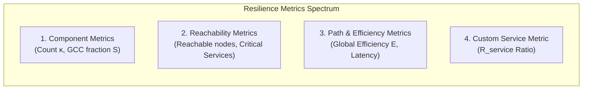
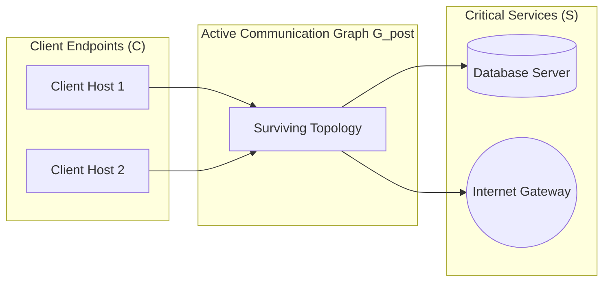

# Phase 1: Network Resilience Metrics & Quantitative Scorecard
## Graph-Theoretic Critical Infrastructure Failure & Network Resilience Simulator

---

### 1. Conceptual Framework: Measuring Topological Resilience

In discrete mathematical network analysis, **resilience** is the capacity of a graph structure $G = (V, E)$ to sustain component removals while maintaining communication reachability, low path latency, and operational service availability across surviving nodes.

Traditional reliability engineering metrics (e.g., MTBF, availability percentage "nines") are historical temporal metrics. In contrast, our platform implements **topological resilience metrics** derived strictly from graph theory, harmonic path lengths, and reachability equivalence classes.

---

### 2. Core Resilience Metrics Inventory

#### Metric 1: Connected Component Count ($\kappa(G)$)
- **Mathematical Definition**: The number of maximal connected subgraphs in $G$.
  $$\kappa(G) = |V / \mathcal{R}|$$
  where $\mathcal{R}$ is the Reachability Equivalence Relation.
- **Resilience Interpretation**: For an initially connected network, $\kappa(G_0) = 1$. As failures occur, $\kappa(G) > 1$ directly indicates network fragmentation. Lower $\kappa(G)$ indicates higher resilience.

#### Metric 2: Number of Reachable Nodes ($N_{\text{reach}}$)
- **Mathematical Definition**: The cardinality of the largest connected equivalence class (Giant Component) excluding isolated vertices:
  $$N_{\text{reach}} = |V_{\text{GCC}}|$$
- **Relative Giant Component Size ($S$)**:
  $$S = \frac{|V_{\text{GCC}}|}{n}$$
  Where $n = |V_0|$ is the initial network order. A resilient network maintains $S \approx 1$ even after multiple component losses.

#### Metric 3: Number of Reachable Critical Services ($N_{\text{service}}$)
- **Mathematical Definition**: Let $\mathcal{S} \subset V$ denote the subset of critical service endpoints (defined by archetype $\tau(v) \in \{\text{GATEWAY}, \text{DATABASE\_SERVER}\}$).
  $$N_{\text{service}}(G) = |\{s \in \mathcal{S} \mid s \in V_{\text{GCC}}\}|$$
- **Resilience Interpretation**: A network may have 90% of its nodes connected to each other, but if the single egress Gateway or Database Server is isolated, the network is operationally incapacitated.

#### Metric 4: Connectivity Loss Metric ($\mathcal{C}_{\text{loss}}$)
- **Mathematical Definition**: Quantifies the fraction of all mutually reachable vertex pairs severed by the failure:
  $$\mathcal{C}_{\text{loss}}(G') = 1 - \frac{\sum_{i=1}^{\kappa(G')} \binom{|V_i'|}{2}}{\binom{n}{2}}$$
  Where $|V_i'|$ is the number of vertices in the $i$-th connected component of degraded graph $G'$.
- **Properties**:
  - $\mathcal{C}_{\text{loss}} = 0.0$ if the network remains fully connected ($\kappa = 1$).
  - $\mathcal{C}_{\text{loss}} = 1.0$ if the network completely disintegrates into isolated vertices ($\kappa = n$).

#### Metric 5: Number of Affected Nodes ($N_{\text{affected}}$)
- **Mathematical Definition**:
  $$N_{\text{affected}} = n - |V_{\text{GCC}}'|$$
  Measures the absolute headcount of devices completely severed from the primary computing infrastructure.

#### Metric 6: Critical Node Ranking (Composite Vulnerability Index - CVI)
- **Mathematical Definition**: Ranks nodes by their structural centrality and single point of failure impact:
  $$\text{CVI}(v) = w_1 \cdot \mathbb{I}(v \in V_{\text{AP}}) + w_2 \cdot C_B(v) + w_3 \cdot \frac{\deg(v)}{n-1}$$
  where $\mathbb{I}$ is the indicator function ($1$ if articulation point, $0$ otherwise), and $w_1, w_2, w_3$ are normalizing weights ($w_1 = 0.5, w_2 = 0.3, w_3 = 0.2$).

#### Metric 7: Critical Edge Ranking (Bridge Impact Index - BII)
- **Mathematical Definition**: For any edge $e = \{u, v\} \in E$:
  $$\text{BII}(e) = \begin{cases} |V_u| \cdot |V_v| & \text{if } e \text{ is a bridge} \\ 0 & \text{otherwise} \end{cases}$$
  where $|V_u|$ and $|V_v|$ are the sizes of the two partitions created when $e$ is severed. A bridge in the center of the network severing two equal halves of size $n/2$ achieves the maximum possible impact: $\text{BII}_{\max} = n^2 / 4$.

#### Metric 8: Alternative Path Availability (Menger Redundancy Ratio - MRR)
- **Mathematical Definition**: Based on Menger's Theorem, for a designated source-destination pair $(s, t)$, the Alternative Path Availability is the maximum number of edge-disjoint paths $k_{\text{paths}}(s, t)$ connecting $s$ and $t$:
  $$\text{MRR}(s, t) = \max \text{ edge-disjoint paths between } s \text{ and } t$$
  Computed via the Edmonds-Karp maximum flow algorithm with unit edge capacities. If $\text{MRR}(s, t) \ge 2$, the pair possesses redundant pathing and can survive at least one cable cut.

#### Metric 9: Network-Wide Global Efficiency ($E_{\text{glob}}$)
- **Mathematical Definition**: The Latora-Marchiori harmonic path efficiency:
  $$E_{\text{glob}}(G) = \frac{1}{n(n-1)} \sum_{u \neq v \in V} \frac{1}{d(u, v)}$$
  Captures both path inflation and network fragmentation in a single continuous scalar bounded strictly in $[0, 1]$.

---

### 3. Proposed Service-Oriented Resilience Metric ($R_{\text{service}}$)

To bridge abstract graph topology with practical enterprise service requirements, we propose the **Service-Oriented Resilience Metric** $R_{\text{service}}$:

$$R_{\text{service}} = \frac{\sum_{s \in \mathcal{S}} \sum_{c \in \mathcal{C}} \mathbb{I}(c \ \mathcal{R}_{G_{\text{post}}} \ s)}{\sum_{s \in \mathcal{S}} \sum_{c \in \mathcal{C}} \mathbb{I}(c \ \mathcal{R}_{G_{\text{pre}}} \ s)}$$

Where:
* $\mathcal{S} \subseteq V$ is the designated set of **Service Providers** ($\tau(s) \in \{\text{GATEWAY}, \text{DATABASE\_SERVER}, \text{SERVER}\}$).
* $\mathcal{C} \subseteq V$ is the designated set of **Client Endpoints** ($\tau(c) \in \{\text{ROUTER}, \text{SWITCH}, \text{SERVER}\}$ where $c \notin \mathcal{S}$).
* $\mathbb{I}(c \ \mathcal{R} \ s)$ is the indicator function evaluating whether client $c$ can reach service $s$ through an active path in the network graph.

#### 3.1 Assumptions of the $R_{\text{service}}$ Model
1. **Binary Reachability**: Service availability is modeled strictly as topological reachability; quality-of-service parameters (such as link jitter or packet loss) are abstracted away.
2. **Homogeneous Service Weighting**: In the baseline formula, each client-to-service pair contributes equally to the numerator. (Weighted service extensions can assign higher weight to Gateways over Web servers).
3. **Static Pre-Failure State**: Baseline reachability assumes a fully connected initial network where all clients can access all services.

#### 3.2 Interpretation Guidelines
* $R_{\text{service}} = 1.0$: **Perfect Resilience**. All client devices can still communicate with all designated critical services, despite the component failures.
* $0.5 \le R_{\text{service}} < 1.0$: **Partial Service Degradation**. One or more client subnets have lost reachability to services, or a secondary redundant service has been severed.
* $R_{\text{service}} = 0.0$: **Total Operational Outage**. Zero clients can reach any critical service, representing complete business disruption.

#### 3.3 Boundary Conditions & Edge Cases
1. **Empty Service Set ($\mathcal{S} = \emptyset$)**:
   If the user defines a topology without any Servers, Gateways, or Databases, the denominator becomes zero.
   *System Handling*: The simulator detects $|\mathcal{S}| = 0$ and gracefully falls back to Global Efficiency $E_{\text{glob}}$ and Relative Giant Component size $S$, notifying the user via UI tooltip.
2. **Pre-Existing Disconnection**:
   If the network was already fragmented before the simulation started, the denominator reflects only initially reachable pairs, preventing false 100% scores.

#### 3.4 Explicit Academic Disclaimer
> [!IMPORTANT]
> **Academic Model Notice**: The metric $R_{\text{service}}$ is a customized, pedagogically sound mathematical composite formulated specifically for this Discrete Mathematics engineering project. It represents an intuitive, reachability-based academic score. **It must NOT be cited or represented as an established IEEE, ISO/IEC, or IETF industry standard.** Standard established metrics ($E_{\text{glob}}$, $S(f)$, $\kappa(G)$, $\lambda_2$) are provided alongside $R_{\text{service}}$ for authoritative academic benchmarking.

