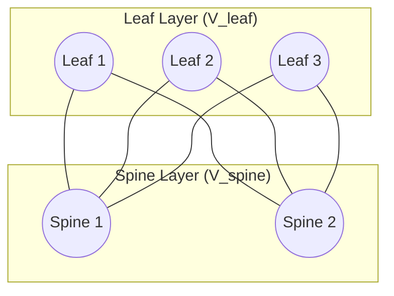

# Phase 1: Discrete Mathematics Syllabus Mapping & Academic Foundations
## Graph-Theoretic Critical Infrastructure Failure & Network Resilience Simulator

---

### 1. Academic Curriculum Alignment Overview

This document establishes the formal mathematical alignment between the **Graph-Theoretic Critical Infrastructure Failure & Network Resilience Simulator** and the standardized second-year Computer Engineering **Discrete Mathematics (DM)** curriculum. 

Every unit of the syllabus is systematically analyzed to:
1. Define how core mathematical theory models real-world computer networks.
2. Formulate explicit mathematical equations and definitions.
3. Distinguish between topics explicitly present in the syllabus and algorithmic engineering extensions.
4. Rigorously justify the exclusion of concepts (such as Modular Arithmetic) that have no natural mathematical application to graph topological resilience, preventing artificial topic-forcing.

```mermaid
flowchart TD
    subgraph Syllabus ["Discrete Mathematics Curriculum Units"]
        U1["Unit 1: Logic, Sets & Relations"]
        U2["Unit 2: Basic Counting & Combinatorics"]
        U3["Unit 3: Advanced Combinatorics"]
        U4["Unit 4: Recurrence Relations"]
        U5["Unit 5: Modular Arithmetic"]
        U6["Unit 6: Graph Theory (Core)"]
    end

    subgraph Simulator ["Simulator Architectural Components"]
        C1["Component Sets & Reachability Equivalence"]
        C2["Failure Scenario Explosion & C(n,k)"]
        C3["Link Contention & Overlapping Failure Sets"]
        C4["Cascading Failure Model F(t)"]
        C5["Explicitly Excluded / Documented"]
        C6["Tarjan DFS, Cut-Vertices, Bridges & Centrality"]
    end

    U1 --> C1
    U2 --> C2
    U3 --> C3
    U4 --> C4
    U5 -.->|Omitted (No Fit)| C5
    U6 --> C6
```

---

### 2. Unit 1: Logic, Sets, and Relations

#### 2.1 Set-Theoretic Representation of Network Infrastructure
The entire physical and logical network is expressed through classical set theory:
* **Universal Set of Devices**: $V = \{v_1, v_2, \dots, v_n\}$.
* **Device Subsets by Archetype**:
  $$\begin{aligned}
  V_{\text{router}} &\subseteq V, \quad V_{\text{switch}} \subseteq V, \quad V_{\text{firewall}} \subseteq V, \\
  V_{\text{gateway}} &\subseteq V, \quad V_{\text{server}} \subseteq V, \quad V_{\text{db}} \subseteq V
  \end{aligned}$$
  These form a partition of $V$:
  $$V = V_{\text{router}} \uplus V_{\text{switch}} \uplus V_{\text{firewall}} \uplus V_{\text{gateway}} \uplus V_{\text{server}} \uplus V_{\text{db}}$$
  where $\uplus$ denotes disjoint union: $\forall i \neq j, V_i \cap V_j = \emptyset$.
* **State Subsets**:
  At any simulation time $t$, the set of failed components is $F(t) \subseteq V$. The set of active operating devices is the relative complement:
  $$V_{\text{active}}(t) = V \setminus F(t) = \{v \in V \mid v \notin F(t)\}$$

#### 2.2 Mathematical Relations & The Reachability Equivalence Relation
A communication link represents a binary relation $\mathcal{E}$ on the set $V$:

$$\mathcal{E} \subseteq V \times V, \quad (u, v) \in \mathcal{E} \iff \{u, v\} \in E$$

Because physical Layer-1/Layer-2 links are bidirectional, $\mathcal{E}$ is **symmetric**:
$$\forall u, v \in V, \ (u, v) \in \mathcal{E} \implies (v, u) \in \mathcal{E}$$

We define the **Reachability Relation** $\mathcal{R}$ on $V$:
$$u \mathcal{R} v \iff \text{there exists a path in } G \text{ connecting } u \text{ and } v$$

**Theorem 1**: *The Reachability Relation $\mathcal{R}$ on an undirected graph is an Equivalence Relation.*
*Proof*:
1. **Reflexive**: For any $u \in V$, the trivial walk of length 0 connects $u$ to $u$. Thus, $u \mathcal{R} u$.
2. **Symmetric**: If $u \mathcal{R} v$, there exists a path $(u = x_0, x_1, \dots, x_k = v)$. Because all edges are undirected, reversing the sequence yields $(v = x_k, x_{k-1}, \dots, x_0 = u)$, which is a valid path from $v$ to $u$. Thus, $v \mathcal{R} u$.
3. **Transitive**: If $u \mathcal{R} v$ and $v \mathcal{R} w$, let $P_1$ be a path from $u$ to $v$ and $P_2$ be a path from $v$ to $w$. Concatenating $P_1$ and $P_2$ forms a walk from $u$ to $w$. By the Graph Walk-to-Path Reduction Lemma, every walk contains a simple path. Thus, $u \mathcal{R} w$. $\blacksquare$

**Fundamental Consequence**:
The equivalence classes of $V$ under $\mathcal{R}$ are precisely the **connected components** of the network:
$$V / \mathcal{R} = \{[v_1]_{\mathcal{R}}, [v_2]_{\mathcal{R}}, \dots, [v_k]_{\mathcal{R}}\}$$
Where $[u]_{\mathcal{R}} = \{v \in V \mid u \mathcal{R} v\}$. If an articulation point fails, a single equivalence class fragments into two or more disjoint equivalence classes.

#### 2.3 Propositional Logic & Mathematical Proof Techniques
- **Propositional Failure Predicates**:
  For any vertex $u$, let $Fail(u)$ denote the proposition that $u$ is non-operational. For an articulation point $u$:
  $$Fail(u) \implies \exists x, y \in (V \setminus \{u\}) \text{ such that } \neg(x \mathcal{R}_{G - u} y)$$
- **Proof by Contradiction in Cut-Element Verification**:
  To prove that edge $e = \{u, v\}$ is a bridge: Assume for contradiction that $e$ is *not* a bridge. Then $G - e$ remains connected. By definition of connectivity, there exists an alternate path $P'$ connecting $u$ and $v$ in $G - e$. Concatenating $P'$ with edge $e$ forms a simple cycle $C$. Thus, *an edge is a bridge if and only if it belongs to no cycle*. This contradiction validates Tarjan's back-edge low-link theorem: if $\text{low}[v] > d[u]$, no back-edge bypasses $(u, v)$ to form a cycle, proving $(u, v)$ is strictly a bridge.

---

### 3. Unit 2: Basic Counting & Combinatorial Failure Explosion

#### 3.1 Combinatorial Space of Multiple Failures
In reliability engineering, analyzing network resilience under $k$ simultaneous device failures requires evaluating all possible combinations of $k$ elements chosen from a network of $n$ components.

Using the binomial coefficient formula:

$$C(n, k) = \binom{n}{k} = \frac{n!}{k!(n - k)!}$$

#### 3.2 Concrete Combinatorial Evaluations

To illustrate why exhaustive failure simulation is computationally intractable, we calculate $C(n, k)$ across realistic network scales:

| Network Scale ($n = |V|$) | 1-Component Failure: $C(n, 1)$ | 2-Component Failures: $C(n, 2)$ | 3-Component Failures: $C(n, 3)$ | 5-Component Failures: $C(n, 5)$ |
| :--- | :--- | :--- | :--- | :--- |
| **Small Lab ($n = 10$)** | $10$ | $45$ | $120$ | $252$ |
| **Campus Subnet ($n = 50$)** | $50$ | $1,225$ | $19,600$ | $2,118,760$ |
| **Enterprise Backbone ($n = 100$)** | $100$ | $4,950$ | $161,700$ | **$75,287,520$** |
| **Regional Transit WAN ($n = 500$)** | $500$ | $124,750$ | $20,770,830$ | **$\approx 2.55 \times 10^{11}$** |

#### 3.3 The Combinatorial Explosion & Algorithmic Justification
- **1-Component Failure ($N-1$ Contingency)**:
  $C(n, 1) = n$. In an enterprise network of $n = 100$ nodes, testing every single failure requires exactly 100 simulation passes. This is completely tractable and runs in milliseconds.
- **2-Component Failures ($N-2$ Contingency)**:
  $C(n, 2) = \frac{n(n-1)}{2}$. For $n = 100$, there are $4,950$ pairs. Testing every pair takes $\approx 0.5$ seconds.
- **3-Component Failures ($N-3$ Contingency)**:
  $C(n, 3) = \frac{n(n-1)(n-2)}{6}$. For $n = 100$, there are $161,700$ triplets.
- **Higher-Order Failures ($k \ge 5$)**:
  For $n = 100$ and $k = 5$, there are over **$75\text{ million}$** failure scenarios! At $1\text{ ms}$ per simulation pass, exhaustive testing would require **20.9 hours** of continuous computation.

**Engineering Decision**:
Exhaustive brute-force enumeration of $N-k$ failures is mathematically impossible for $k \ge 3$ on non-trivial graphs. Therefore, our simulator implements:
1. **Targeted Heuristic Attacks**: Focusing computation on high-value combinatorial cuts (e.g., greedy removal of top-betweenness nodes).
2. **Monte Carlo Random Sampling (Percolation)**: Evaluating a statistically significant sample of $K = 20$ randomized trials to compute empirical expected resilience $\mathbb{E}[S(f)]$.

---

### 4. Unit 3: Advanced Combinatorics

#### 4.1 The Pigeonhole Principle (PHP) & Traffic Congestion
- **Theorem (Dirichlet's Box Principle)**:
  If $k$ objects (pigeons) are placed into $m$ boxes (pigeonholes) where $k > m$, then at least one box must contain at least $\lceil k/m \rceil$ objects.
- **Direct Application to Network Infrastructure**:
  Consider an access switch aggregating traffic from $k = 24$ active server ports. The switch has $m = 2$ uplink ports connected to the distribution layer.
  By the Generalized Pigeonhole Principle:
  $$\text{At least one uplink port must carry } \ge \left\lceil \frac{24}{2} \right\rceil = 12 \text{ server traffic flows}$$
  If one uplink cable is severed due to an edge failure, $m' = 1$ uplink remains. Then all $24$ flows are concentrated onto a single link ($\lceil 24/1 \rceil = 24$). If the uplink bandwidth capacity is $B = 10\text{ Gbps}$ and each server demands $1\text{ Gbps}$, the total demand ($24\text{ Gbps}$) exceeds capacity, proving mathematically that congestion and packet drops *must* occur.

#### 4.2 Principle of Inclusion-Exclusion (PIE) & Multi-Failure Impact
When two or more independent failure events occur, the sets of disconnected or affected nodes may overlap. 

Let $A \subseteq V$ be the set of nodes disconnected if Router $R_1$ fails.  
Let $B \subseteq V$ be the set of nodes disconnected if Router $R_2$ fails.  
Let $C \subseteq V$ be the set of nodes disconnected if Switch $S_1$ fails.

To compute the total number of distinct network nodes severed if $R_1, R_2$, and $S_1$ fail concurrently, simple summation $|A| + |B| + |C|$ overcounts nodes that depend on multiple failing devices. By the **Principle of Inclusion-Exclusion**:

$$|A \cup B \cup C| = |A| + |B| + |C| - (|A \cap B| + |A \cap C| + |B \cap C|) + |A \cap B \cap C|$$

Where:
- $|A \cap B|$ represents the set of nodes mutually dependent on both $R_1$ and $R_2$.
- $|A \cap B \cap C|$ represents nodes that lose reachability through all three chokepoints simultaneously.

*Categorization*: Core mathematical tool for calculating non-redundant affected device sets under $N-k$ multi-failure events.

---

### 5. Unit 4: Recurrence Relations & Cascading Dynamics

Cascading failures represent non-linear, dynamic propagation where an initial failure triggers sequential secondary failures due to capacity overloads. We formalize this process as a discrete-time recurrence relation.

#### 5.1 Mathematical Formulation of the Cascading Recurrence
Let $t \in \mathbb{N}_0 = \{0, 1, 2, \dots\}$ denote discrete simulation time steps.
* **Failure Set State $F(t)$**:
  $F(t) \subseteq V$ is the cumulative set of failed nodes up to step $t$.
* **Active Subgraph $G(t)$**:
  $$G(t) = G[V \setminus F(t)] = (V(t), E(t))$$
  where $V(t) = V \setminus F(t)$ and $E(t) = \{\{u, v\} \in E \mid u, v \in V(t)\}$.
* **Initial Conditions ($t = 0$)**:
  $$F(0) = V_{\text{initial\_fail}} \neq \emptyset$$
  $$L_v(0) = C_B(v; G(0)) \quad \forall v \in V(0)$$
  where $C_B(v; G(0))$ is the betweenness centrality of node $v$ in the pre-failure graph $G(0)$.
* **Capacity Definition**:
  Each node $v$ possesses a maximum operating throughput capacity $C(v)$, parameterized by an engineering tolerance $\alpha > 0$:
  $$C(v) = (1 + \alpha) L_v(0)$$

#### 5.2 Recurrence Update Rule
For $t \ge 0$:
1. **Traffic Load Recalculation**:
   Shortest paths between all remaining active node pairs in $G(t)$ are recomputed. The new load on surviving node $v \in V(t)$ is:
   $$L_v(t) = C_B(v; G(t))$$
2. **Overload Failure Set at Step $t$**:
   $$\Delta F(t) = \{v \in V(t) \mid L_v(t) > C(v)\}$$
3. **Recurrence Relation**:
   $$F(t+1) = F(t) \cup \Delta F(t)$$

#### 5.3 Termination Conditions & Proof of Finite Convergence
**Theorem 2**: *The cascading failure process terminates in at most $|V|$ discrete steps.*
*Proof*:
By construction, $F(t) \subseteq F(t+1) \subseteq V$ for all $t$. The sequence of failed sets forms a monotonically non-decreasing chain of subsets:
$$F(0) \subseteq F(1) \subseteq F(2) \subseteq \dots \subseteq V$$
Because $V$ is a finite set with cardinality $|V| = n$, and $|\Delta F(t)| \ge 1$ whenever the system has not stabilized, the chain must reach a fixed point $F(t^* + 1) = F(t^*)$ in at most $t^* \le n$ steps. $\blacksquare$

The recurrence halts when either:
1. **Steady-State Equilibrium**: $\Delta F(t) = \emptyset \implies F(t+1) = F(t)$. All surviving nodes satisfy $L_v(t) \le C(v)$.
2. **Total Network Collapse**: $F(t) = V \implies V(t) = \emptyset$. All nodes have failed.

*Distinction from Operational Simulators*: This academic model evaluates structural shortest-path traffic redistribution via discrete betweenness recurrence. It does not model millisecond-level packet buffer queueing (M/M/1 queues) or TCP congestion window backoff (AIMD).

---

### 6. Unit 5: Modular Arithmetic (Evaluation & Decision)

#### 6.1 Technical Evaluation
Modular arithmetic ($\mathbb{Z}_m$, congruent relations $a \equiv b \pmod m$, Fermat's Little Theorem, Chinese Remainder Theorem) forms the backbone of public-key cryptography (RSA, Diffie-Hellman, ECC) and network security. 

However, in **graph-theoretic topological resilience**, physical cable severances, cut-vertices, giant components, and algebraic connectivity do not behave according to cyclic integer rings $\mathbb{Z}_m$.

#### 6.2 Formal Pedagogical & Architectural Decision
> **Decision: Modular arithmetic is explicitly excluded from the core graph resilience engine.**

*Justification*: Artificially forcing modular arithmetic into topological failure modeling would compromise academic integrity and produce a contrived, un-rigorous model. Where circular integer math naturally exists in networking—such as sequence number wrapping in TCP ($2^{32}$) or Token Ring token passing—it belongs to transport layer protocols, which Phase 0 has established as Out-of-Scope. This omission is formally documented and justified.

---

### 7. Unit 6: Graph Theory (Core Foundation)

Graph theory is the primary mathematical pillar of this project. The table below delineates topics explicitly in the 2nd-year DM syllabus versus advanced algorithmic extensions:

$$\begin{array}{|l|l|l|}
\hline
\textbf{Concept} & \textbf{Syllabus Status} & \textbf{Mathematical Definition \& Network Practical Meaning} \\ \hline
\text{Degree } \deg(v) & \textbf{Core Syllabus} & \deg(v) = |\{u \in V \mid \{u, v\} \in E\}|. \text{ Number of physical interfaces on a switch/router.} \\ \hline
\text{Handshaking Lemma} & \textbf{Core Syllabus} & \sum_{v \in V} \deg(v) = 2m. \text{ Total interface count is twice the number of cables.} \\ \hline
\text{Walks, Trails, Paths} & \textbf{Core Syllabus} & \text{Path: Walk with no repeated vertices. Packet transmission route.} \\ \hline
\text{Cycles } C_k & \textbf{Core Syllabus} & \text{Closed path } (x_0, x_1, \dots, x_k = x_0). \text{ Physical switching loops requiring STP.} \\ \hline
\text{Trees \& Spanning Trees} & \textbf{Core Syllabus} & \text{Connected acyclic graph } (m = n - 1). \text{ Loop-free active Layer-2 topology (STP/RSTP).} \\ \hline
\text{Bipartite Graphs } K_{r, s} & \textbf{Core Syllabus} & V = V_1 \cup V_2, \ E \subseteq V_1 \times V_2. \textbf{ Spine-Leaf Data Center fabric!} \\ \hline
\text{Adjacency Matrix } A & \textbf{Core Syllabus} & A[i, j] \in \{0, 1\}. \text{ Binary matrix representing direct connectivity.} \\ \hline
\text{Graph Traversal (BFS/DFS)} & \textbf{Core Syllabus} & \text{Systematic search of } V. \text{ Path discovery and connected component discovery.} \\ \hline
\text{Graph Coloring} & \textbf{Core Syllabus} & \chi(G). \text{ Conflict-free wireless channel/frequency allocation across base stations.} \\ \hline
\text{Articulation Points (SPOFs)} & \textit{Algorithmic Extension} & v \in V \text{ where } \kappa(G - v) > \kappa(G). \text{ Single Point of Failure router/switch.} \\ \hline
\text{Bridges (Cut-Edges)} & \textit{Algorithmic Extension} & e \in E \text{ where } \kappa(G - e) > \kappa(G). \text{ Critical transmission link whose cut partitions LAN.} \\ \hline
\text{Dijkstra's Algorithm} & \textit{Algorithmic Extension} & \text{Single-source shortest path on weighted graphs (OSPF link-state routing).} \\ \hline
\text{Betweenness Centrality} & \textit{Algorithmic Extension} & C_B(v) = \sum \frac{\sigma_{st}(v)}{\sigma_{st}}. \text{ Mathematical quantification of network transit chokepoints.} \\ \hline
\text{Algebraic Connectivity } \lambda_2 & \textit{Algorithmic Extension} & \text{Fiedler eigenvalue of Laplacian } L = D - A. \text{ Spectral measure of topological robustness.} \\ \hline
\end{array}$$

#### 7.1 Special Highlight: Bipartite Graphs in Modern Data Centers
In modern cloud data centers, the **Spine-Leaf (Clos) architecture** is a direct real-world realization of a **Complete Bipartite Graph** $K_{r, s}$:
- $V_{\text{spine}}$: Set of $r$ spine switches.
- $V_{\text{leaf}}$: Set of $s$ leaf switches.
- Every leaf switch connects to every spine switch ($\forall u \in V_{\text{leaf}}, \forall v \in V_{\text{spine}}, \{u, v\} \in E$).
- No leaf connects to another leaf ($E \cap (V_{\text{leaf}} \times V_{\text{leaf}}) = \emptyset$).
- No spine connects to another spine ($E \cap (V_{\text{spine}} \times V_{\text{spine}}) = \emptyset$).



*Resilience Property*: In a $K_{r, s}$ spine-leaf topology, there are zero articulation points and zero bridges. The vertex connectivity is $\kappa(G) = \min(r, s)$, proving that the network can survive up to $\min(r, s) - 1$ arbitrary switch failures without disconnecting.

