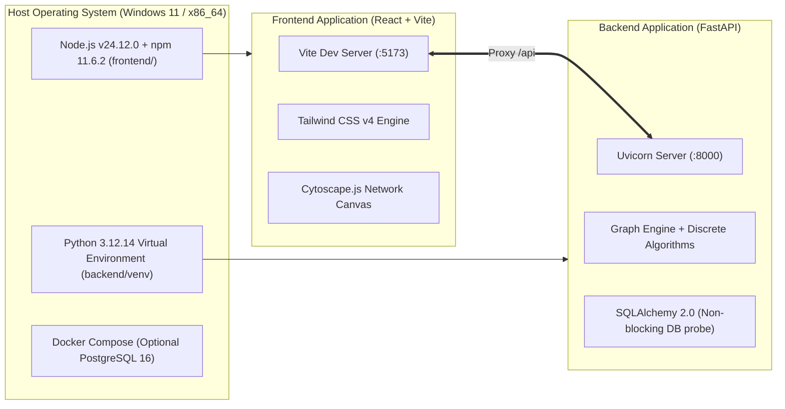

# Phase 2: Development Environment Setup
## Graph-Theoretic Critical Infrastructure Failure & Network Resilience Simulator

---

### 1. Environment Architecture & System Prerequisites

The development environment is structured as a decoupled, modern multi-tier architecture supporting both local standalone execution and containerized deployment:



---

### 2. Verified Host Runtimes & Tooling

| Software / Tool | Installed Version | Location / Source | Role in Architecture |
| :--- | :--- | :--- | :--- |
| **Python** | `Python 3.12.14` | Local Runtime / Virtualenv `backend/venv` | Primary backend execution and discrete graph math engine. |
| **pip** | `pip 26.2.2` | `backend/venv/Scripts/pip.exe` | Python package dependency manager. |
| **Node.js** | `v24.12.0` | System PATH | JavaScript / TypeScript frontend runtime. |
| **npm** | `11.6.2` | System PATH | Frontend package manager. |
| **Git** | `2.55.0.windows.5` | System PATH | Version control and codebase tracking. |
| **Docker** | Optional | `docker-compose.yml` configured | Containerization runtime for PostgreSQL and services. |

---

### 3. Backend Virtual Environment Setup

The backend utilizes a clean, isolated Python virtual environment configured at `backend/venv`:
1. **Creation**:
   ```powershell
   python -m venv backend/venv
   ```
2. **Activation**:
   ```powershell
   # Windows PowerShell
   backend\venv\Scripts\Activate.ps1
   ```
3. **Dependency Installation**:
   All dependencies are declared in `backend/requirements.txt` and verified:
   - `fastapi==0.162.0`: Modern REST API framework.
   - `uvicorn==0.54.0`: ASGI production server.
   - `networkx==3.7`: Independent mathematical validation and graph analysis.
   - `numpy==2.5.4`: Vectorized linear algebra and adjacency matrix manipulation.
   - `pandas==3.1.0`: Tabular data structures for metric histories.
   - `pydantic==2.14.2`: Strict schema parsing and data validation.
   - `pydantic-settings==2.16.2`: Environment configuration loader.
   - `sqlalchemy==2.1.6`: Database abstraction and ORM.
   - `psycopg2-binary==2.9.13`: PostgreSQL driver.
   - `pytest==9.2.0`: Unit testing framework (67 tests passing).
   - `httpx==0.28.1`: HTTP client for endpoint testing.

---

### 4. Frontend Environment Setup

The frontend application was initialized using Vite with React 19 and TypeScript:
1. **Scaffold**:
   ```bash
   npm create vite@latest frontend -- --template react-ts
   ```
2. **Dependency Stack**:
   - `react==19.3.1`: Declarative UI component tree.
   - `typescript==7.0.2`: Strict static typing.
   - `tailwindcss==4.3.3` & `@tailwindcss/vite`: Utility-first design system.
   - `axios==1.21.0`: Typed REST client with proxy configuration.
   - `cytoscape==3.34.4`: Interactive graph theory visualization canvas.
   - `recharts==3.10.1`: Real-time analytical charting library.
   - `lucide-react==1.66.0`: Modern icon library.
3. **Verification**:
   The frontend build was verified via `npm run build`, generating optimized production bundles in `frontend/dist/` in under 650 ms.

---

### 5. Database Resilience & Graceful Fallback

In accordance with Phase 2 specifications:
- The database name is configured as `infrastructure_resilience`.
- **Fault-Tolerant Non-Blocking Architecture**: The backend starts immediately and operates at full capability even when PostgreSQL is offline or Docker is not running.
- The `GET /api/database-health` endpoint performs a fast, non-blocking connection check (0.5s timeout) and returns:
  ```json
  {
    "status": "unavailable",
    "database": "infrastructure_resilience",
    "host": "localhost",
    "port": 5432,
    "error": "PostgreSQL port unreachable"
  }
  ```
  The server does not crash, and all in-memory graph operations and algorithms remain 100% operational.

