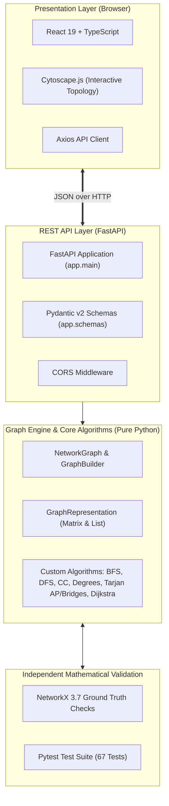

# Phase 2: Technology Stack & Architectural Rationale
## Graph-Theoretic Critical Infrastructure Failure & Network Resilience Simulator

---

### 1. Technology Stack Summary

| Layer | Technology | Version | Rationale & Academic Function |
| :--- | :--- | :--- | :--- |
| **Backend Core** | Python | `3.12.14` | Clean mathematical syntax, mature graph computing ecosystem, native 64-bit numerical support. |
| **API Framework** | FastAPI | `0.162.0` | Asynchronous, typed REST framework with automatic OpenAPI/Swagger documentation. |
| **ASGI Server** | Uvicorn | `0.54.0` | Lightning-fast ASGI web server with auto-reloading for local development. |
| **Graph Science** | NetworkX | `3.7` | Used exclusively for **independent validation** and ground-truth cross-checks against custom algorithms. |
| **Linear Algebra** | NumPy | `2.5.4` | Matrix computations, Adjacency Matrix representations, and Laplacian eigenvalue analysis. |
| **Data Processing** | Pandas | `3.1.0` | Tabular metric reporting and time-series degradation tracking. |
| **Schema Validation** | Pydantic v2 | `2.14.2` | High-performance Rust-backed data validation enforcing simple graph invariants. |
| **ORM / Persistence** | SQLAlchemy | `2.1.6` | Decoupled persistence abstraction over relational database tables. |
| **Database Driver** | psycopg2-binary | `2.9.13` | PostgreSQL binary adapter with connection pooling. |
| **Unit Testing** | Pytest | `9.2.0` | Automated test runner with comprehensive 67-test suite. |
| **Frontend Framework** | React | `19.3.1` | Declarative, component-based user interface architecture. |
| **Language** | TypeScript | `7.0.2` | Compile-time type checking preventing UI state runtime exceptions. |
| **Build Tooling** | Vite | `8.3.5` | Instant HMR development server and fast production bundler. |
| **Styling Engine** | Tailwind CSS v4 | `4.3.3` | Modern utility CSS integrated directly with Vite. |
| **Graph Rendering** | Cytoscape.js | `3.34.4` | Industry-standard canvas for interactive graph manipulation, layout physics, and custom node glyphs. |
| **Charting Engine** | Recharts | `3.10.1` | D3-backed React charts for plotting resilience degradation curves. |
| **HTTP Client** | Axios | `1.21.0` | Promise-based HTTP client with proxy support. |
| **Containerization** | Docker & Compose | Dockerfile | Optional reproducible deployment of PostgreSQL and backend. |

---

### 2. Architectural Separation of Concerns

1. **Independent Mathematical Engine**: The graph engine (`app.graph_engine`) and core algorithms (`app.algorithms`) have zero dependencies on FastAPI or React. They can be executed, tested, and imported as a standalone pure-Python library.
2. **Independent Algorithmic Ground Truth**: Custom algorithms are written from first principles (no black-box calls). In unit tests, every custom algorithm output is independently cross-validated against NetworkX to prove mathematical equivalence.

