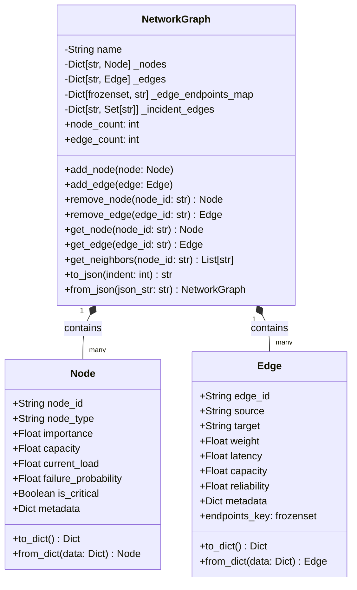

# Phase 3: Graph Engine Design & Architecture
## Graph-Theoretic Critical Infrastructure Failure & Network Resilience Simulator

---

### 1. Architectural Philosophy

The Graph Engine is the computational and mathematical heart of the platform. It is engineered with three uncompromising architectural invariants:
1. **Zero Framework Coupling**: The graph engine does not import FastAPI, SQLAlchemy, or React. It operates as a pure, self-contained Python module adhering strictly to graph theory principles.
2. **Simple Undirected Graph Invariant**: The engine rigorously enforces irreflexivity (no self-loops $\{u, u\}$) and simplicity (at most one undirected edge between any pair of vertices).
3. **State Consistency & Cascading Deletions**: An edge cannot exist without its endpoints. Removing a vertex $v$ atomically removes all incident edges $\delta(v)$, preventing dangling pointers or orphaned adjacency records.

---

### 2. Implementation of the 13 Fundamental Graph Operations

The table below documents how each required operation is implemented in `app.graph_engine.graph_builder.NetworkGraph`:

| Operation ID & Name | Method Signature | Time Complexity | State Transitions & Invariant Enforcement |
| :--- | :--- | :--- | :--- |
| **1. Create Graph** | `NetworkGraph.create(name)` | $\Theta(1)$ | Instantiates empty node/edge maps and lookup tables. |
| **2. Add Node** | `add_node(node: Node)` | $\Theta(1)$ | Checks for duplicate ID; initializes incident edges set `_incident_edges[node_id] = set()`. |
| **3. Add Edge** | `add_edge(edge: Edge)` | $\Theta(1)$ | Verifies both endpoints exist in $V$; rejects self-loops; checks undirected uniqueness via `frozenset({u, v})`. |
| **4. Remove Node** | `remove_node(node_id)` | $O(\deg(v))$ | Iterates through incident edges and deletes them from $E$, then removes node $v$ from $V$. |
| **5. Remove Edge** | `remove_edge(edge_id)` | $\Theta(1)$ | Removes edge from `_edges`, removes frozenset from endpoint map, and removes from incident sets. |
| **6. Retrieve Node** | `get_node(node_id)` | $\Theta(1)$ | Dictionary lookup by ID. Raises `NodeNotFoundError` if missing. |
| **7. Retrieve Edge** | `get_edge(edge_id)` | $\Theta(1)$ | Dictionary lookup by ID. Raises `EdgeNotFoundError` if missing. |
| **8. List All Nodes** | `get_all_nodes()` | $O(V \log V)$ | Returns all nodes deterministically sorted by `node_id`. |
| **9. List All Edges** | `get_all_edges()` | $O(E \log E)$ | Returns all edges deterministically sorted by `edge_id`. |
| **10. Update Node** | `update_node(node_id, **kw)` | $\Theta(1)$ | Updates specified attributes and re-runs attribute validation. |
| **11. Update Edge** | `update_edge(edge_id, **kw)` | $\Theta(1)$ | Updates weight, capacity, or latency and re-validates. |
| **12. Export JSON** | `to_json(indent=2)` | $\Theta(V + E)$ | Serializes entire graph structure, attributes, and metadata. |
| **13. Import JSON** | `NetworkGraph.from_json(str)` | $\Theta(V + E)$ | Deserializes JSON, creating nodes first, then validating and linking edges. |

---

### 3. Error Handling Architecture

The graph engine defines an explicit hierarchy of domain-specific exceptions in `app.graph_engine.graph_validation`:
- `GraphException`: Base class.
- `NodeValidationError`: Raised on negative importance, capacity $\le 0$, negative load, or invalid device type.
- `EdgeValidationError`: Raised on negative weight, negative latency, capacity $\le 0$, or invalid reliability.
- `DuplicateNodeError`: Raised on duplicate node ID.
- `DuplicateEdgeError`: Raised when adding an edge between already connected vertices.
- `NodeNotFoundError`: Raised when referencing a non-existent vertex.
- `EdgeNotFoundError`: Raised when referencing a non-existent link.
- `SelfLoopError`: Raised when source equals target.
- `GraphStructureError`: Raised on malformed JSON or corrupted graph schemas.

