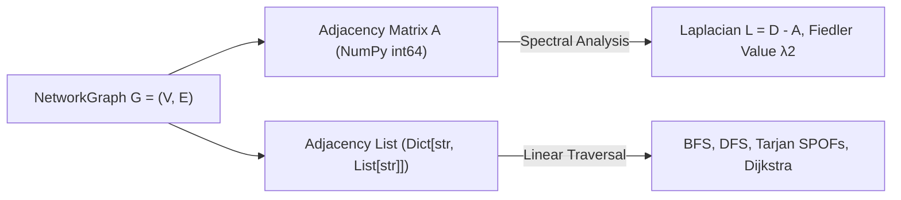

# Phase 3: Graph Representations (Matrix & List)
## Graph-Theoretic Critical Infrastructure Failure & Network Resilience Simulator

---

### 1. Overview of Representations

The simulator implements two complementary mathematical representations in `app.graph_engine.graph_representation.GraphRepresentation`:

---

### 2. Mathematical Definition & Implementation

#### 2.1 Adjacency Matrix ($A \in \{0, 1\}^{n \times n}$)
The Adjacency Matrix is a square binary matrix where row $i$ and column $j$ correspond to the $i$-th and $j$-th nodes in deterministically sorted order:

$$A[i, j] = \begin{cases} 1 & \text{if } \{\text{node}_i, \text{node}_j\} \in E \\ 0 & \text{otherwise} \end{cases}$$

- **Method**: `rep.to_adjacency_matrix()`
- **Returns**: `(ordered_node_ids, matrix_list, matrix_numpy)`
- **Mathematical Invariants Verified**:
  1. **Dimensions**: Shape is strictly $n \times n$.
  2. **Symmetry**: $A = A^T$ (because physical edges are undirected).
  3. **Zero Diagonal**: $\text{diag}(A) = \mathbf{0}$ (because simple graphs forbid self-loops).
  4. **Boundary**: For an empty graph ($n = 0$), returns shape `(0, 0)`.

#### 2.2 Adjacency List ($\text{Adj}$)
The Adjacency List is a hash map linking each vertex identifier to a deterministically sorted list of all adjacent neighbors:

$$\text{Adj}[u] = [v \in V \mid \{u, v\} \in E]$$

- **Method**: `rep.to_adjacency_list()`
- **Returns**: `Dict[str, List[str]]`
- **Guarantees**:
  1. Every node in $V$ is present as a key, including **isolated vertices** (which map to `[]`).
  2. Neighbor lists are sorted alphabetically for deterministic traversal.

---

### 3. Representation Consistency & Isomorphism Verification

The method `rep.verify_representation_consistency()` formally verifies that both data structures describe the exact same underlying graph:
$$\forall u, v \in V: \quad A[\text{idx}(u), \text{idx}(v)] == 1 \iff v \in \text{Adj}[u]$$

This check is executed in automated test fixtures across all benchmark networks (including `sample_network.json`), guaranteeing zero structural divergence between matrix algebra and adjacency list traversals.

