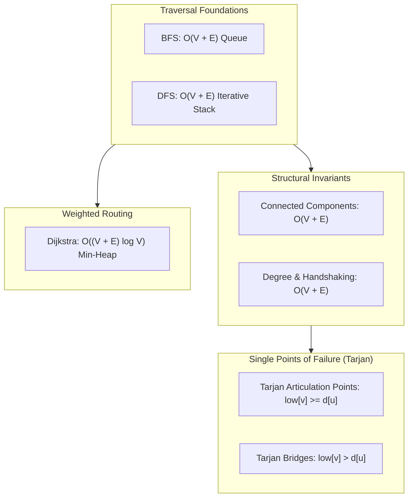

# Phase 4: Core Graph Algorithms Specification
## Graph-Theoretic Critical Infrastructure Failure & Network Resilience Simulator

---

### 1. Overview of Implemented Algorithms

The core algorithms were implemented in pure Python from first principles in `app.algorithms`:
1. **Breadth-First Search (`bfs.py`)**: Traversal order, hop distances, predecessors, unweighted shortest paths.
2. **Depth-First Search (`dfs.py`)**: Iterative stack-based traversal, edge discovery, cycle handling.
3. **Connected Components (`connected_components.py`)**: Reachability equivalence classes, component counts, giant component identification.
4. **Degree Analysis (`degree_analysis.py`)**: Degree sequence, min/max/average degree, Euler Handshaking Lemma verification.
5. **Tarjan Articulation Points (`articulation_points.py`)**: Linear-time DFS low-link detection of Single Points of Failure.
6. **Tarjan Bridges (`bridges.py`)**: Linear-time DFS low-link detection of critical transmission links.
7. **Dijkstra Shortest Path (`shortest_path.py`)**: Priority queue binary min-heap path reconstruction with non-negative weights.

---

### 2. Algorithmic Detail: Tarjan's Articulation Points & Bridges

#### 2.1 Tarjan’s Low-Link Formulation
During a Depth-First Search traversal:
* Each vertex $u$ is assigned a discovery timestamp $d[u]$ upon first entry.
* The low-link value $\text{low}[u]$ records the lowest discovery timestamp reachable from $u$ by traversing zero or more tree edges followed by at most one back-edge:
  $$\text{low}[u] = \min \begin{cases} d[u] \\ \text{low}[v] & \forall \text{ tree edges } (u, v) \\ d[w] & \forall \text{ back edges } (u, w) \text{ where } w \neq \text{parent}[u] \end{cases}$$

#### 2.2 Bridge Condition
A tree edge $(u, v)$ (where $u$ is parent of $v$) is a **bridge** if and only if:
$$\text{low}[v] > d[u]$$
*Logic*: If $\text{low}[v] > d[u]$, no vertex in the subtree rooted at $v$ can reach $u$ or any ancestor of $u$. The edge $(u, v)$ is the sole physical conduit connecting the two subnets.

#### 2.3 Articulation Point Condition
A vertex $u$ is an **articulation point** if and only if:
1. **Root Condition**: $u$ is the root of a DFS tree and has **two or more children** in the DFS tree.
2. **Non-Root Condition**: $u$ is not the root, and has a DFS child $v$ such that:
   $$\text{low}[v] \ge d[u]$$
*Logic*: If $\text{low}[v] \ge d[u]$, the subtree under $v$ cannot bypass $u$ to reach any earlier ancestor. Removing $u$ traps $v$ in a severed partition.

---

### 3. Algorithmic Detail: Dijkstra’s Shortest Path

#### 3.1 Binary Min-Heap Priority Queue
Implemented using Python's `heapq` module:
- Initializes `distances[source] = 0.0`, all other vertices to $\infty$.
- Maintains a min-heap storing `(dist_u, u)`.
- At each step, extracts the vertex $u$ with the minimum settled distance.
- Relaxes all incident edges: if $\text{dist}[u] + w(u, v) < \text{dist}[v]$, updates distance and records predecessor $\pi[v] = u$.
- Reconstructs the exact node sequence $[s, x_1, \dots, t]$ by backtracking along $\pi$.
- Correctly reports $d(s, t) = \infty$ and empty path for unreachable pairs.

