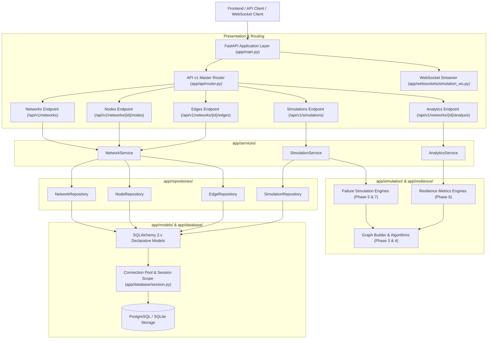

# Phase 8: Layered Backend Architecture & System Design

## 1. Architectural Overview

Phase 8 elevates the Discrete Mathematics Graph-Theoretic Critical Infrastructure Failure & Network Resilience Simulator into an enterprise-grade, layered backend architecture. The application is built on **FastAPI**, **SQLAlchemy 2.x (Typed ORM)**, **Pydantic v2**, and **Alembic**, maintaining a strict separation of concerns across presentation, domain logic, persistence, and execution layers.



---

## 2. Directory Structure & Responsibilities

The layered codebase follows strict packaging standards:

```text
backend/app/
├── core/
│   ├── config.py             # Pydantic Settings (DB URI, resource bounds, limits)
│   ├── exceptions.py         # Standardized domain application exceptions hierarchy
│   ├── logging.py            # Structured logging configuration
│   └── security.py           # Payload validation, file format checks, graph bounds
├── database/
│   ├── base.py               # DeclarativeBase for SQLAlchemy 2.x models
│   ├── session.py            # Engine, connection pooling, get_db, get_db_context
│   └── init_db.py            # Startup recovery for interrupted simulations
├── models/
│   ├── network.py            # Network ORM model (with optimistic versioning)
│   ├── node.py               # NodeModel ORM model (vertex with physics & check constraints)
│   ├── edge.py               # EdgeModel ORM model (undirected canonical ordering)
│   ├── network_snapshot.py   # Immutable frozen graph topology snapshots
│   ├── simulation.py         # Simulation execution lifecycle & results
│   └── simulation_event.py   # Chronological execution events
├── schemas/
│   ├── common.py             # ErrorResponse, PaginationParams, PaginatedResponse[T]
│   ├── network.py            # NetworkCreate, NetworkUpdate, NetworkTopologyResponse
│   ├── node.py               # NodeCreate, NodeUpdate, NodeResponse
│   ├── edge.py               # EdgeCreate, EdgeUpdate, EdgeResponse
│   └── simulation.py         # SimulationRecordResponse, SimulationEventRecordResponse
├── repositories/
│   ├── network_repository.py # Eager-loading queries, version verification
│   ├── node_repository.py    # Node mutations & incident edge cascading
│   ├── edge_repository.py    # Canonical endpoint validation & link queries
│   └── simulation_repository.py # Snapshot linkage, event sequencing, status updates
├── services/
│   ├── network_service.py    # Network lifecycle, Cytoscape conversion, import/export
│   ├── simulation_service.py # Snapshot generation, engine execution, event logging
│   ├── analytics_service.py  # Network connectivity, criticality, resilience evaluations
│   └── persistence_service.py# Benchmark dataset seeding
├── api/
│   ├── dependencies.py       # Request-scoped get_database & get_pagination
│   ├── router.py             # Master APIRouter assembling v1 endpoints
│   └── v1/
│       ├── health.py         # Health, version, database connectivity
│       ├── networks.py       # Persistent network management & topology
│       ├── nodes.py          # Vertex management
│       ├── edges.py          # Communication link management
│       ├── simulations.py    # Simulation triggers, history, results
│       └── analytics.py      # Graph metrics & markdown report generation
├── websockets/
│   └── simulation_ws.py      # Live event WebSocket (/ws/simulations/{id})
└── main.py                   # Lifespan startup, CORS, centralized exception handlers
```

---

## 3. Separation of Concerns & Clean Architecture Principles

1. **Presentation Layer (`api/v1/`, `websockets/`)**:
   - Accepts incoming HTTP/WebSocket connections.
   - Parses, validates, and deserializes requests via Pydantic v2 schemas.
   - Delegates business operations strictly to the Service layer.
   - Returns typed Pydantic responses or standard JSON error envelopes.
   - Free of SQL queries or direct mathematical engine calls.

2. **Service Layer (`services/`)**:
   - Contains all domain orchestrations and transaction boundaries.
   - Manages graph snapshot creation before running simulations to guarantee immutability.
   - Converts ORM entities into high-performance in-memory `NetworkGraph` structures.
   - Handles import/export translation (JSON, CSV) and Cytoscape.js topology formatting.

3. **Data Access Layer (`repositories/`)**:
   - Encapsulates all raw SQLAlchemy 2.x `select()`, `insert()`, `update()`, and `delete()` statements.
   - Implements eager loading (`selectinload(Network.nodes)`, `selectinload(Network.edges)`) to eliminate $N+1$ query overhead.
   - Enforces optimistic concurrency verification against the `version` column.

4. **Persistence Layer (`models/`, `database/`)**:
   - Pure typed declarative models using `Mapped[...]` and `mapped_column(...)`.
   - Comprehensive table-level check constraints enforcing physical non-negativity, capacity bounds, and probability bounds $[0, 1]$.
   - Foreign key cascading deletes ensuring zero dangling records.

5. **Cross-Cutting Concerns (`core/`)**:
   - Centralized exception hierarchy (`AppException`, `EntityNotFoundError`, `ConflictError`, `BadRequestError`).
   - Standardized error response envelope across all HTTP status codes.
   - Security constraints on upload byte length, file extensions, graph order $|V|$, and graph size $|E|$.

