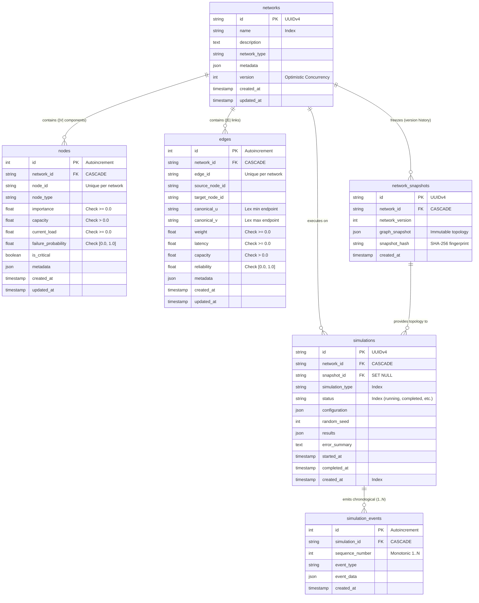

# Phase 8: Entity Relationships & Referential Integrity

## 1. Entity-Relationship Model

The network simulation domain relies on strict parent-child hierarchies, deterministic snapshotting, and immutable audit logs. The entity-relationship model ensures zero orphaned rows while maintaining referential integrity.

---

## 2. Foreign Key Cascade & Lifecycle Semantics

### 2.1. Network Cascade Deletions (`ON DELETE CASCADE`)
- Deleting a parent `Network` automatically purges:
  - All associated `nodes` ($V$).
  - All associated `edges` ($E$).
  - All stored `network_snapshots`.
  - All historical `simulations`.
  - All corresponding `simulation_events` (via transitive cascade from `simulations`).
- *Rationale*: A network defines the boundary of infrastructure modeling; orphaned devices or simulations without a root network context violate domain invariants.

### 2.2. Incident Edge Deletion on Node Removal
- While `edges` reference `networks.id`, deleting an individual node $v \in V$ triggers an application-level cascade in `NodeRepository.delete(...)`:
  $$\forall e = \{u, w\} \in E : (u = v \lor w = v) \implies E \gets E \setminus \{e\}$$
- All incident edges are automatically removed from the database and the network's `version` counter is incremented, ensuring the graph cannot contain dangling endpoints.

### 2.3. Snapshot Linkage (`ON DELETE SET NULL`)
- In `simulations.snapshot_id`, the foreign key constraint is configured with `ON DELETE SET NULL`:
  - If an administrative purge clears old historical snapshots, the simulation record itself remains intact with its computed metrics (`results`), preserving scientific provenance while freeing disk space.

### 2.4. Chronological Event Cascades (`ON DELETE CASCADE`)
- `simulation_events` references `simulations.id` with `ON DELETE CASCADE`. Deleting a simulation job automatically purges all of its live progress events.

---

## 3. Bidirectional ORM Mappings

All relationships in SQLAlchemy 2.x declarative models are explicitly mapped using `relationship()` with reverse back-population:

| Model | Relationship Attribute | Target Model | Cardinality | Loading Strategy |
| :--- | :--- | :--- | :--- | :--- |
| `Network` | `.nodes` | `NodeModel` | $1 : N$ | Eager (`selectinload`) |
| `Network` | `.edges` | `EdgeModel` | $1 : N$ | Eager (`selectinload`) |
| `Network` | `.snapshots` | `NetworkSnapshot` | $1 : N$ | Lazy |
| `Network` | `.simulations` | `SimulationModel` | $1 : N$ | Lazy |
| `NodeModel` | `.network` | `Network` | $N : 1$ | Joined |
| `EdgeModel` | `.network` | `Network` | $N : 1$ | Joined |
| `NetworkSnapshot` | `.network` | `Network` | $N : 1$ | Joined |
| `NetworkSnapshot` | `.simulations` | `SimulationModel` | $1 : N$ | Lazy |
| `SimulationModel` | `.network` | `Network` | $N : 1$ | Joined |
| `SimulationModel` | `.snapshot` | `NetworkSnapshot` | $N : 1$ | Joined |
| `SimulationModel` | `.events` | `SimulationEventModel` | $1 : N$ | Ordered by `sequence_number` |
| `SimulationEventModel` | `.simulation` | `SimulationModel` | $N : 1$ | Joined |

