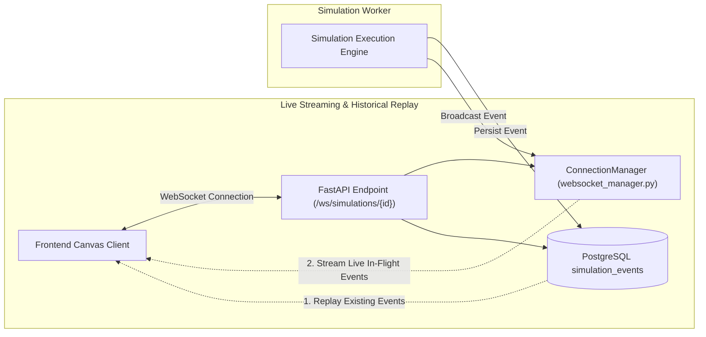

# Phase 8: Live WebSocket Event Architecture & Replay System

## 1. Real-Time Streaming Motivation

Resilience simulations, especially large-scale stochastic percolation ($N = 500$ trials) and multi-round cascading load redistribution, generate a continuous stream of events:
- Injected failures at round $t$
- Disconnected component clusters
- Dynamic traffic rerouting and link congestions
- Overloaded buffer cascades

To provide an interactive, responsive user experience in Cytoscape.js visualizers, the backend must stream progress events to frontend clients as they happen, while simultaneously writing them to persistent storage for offline auditing.

---

## 2. WebSocket Channel Architecture

The WebSocket endpoint is mounted at `/ws/simulations/{simulation_id}`:



### 2.1. Dual-Phase Client Experience (Replay + Live Stream)
When a client connects to `/ws/simulations/{simulation_id}`:
1. **Historical Event Replay**: The endpoint queries `simulation_events` ordered by `sequence_number ASC` and immediately transmits all recorded events to the client. This guarantees that clients connecting late (or reconnecting after network drops) instantly catch up to the current simulation state without missed messages.
2. **Live Subscription**: The connection is registered with `ConnectionManager`. Subsequent in-flight events are pushed down the socket in real time.
3. **Keepalive & Clean Teardown**: The connection listens for client disconnects or pings and unregisters dead sockets cleanly without leaking memory or file descriptors.

---

## 3. Connection Management (`ConnectionManager`)

The `ConnectionManager` class in `app/simulation/websocket_manager.py` maintains an in-memory subscription registry:
```python
class ConnectionManager:
    def __init__(self):
        # simulation_id -> List[WebSocket]
        self.active_connections: Dict[str, List[WebSocket]] = {}

    async def connect(self, websocket: WebSocket, simulation_id: str):
        await websocket.accept()
        if simulation_id not in self.active_connections:
            self.active_connections[simulation_id] = []
        self.active_connections[simulation_id].append(websocket)

    def disconnect(self, websocket: WebSocket, simulation_id: str):
        if simulation_id in self.active_connections:
            if websocket in self.active_connections[simulation_id]:
                self.active_connections[simulation_id].remove(websocket)

    async def broadcast_event(self, simulation_id: str, event_data: Dict[str, Any]):
        if simulation_id not in self.active_connections:
            return
        dead_connections = []
        for connection in self.active_connections[simulation_id]:
            try:
                await connection.send_json(event_data)
            except Exception:
                dead_connections.append(connection)
        for dead in dead_connections:
            self.disconnect(dead, simulation_id)
```

### Key Fault-Tolerance Features:
- Dead Connection Pruning: If a client suddenly closes their browser tab or loses Wi-Fi connectivity, `connection.send_json()` catches the broken pipe and safely unregisters the socket from the broadcast pool.
- Zero Blocking: Asynchronous broadcasting (`await connection.send_json()`) prevents one slow client from delaying event delivery to other active subscribers or stalling the simulation engine.

