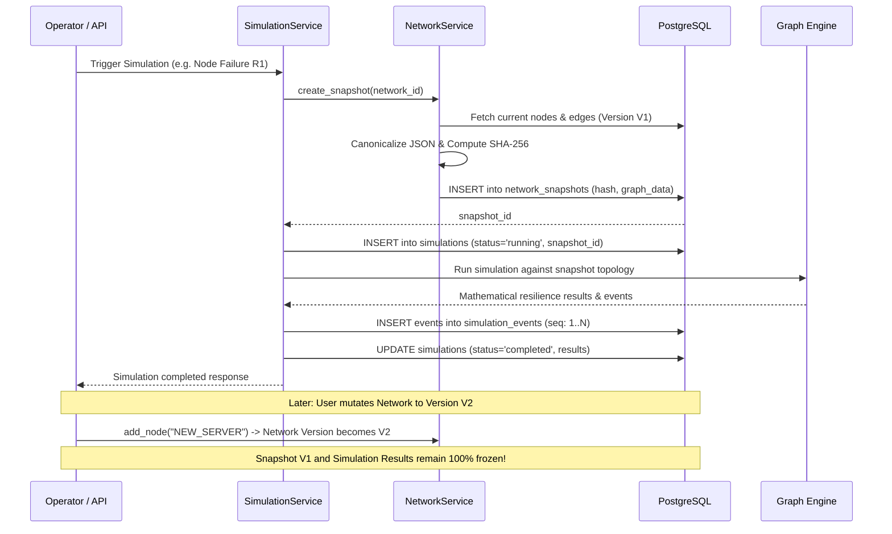
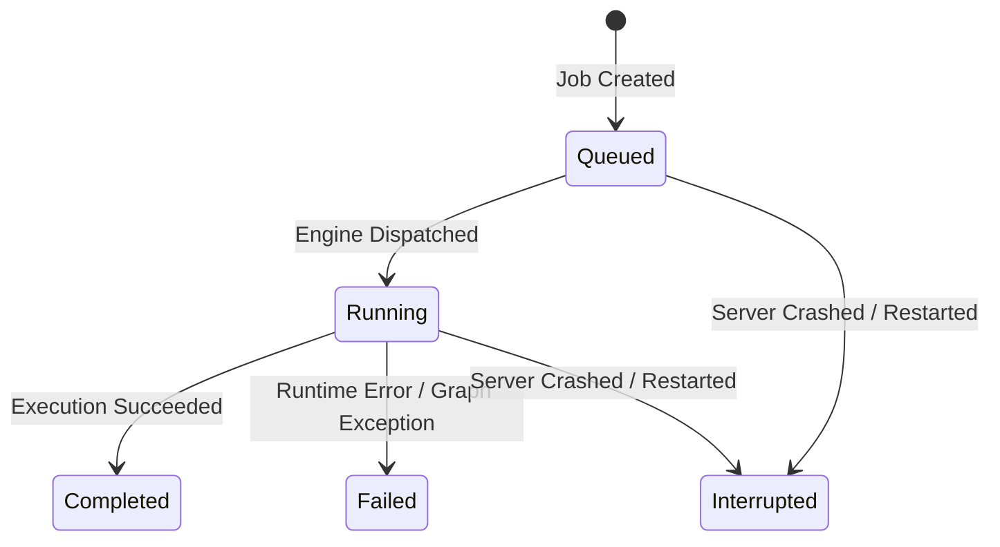

# Phase 8: Simulation Persistence & Snapshot Immutability

## 1. The Immutability Challenge in Scientific Simulation

A core engineering requirement of Phase 8 is **historical simulation reproducibility**. In dynamic networks, network operators continually modify topologies:
- Adding redundant links
- Upgrading node capacities
- Decommissioning legacy routers

If a simulation executed on Monday at Network Version 1 were linked directly to the mutable `networks`, `nodes`, and `edges` tables, changes made on Tuesday would invalidate Monday's simulation results: re-evaluating the simulation would yield different metrics, violating scientific auditability.



---

## 2. Point-in-Time Snapshot Generation

Before executing any simulation, `NetworkService.create_snapshot(db, network_id)` executes the following invariant sequence:
1. Queries all current nodes and edges belonging to the network.
2. Canonicalizes the topology into a sorted JSON dictionary:
   - Nodes sorted lexicographically by `node_id`.
   - Edges sorted canonically by `(canonical_u, canonical_v)`.
3. Computes a deterministic SHA-256 fingerprint of the serialized payload:
   $$\text{hash} = \text{SHA256}(\text{canonical\_json})[0:16]$$
4. Persists the snapshot in `network_snapshots` with the parent `network_id` and current `network_version`.
5. Passes the frozen graph dictionary to the simulation engine.

Even if all nodes and edges in the parent network are subsequently edited or deleted, the snapshot preserves the exact physical topology that produced the analytical outcome.

---

## 3. Simulation Lifecycle & State Machine

Simulations progress through a deterministic finite state machine (FSM):



### 3.1. State Definitions:
- `queued`: The simulation record is registered in PostgreSQL awaiting worker execution.
- `running`: In-flight mathematical computation; events are being written to `simulation_events`.
- `completed`: Simulation finished successfully; final analytical metrics (`results`) are persisted.
- `failed`: An unhandled exception or malformed graph input occurred; detailed stack trace logged in `error_summary`.
- `interrupted`: An external server restart or worker crash interrupted the run before completion.

---

## 4. Startup Crash Recovery Routine

In real-world operations, backend servers may be abruptly terminated (e.g. Docker container restarts, host reboots, power cuts) while simulations are in progress. Without a startup recovery routine, those runs remain permanently stuck in `running` or `queued` state in the database, confusing users and corrupting analytics.

### Implementation (`app/database/init_db.py`):
```python
def recover_interrupted_simulations(db: Session) -> int:
    """Scans for unfinished simulations prior to server restart and marks them interrupted."""
    interrupted = db.query(SimulationModel).filter(
        SimulationModel.status.in_(["running", "queued"])
    ).all()

    for sim in interrupted:
        sim.status = "interrupted"
        sim.error_summary = "Simulation interrupted by backend restart"
        sim.completed_at = datetime.now(timezone.utc)

    if interrupted:
        db.commit()
    return len(interrupted)
```

The recovery routine executes automatically during FastAPI application startup inside the `lifespan` hook. Any interrupted simulation is cleanly marked with timestamps and explanatory error notes.

